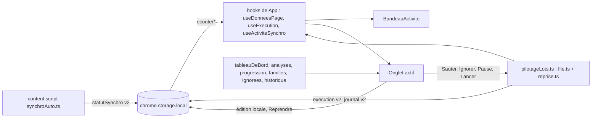

# Plan — Refonte de l’interface de gestion

Entrées : `spec.refined.md` (SC-001 à SC-028, H1 à H18, § Vocabulaire, prioritaire), `design.md` (révision du 2026-11-13 : D-01 à D-21, D-30 à D-33, D-40, D-50, D-61, D-62), `AGENTS.md`, code de la branche au 2026-11-13. Variante 1 retenue (6 onglets). Les identifiants T-301 à T-312 du plan préliminaire sont gardés avec le même sens ; T-313 à T-319 sont nouveaux (le plan préliminaire mettait trop de choses dans T-303 et T-304).

## Architecture

### Approche retenue
Refonte **par couches, sans nouvelle requête** : d’abord la logique pure et le stockage (versions 2 rétrocompatibles), puis le moteur d’exécution (pause, sauts, reprise), puis une coquille à onglets qui **déplace** l’existant sans le changer, enfin un onglet par tâche. Chaque PR garde la CI verte : les e2e existants sont adaptés (navigation, sélecteurs) dans la PR qui déplace l’élément qu’ils visent, jamais affaiblis (SC-010).

1. **Modules purs nouveaux** (`src/lib`, sans `chrome.*`, horloge injectée, testés d’abord) :
   - `tableauDeBord.ts` : 4 chiffres clés, répartition par statut (parts par plus forts restes, valeur, 3 titres d’exemple), santé, fraîcheur des prix (SC-001, SC-022, H1, H6). Places d’enchères : même formule que `lot.ts` l. 257-258 (min de `maxVentesSimultanees` et `ventesSite.max`, max de `en-vente` et `ventesSite.enCours`), extraite dans une fonction exportée `placesEncheres` de `lot.ts` pour n’avoir qu’une formule.
   - `analyses.ts` : doublons, à trier, défaussables (plafond réglé de `tri.ts`), valeur par décision, 10 plus chères, 10 thèmes (`themesDeCarte`) (SC-021).
   - `familles.ts` : famille d’une action (`etiquettes` = création, retrait, pose ; `encheres` ; `defausses` ; `suppressions` ; `lectures`), découpage d’une exécution en lots **par famille, dans l’ordre de première apparition** (H2). Le découpage se fait par appartenance, pas par plage : `file.ajouter` (retrait depuis le journal) peut ajouter des étiquettes en fin de file.
   - `progression.ts` : barre globale synchro « Étape i / k · P % » (4 étapes de poids égal : `stats`, `pages`, `prix`, `ventes`), barres d’étape et de lot « N / M · P % », barre indéterminée si M inconnu, P monotone par étape ou lot, décision d’annonce `aria-live` (≥ 2 s, changement d’étape ou de lot, palier de 10 %), durée restante H4 (0,25 s par action, sans division par la concurrence ; synchro : pages restantes + prix restants + 1), listes En cours / À venir / Terminées (SC-002, SC-003, D-10, D-11, D-20).
   - `ignorees.ts` : ajout, retrait (« Reprendre »), purge (synchro complète commencée après la date, carte disparue, 30 jours ; H3, H16), filtrage d’un lot construit (une création ignorée écarte les poses de la même étiquette, raison « création ignorée »), 500 entrées au plus (SC-006).
   - `historique.ts` : point quotidien `{jour, exemplaires}` (jour local `AAAA-MM-JJ`, le dernier du jour remplace), 30 jours glissants, série avec trous (SC-020, H15).
   - `affichage.ts` : réglage `{version, animations}` (SC-026, H14).
   - `ordreTableau.ts` : tri stable des tableaux, `localeCompare('fr')`, inconnues en dernier dans les deux sens, cycle croissant → décroissant → aucun (SC-024, D-16).
   - `colonnesTri.ts` : colonnes du tableau de tri, colonne voisine pour ← →, carte `en-vente` exclue ; l’édition passe par `appliquerEdition` de `collection.ts` (SC-023, H12).
   - `reprise.ts` : règles de reprise d’une exécution arrêtée, à l’heure murale injectée : `pauseJusqua` après 401, 429, refus hors exemplaire ou 3 échecs ; choix disponibles du panneau (table D-33) ; raison de désactivation de « Lancer » pendant la pause (SC-016, H11).
2. **Stockage v2 rétrocompatible** (`stockage.ts` reste le seul module de `src/lib` qui touche `chrome.storage.local`) : voir le tableau « Schéma » ci-dessous. Principe commun : lecture tolérante des v1 (champs ajoutés à `null` ou valeur neutre), réécriture en v2 à la prochaine écriture, version inconnue = comportement actuel sans écrasement, validation champ par champ sur liste fermée (SC-007, SC-019). Les validateurs et migrations vivent dans des modules purs (`journal.ts`, `etatExecution.ts`, `statutSynchro.ts`, `ignorees.ts`, `historique.ts`, `affichage.ts`) ; `stockage.ts` ne fait que lire, appeler le validateur et écrire. `enregistrerExecution` et `enregistrerStatutSynchro` acceptent encore une valeur v1 (complétée en v2) : la page et le content script peuvent passer en v2 dans des PR séparées sans casser l’autre côté.
3. **Statut de synchro v2, seule modification du content script** (`src/content/synchroAuto.ts`) : `etape` déduite du chemin déjà demandé dans le `transport` enveloppant existant (`/api/my-collection/stats` → `stats`, `?page=` → `pages`, `/sales?scope=summary` → `prix`, `/api/marketplace/mine` → `ventes`) ; `prixFaits` compté au même endroit ; `prixPrevus` fourni par un **crochet optionnel** `annoncerPrix?(n)` de `ordonnanceur.ts`, appelé une fois avant la boucle de `relevePrix` avec `min(candidats, plafond)` (aucun changement de plan, de chemin ni de cadence) ; écriture du statut limitée à une par seconde sauf changement d’étape ou d’état. Aucune requête ajoutée, repères inchangés. Le relevé d’affluence (`/api/marketplace?…`, après la synchro) n’est pas une étape.
4. **Moteur d’exécution des lots** (`file.ts` + `src/app/pilotageLots.ts`) :
   - `file.ts` : `pause()` / `reprendre()` (plus aucun nouveau départ, y compris les créneaux réservés d’un lot parallèle pas encore envoyés ; les requêtes en vol vont à leur terme ; au-delà de 15 min, arrêt `manuel`, H18) ; état v2 publié (`lots` avec famille, total, traitées, sautées) ; contexte d’erreur (action, rang, lot, code, raison, autres échecs en vol) ; **actions restantes** après arrêt (action en erreur, ordres abandonnés du lot parallèle, actions non parties) ; `demarrer` accepte une suite (`idLot` et compteurs conservés) ; `JournalFile.ouvrir(action, { rang, total, lot })`. Les tests existants de `file.test.ts` restent inchangés (paramètres ajoutés facultatifs).
   - `pilotageLots.ts` (extrait de `Synchronisation.tsx` en T-316, enrichi en T-313) : contexte unique de la page (file, exécution, pont), `lancerLot` (lots cochés, pause de 30 min revérifiée, bail, verrou), `reessayer`, `sauterAction`, `sauterLot` (H10 : une seule entrée de journal, les autres comptées « sautées »), `ignorer` (écrit `ignorees` puis saute ; échec d’écriture = rien d’ignoré), `pause`, `reprendre`, `arreterTout`. La reprise est un nouveau `demarrer` sur les restantes de la **même** exécution, avec les conditions de lancement existantes (un seul onglet WikiMasters, verrou, bail, revérification, cadence, arrêts). Les restantes ne vivent qu’en mémoire de la page : après rechargement, SC-017 (pas de reprise).
   - `pauseJusqua` est une heure **murale** (`Date.now`), calculée par `reprise.ts` dans `pilotageLots.ts` : l’horloge de `file.ts` est monotone (`performance.now`) et ne doit pas être stockée.
   - `lancerSuppressionEtiquettes` passe par le même `lancerLot` : la pause de 30 min la bloque aussi (H11, aucun contournement par Réglages).
5. **Coquille à onglets** (`App.tsx` découpé) : `App.tsx` ne garde que l’assemblage ; les lectures et abonnements du stockage passent dans des hooks (`useDonneesPage`, `useExecution`, `useActiviteSynchro`, `useAffichage`, `useHistoriqueQuotidien`) montés une fois, au-dessus des onglets. **Seul le panneau actif est monté** : la vérification Wikipédia (`VerificationWikipedia`, file unique `creerPlanificateur` qui survit au démontage) n’est montée que dans la vue liste de l’onglet Collection, avec la même règle et la même pagination de 200 (SC-011). L’onglet actif vient de `location.hash` (`hashchange`, Précédent / Suivant), sans stockage (H13, D-12). Les états de filtre, de vue et de pagination de la Collection sont remontés dans `App` pour survivre au changement d’onglet. Le bandeau d’activité et les messages de stockage (D-62) sont rendus au-dessus des panneaux, sur les 6 onglets.
6. **Mouvement** : tokens déjà écrits par le designer dans `src/styles/tokens.css` (D-08, règle `:root[data-animations='off']`, D-17) ; un test unitaire verrouille leur présence et l’absence de durée, courbe ou couleur littérale dans `src/app` et `src/styles` hors `tokens.css` (SC-025). Les composants animés en JavaScript (compteur, FLIP, glisser) lisent `matchMedia('(prefers-reduced-motion: reduce)')` et le réglage `affichage` via un hook `useMouvement`.

### Découpage de `Synchronisation.tsx` (1 123 lignes) et de `App.tsx` (403 lignes)
| Aujourd’hui | Cible | Tâche |
|---|---|---|
| `Synchronisation.tsx` l. 45-396 : libellés, totaux, durée, `raisonDesactivation`, non incluses, `configDuLot`, `preparerLot`, `detailsDuLot`, `libelleCause`, `texteFin`, `libelleErreurLancement` | `src/app/apercuLot.ts` (fonctions pures, mêmes noms et signatures) | T-316 |
| l. 398-589 : contexte, `lancerLot`, `sousBail`, `executerLot`, `lancerSuppressionEtiquettes`, `actionsRetrait` | `src/app/pilotageLots.ts` | T-316 (déplacé), T-313 (enrichi) |
| l. 603-623 `BandeauRisque` | `src/app/BandeauRisque.tsx` | T-316 |
| l. 635-722 `ZoneExecution` | `src/app/ZoneExecution.tsx` (remplacé ensuite par `PanneauErreur.tsx` + barres) | T-316, T-307 |
| l. 773-837 abonnements (file, onglets, journal, registre, clôture des interrompues) | `src/app/useExecution.ts` (hook, monté dans `App`) | T-316 |
| l. 1010-1073 liste d’actions, cartes non incluses | `src/app/ListeActionsLot.tsx`, `src/app/CartesNonIncluses.tsx` | T-316 |
| reste du composant (aperçu, Lancer) | `src/app/PanneauApercuLot.tsx` | T-316, puis T-311 |
| `App.tsx` écran de blocage l. 194-245 | `src/app/BlocageCollection.tsx` (au-dessus des onglets, SC-012, D-62) | T-304 |
| `App.tsx` effets de chargement l. 87-157 | `src/app/useDonneesPage.ts` | T-304 |
| `App.tsx` filtres et liste l. 346-396 | `src/app/OngletCollection.tsx` + `src/app/FiltresCollection.tsx` | T-304 |

`Synchronisation.tsx` est supprimé. Trois tests unitaires (`synchronisation.test.ts`, `apercu-etiquettes.test.ts`, `bail-lot.test.ts`) changent **seulement** leur chemin d’import (`../../src/app/apercuLot`, `../../src/app/pilotageLots`) ; aucune attente modifiée (SC-010).

### Fichiers créés / modifiés
| Fichier | Rôle | Tâche |
|---|---|---|
| `src/lib/tableauDeBord.ts`, `src/lib/analyses.ts` (créés) | chiffres clés, répartition, santé, fraîcheur des prix ; analyses | T-301 |
| `src/lib/lot.ts` | extraction de `placesEncheres` (comportement inchangé) | T-301 |
| `src/lib/familles.ts`, `src/lib/progression.ts` (créés) | lots par famille, barres, étapes, durée, annonces, tâches | T-302 |
| `src/lib/actions.ts` | types `EntreeJournal` v2, `EtatExecutionV2`, `FamilleLot`, `CauseJournal` | T-303 |
| `src/lib/journal.ts` | entrée v2 (`rang`, `total`, `lot`, `cause`), migration v1, libellé d’affichage H5 | T-303 |
| `src/lib/etatExecution.ts`, `src/lib/statutSynchro.ts` (créés) | validation et migration v1 → v2 (extraites de `stockage.ts`) | T-303 |
| `src/lib/ignorees.ts`, `src/lib/historique.ts`, `src/lib/affichage.ts` (créés) | nouvelles clés, logique pure | T-303 |
| `src/lib/stockage.ts` | versions, nouvelles clés, écouteurs `ecouterExecution`, `ecouterJournal`, `ecouterIgnorees`, `ecouterAffichage`, `ecouterHistorique` ; `StatutSynchro` réexporté | T-303 |
| `src/lib/file.ts`, `src/lib/reprise.ts` (créé), `src/app/pilotageLots.ts` | pause, sauts, reprise, erreur, pause de 30 min | T-313 |
| `src/lib/ordonnanceur.ts` | crochet optionnel `annoncerPrix` | T-314 |
| `src/content/synchroAuto.ts` | statut v2, débit ≤ 1/s | T-314 |
| `src/lib/ordreTableau.ts` (créé), `src/app/useMouvement.ts`, `src/app/useFlip.ts`, `src/app/BarreProgression.tsx`, `src/app/SectionRepliable.tsx`, `src/app/PastilleStatut.tsx`, `src/app/PastilleStatutCarte.tsx`, `src/app/ChiffreAnime.tsx`, `src/app/EnTeteTriable.tsx` (créés) | primitives communes | T-315 |
| `src/styles/tokens.css` | tokens D-08, D-17 déjà écrits par le designer ; classes communes (reflet de barre, rayures indéterminées, secousse) en tokens | T-315 |
| `src/app/apercuLot.ts`, `src/app/pilotageLots.ts`, `src/app/useExecution.ts`, `src/app/BandeauRisque.tsx`, `src/app/ZoneExecution.tsx`, `src/app/ListeActionsLot.tsx`, `src/app/CartesNonIncluses.tsx`, `src/app/PanneauApercuLot.tsx` (créés) ; `src/app/Synchronisation.tsx` (supprimé) | découpage sans changement de comportement | T-316 |
| `src/app/App.tsx`, `src/app/onglets.ts`, `src/app/Onglets.tsx`, `src/app/useOngletActif.ts`, `src/app/useDonneesPage.ts`, `src/app/useAffichage.ts`, `src/app/useHistoriqueQuotidien.ts`, `src/app/BlocageCollection.tsx`, `src/app/MessageStockage.tsx`, `src/app/Onglet{TableauDeBord,Synchro,Lots,Collection,Ventes,Reglages}.tsx`, `src/app/FiltresCollection.tsx` (créés) | coquille, onglets, contenu déplacé tel quel | T-304 |
| `src/app/BandeauActivite.tsx`, `src/app/LigneActivite.tsx`, `src/app/useActiviteSynchro.ts` (créés) | bandeau d’activité | T-317 |
| `src/app/OngletTableauDeBord.tsx`, `src/app/CarteKpi.tsx`, `src/app/BarreRepartition.tsx`, `src/app/BulleRepartition.tsx`, `src/app/SanteSynchro.tsx` | tableau de bord | T-305 |
| `src/app/OngletSynchro.tsx`, `src/app/ProgressionSynchro.tsx`, `src/app/ListeTaches.tsx`, `src/app/FraicheurPrix.tsx`, `src/app/SynchroAuto.tsx` (placement seulement) | onglet Synchro | T-306 |
| `src/app/PanneauErreur.tsx`, `src/app/TableIgnorees.tsx`, `src/app/FiltresHistorique.tsx`, `src/app/Journal.tsx`, `src/app/Onglets.tsx` (pastille d’erreur), `src/app/ZoneExecution.tsx` (retiré) | erreur, ignorées, historique | T-307 |
| `src/app/OngletCollection.tsx`, `src/app/TableauCartes.tsx`, `src/app/CarteLigne.tsx`, `src/app/AnalysesCollection.tsx`, `src/app/GraphiqueEvolution.tsx` | onglet Collection | T-308 |
| `src/app/OngletReglages.tsx`, `src/app/ReglageAnimations.tsx` | onglet Réglages | T-309 |
| `src/app/OngletLots.tsx`, `src/app/PanneauApercuLot.tsx`, `src/app/TableauLots.tsx`, `src/app/ListeEcarts.tsx` | onglet Lots | T-311 |
| `src/app/TableauTri.tsx`, `src/app/ColonneTri.tsx`, `src/app/CarteTri.tsx`, `src/app/useGlisser.ts`, `src/lib/colonnesTri.ts` (créés), `src/app/OngletCollection.tsx` (sélecteur de vue) | tableau de tri | T-312 |
| `src/app/OngletVentes.tsx`, `src/app/FileVente.tsx`, `src/app/PlacesEncheres.tsx`, `src/app/HeuresFortes.tsx` | onglet Ventes | T-318 |
| `tests/e2e/extension.ts` | aide `allerA(page, onglet)` | T-304 |
| `tests/e2e/*.spec.ts` existants | navigation et sélecteurs seulement | T-304, puis chaque tâche UI qui déplace un élément |
| `tests/e2e/refonte-*.spec.ts` (créés) | parcours et captures par onglet | chaque tâche UI ; transverses en T-310 |
| `AGENTS.md` (§ Architecture), `README.md` | documentation | T-319 |
| `public/manifest.json`, `package.json`, `src/background.ts`, `src/content/index.ts`, `src/content/executant.ts`, `src/lib/reseau.ts`, `src/lib/jeton.ts`, `src/lib/contrat/*`, `src/config/*`, `src/lib/sauvegarde.ts` | **inchangés** | — |

### Schéma de stockage (SC-019)
| Clé | Avant | Après | Lecture d’une v1 | Version inconnue / illisible | Borne | Écrite par |
|---|---|---|---|---|---|---|
| `journal` | `{version:1, entrees}`, 9 clés exactes | `{version:2, entrees}` + `rang`, `total`, `lot`, `cause` (`null` permis ; `cause` dans une liste fermée : raisons d’arrêt de `file.ts`, `sautee`, `ignoree`) | entrées complétées à `null`, réécrites en v2 à la prochaine écriture | erreur « illisible », jamais écrasé (inchangé) | 1 000 entrées, 1 Mo (inchangé) | page |
| `execution` | `{version:1, idLot, etat, traitees, total}` | v2 + `lots[{famille,total,traitees,sautees}]`, `pauseJusqua`, `erreur{type, parametre, idCarte, titre, famille, indexLot, nbLots, rang, totalLot, codeHttp, cause, le, reussies, autresEchecsEnVol}` | `lots: []`, `pauseJusqua: null`, `erreur: null` | « illisible », « Lancer » désactivé (inchangé) | `lots` ≤ 5, chaînes tronquées | page |
| `statutSynchro` | `{version:1, …, ajoutees, etiquettes, prix}` | v2 + `etape` (`stats` · `pages` · `prix` · `ventes` · `null`), `prixFaits`, `prixPrevus` (+ `debut`, voir point ouvert 1) | `etape: null`, compteurs `null` | `null` (inchangé) | — | content script |
| `ignorees` (nouvelle) | — | `{version:1, entrees[{type, idCarte, parametre, portee:'synchro', date}]}` | — | valeur par défaut (vide), sans écraser | 500 | page |
| `historique` (nouvelle) | — | `{version:1, points[{jour, exemplaires}]}` | — | vide, sans écraser | 30 | page |
| `affichage` (nouvelle) | — | `{version:1, animations:boolean}` | — | `animations: true`, sans écraser | — | page |

Aucune de ces clés n’entre dans la sauvegarde complète (`sauvegarde.ts` inchangé). Une écriture refusée (quota) remonte une erreur affichée par `MessageStockage.tsx` (D-62) et ne touche pas la valeur existante. Les tests de `stockage.test.ts` qui utilisent `version: 2` comme « version inconnue » du journal (l. 260), de l’exécution (l. 301) et du statut (l. 596) passent à `version: 3` : c’est la seule modification d’attente permise (SC-010, « versions explicitement migrées »).

### Flux de données

### Alternatives écartées
- Garder une page unique avec ancres (variante 2) : écartée par Alexis (variante 1 retenue).
- Monter les 6 panneaux et masquer les inactifs : la vérification Wikipédia partirait pour une liste invisible (SC-011) et le rendu de 5 000 cartes resterait payé partout.
- Stocker l’onglet actif ou l’état déplié du bandeau : interdit par H13 ; le fragment d’URL suffit et donne Précédent / Suivant.
- Persister les actions restantes pour reprendre après rechargement : contraire à SC-017 et à « pas de reprise automatique » de `file.ts`.
- Ajouter une pause à l’ordonnanceur de lecture : hors périmètre (H9) et changerait le content script au-delà du statut.
- Inscrire chaque action d’un lot sauté dans le journal : évincerait l’historique (1 000 entrées, H10).
- Une bibliothèque de glisser-déposer ou d’animation (dnd-kit, Framer Motion) : Pointer Events et FLIP maison suffisent, aucune dépendance nouvelle.
- Une bibliothèque de graphiques : barres CSS sur piste `ink-2` + tableau `sr-only` (design, hors périmètre).
- Calculer `prixPrevus` dans le content script en recopiant `candidatsPrix` : duplication de règle ; le crochet `annoncerPrix` lit la vraie liste.
- `localStorage` pour le réglage Animations : interdit par le lint (`lint-reseau.test.ts`) ; clé `affichage` via `stockage.ts`.

### Contraintes
- **Contextes** : page de gestion (`collection.html`) pour tout le nouveau code ; content script modifié seulement dans `synchroAuto.ts` (statut v2) et `ordonnanceur.ts` (crochet de compteur) ; service worker inchangé. Aucune nouvelle requête, route, en-tête, permission ni `host_permissions` ; `fetch` reste là où il est (`verifierWikipedia.ts`, `synchroAuto.ts`, `reseau.ts`). SC-011 est vérifié par un e2e qui intercepte toutes les routes.
- **Cadre WikiMasters inchangé** : cadence, gigue, concurrence (3), arrêts (401, 403, 429, 409, 3 échecs, refus par carte), bail, verrou, revérification avant envoi. « Réessayer » et la reprise n’envoient que des actions déjà prévues, par la même file. Aucun contrôle ne contourne la pause de 30 min ni la règle de relance de la synchro.
- **Stockage** : migrations testées une par clé ; lecture tolérante ; aucune perte (version inconnue jamais écrasée) ; bornes ; `stockage.ts` seul accès.
- **Sécurité** (SC-007) : listes fermées pour journal, exécution, statut, ignorées, historique, affichage ; aucun identifiant d’exemplaire du site dans `erreur`, `ignorees` ou `historique` ; titres rendus en texte (jamais `innerHTML`).
- **Interface** : composants `React.FC`, un par fichier, export par défaut ; hooks dans leurs propres fichiers ; tokens uniquement (D-18, SC-025) ; textes français, ’ et espace insécable avant `:`.
- **Dépendances** : aucune nouvelle.
- **Performance** : 200 lignes au plus dans la vue liste, 50 cartes par colonne ; calculs mémorisés sur `collection.cartes` ; animations sur les seuls éléments rendus.

### Points ouverts (défauts proposés, non bloquants)
1. **Début de synchro pour les ignorées (H3)** : retirer une ignorée « à la fin de la première synchro complète commencée après sa date » exige l’heure de **début** de la synchro, que ni `StatutSynchro` ni `derniereSynchro` (heure de fin) ne portent. Défaut proposé : ajouter `debut` (horodatage) au statut v2, écrit par `synchroAuto.ts` dans la même écriture (aucune requête). SC-019 énumère `etape`, `prixFaits`, `prixPrevus` : ce champ est à ajouter à la liste fermée.
2. **« Réessayer » après résultat inconnu** : `file.ts` pose « jamais de relance d’une requête dont le résultat est inconnu », alors que SC-016 et D-33 rendent « Réessayer » actif après `transport` ou `resultat`. Sur une enchère ou une défausse, un réessai peut doubler l’action si la première est passée. Défaut proposé : « Réessayer » désactivé quand le résultat de l’action en erreur est inconnu, avec la raison « Résultat inconnu : vérifiez sur WikiMasters, puis sautez l’action » ; actif dans tous les autres cas de D-33.
3. **Seuil de refus par carte atteint** (3 d’affilée ou 5 par lot, arrêt `code-http` 403) : signe probable d’une session refusée. Défaut proposé : traité comme un refus hors exemplaire, donc pause de 30 min.
4. **Sauter une création d’étiquette** : les poses de la même étiquette échoueraient ensuite (« action non disponible ») et compteraient comme échecs jusqu’à l’arrêt. Défaut proposé : sauter une création retire aussi des restantes les poses de cette étiquette, comptées « sautées » (même règle que SC-006 pour l’ignorée).

## 1. Task list
| Lot | Description | Couche | Dépend de | SC | D-xx |
|---|---|---|---|---|---|
| L1 (T-301) | Calculs du tableau de bord (chiffres clés, répartition par plus forts restes, valeur par statut, 3 exemples, santé, fraîcheur des prix) et analyses de la Collection ; `placesEncheres` extrait de `lot.ts` | logique | — | SC-001, SC-021, SC-022 (données) | D-01, D-02, D-06, D-13 |
| L2 (T-302) | Familles et découpage en lots ; modèle de progression (étapes, barres, P monotone, indéterminé, annonces, durée H4, listes de tâches) | logique | T-303 | SC-002, SC-003, SC-013 (résumé) | D-10, D-11, D-20, D-21 |
| L3 (T-303) | Schémas v2 et migrations (journal, exécution, statut) ; nouvelles clés `ignorees`, `historique`, `affichage` et leur logique pure ; écouteurs ; libellés d’historique H5 | données | — | SC-019, SC-007, SC-006 (logique), SC-018 (libellés), SC-020 (logique), SC-026 (stockage) | D-17, D-20, D-31, D-62 |
| L4 (T-313) | Moteur : pause / reprise (15 min), contexte d’erreur, restantes, reprise de la même exécution, sauts (action, lot), ignorer, pause de 30 min (`reprise.ts`), câblage dans `pilotageLots.ts` | logique + app | T-302, T-303, T-316 | SC-004 (données), SC-005, SC-006 (saut), SC-014, SC-016, SC-017 (règle) | D-30, D-33 |
| L5 (T-314) | Statut de synchro v2 dans le content script : étape, prix prévus et faits, débit ≤ 1/s ; crochet `annoncerPrix` de l’ordonnanceur | content script | T-303 | SC-019 (statut), SC-002 (données synchro) | D-10, D-11 |
| L6 (T-315) | Primitives et garde-fous du mouvement : test des tokens et des littéraux, test des contrastes `ink` / statuts (y compris `saturate(.45)` et la hachure), `ordreTableau.ts`, `useMouvement`, `useFlip`, `BarreProgression`, `SectionRepliable`, pastilles, `ChiffreAnime`, `EnTeteTriable` | ui (socle) | — | SC-025, SC-024 (fonction de tri), SC-022 (contrastes), SC-026 (mécanisme), SC-027 (composant) | D-04, D-07, D-08, D-10, D-13, D-14 (estompage), D-16, D-17, D-18, D-19, D-40, D-61 |
| L7 (T-316) | Découpage de `Synchronisation.tsx` sans changement de comportement (`apercuLot.ts`, `pilotageLots.ts`, `useExecution.ts`, 5 composants) ; chemins d’import de 3 tests | refactor | — | SC-010 | — |
| L8 (T-304) | Coquille : 6 onglets et fragment d’URL, découpage de `App.tsx` en hooks et panneaux, contenu actuel déplacé tel quel, Wikipédia limité à la vue liste, blocage et messages de stockage au-dessus des onglets, `useAffichage`, `useHistoriqueQuotidien` ; adaptation de navigation des 9 e2e existants | ui | T-303, T-315, T-316 | SC-012, SC-011, SC-008 (onglets), SC-009 (coquille), SC-010, SC-020 (écriture) | D-02, D-12, D-17, D-62 |
| L9 (T-317) | Bandeau d’activité : lignes Synchro / Lots / erreur en attente, replié / déplié, Pause / Reprendre / Arrêter, lecture seule dans un autre onglet, non rendu sans activité | ui | T-302, T-304, T-313 | SC-013, SC-014 (commandes), SC-002 (barres du bandeau) | D-03, D-21, D-10, D-11 |
| L10 (T-305) | Onglet Tableau de bord : 4 KPI animés, barre de répartition (zoom, bulle, légende des segments étroits, Échap), santé, état en cours et erreur | ui | T-301, T-304, T-315 | SC-001, SC-022, SC-027, SC-009 | D-01, D-06, D-13, D-14, D-40, D-61 |
| L11 (T-306) | Onglet Synchro : progression globale et par étape, En cours / À venir / Terminées, « Aucune activité en cours », interrupteur et « Relancer la synchro » (règles inchangées), fraîcheur des prix | ui | T-302, T-304, T-314, T-315 | SC-002, SC-003, SC-028 (interrupteur), SC-009 | D-02, D-10, D-11, D-20, D-40 |
| L12 (T-307) | Panneau d’erreur (5 choix, table D-33, focus seulement si onglet Synchro, pastille d’onglet), Ignorées (Reprendre), historique filtrable (type, résultat, carte, exécution ; libellés H5) | ui | T-306, T-313 | SC-004, SC-005, SC-006, SC-007, SC-008 (focus), SC-016, SC-017, SC-018 | D-30, D-31, D-32, D-33, D-12 (pastille), D-20 |
| L13 (T-311) | Onglet Lots : tableau des lots cochables, durée des lots cochés, aperçu existant, avertissements, écarts avec le site, ignorées filtrées (« création ignorée »), « Lancer » des seuls lots cochés, pause de 30 min dans la raison de désactivation, tri d’affichage seulement | ui | T-304, T-313, T-315 | SC-015, SC-016 (Lancer), SC-006 (aperçu), SC-024 (Lots) | D-09, D-16, D-32 |
| L14 (T-308) | Onglet Collection : liste en tableau triable (titre, rareté, quantité, statut, valeur) avec FLIP et fondu, analyses, évolution sur 30 jours | ui | T-301, T-303, T-304, T-315 | SC-021, SC-020, SC-024, SC-011 (mention), SC-009 | D-02, D-05, D-16, D-13 |
| L15 (T-318) | Onglet Ventes : places, file de vente en tableau triable, heures fortes, assistant de tri déplacé tel quel | ui | T-301, T-304, T-315 | SC-024 (File de vente), SC-009 | D-02, D-05, D-16 |
| L16 (T-312) | Tableau de tri : sélecteur Liste / Tableau de tri, 5 colonnes, glisser-déposer (Pointer Events), flèches ← → 44 px, focus qui suit, `aria-live`, Échap, 50 par colonne, recherche partagée, effets D-15 | ui | T-308 | SC-023, SC-026 (glisser), SC-008 | D-04, D-13, D-15, D-17 |
| L17 (T-309) | Onglet Réglages : sections repliables fermées par défaut (Sauvegarde, Plafond, Étiquettes préexistantes, Wikipédia, Thèmes, Animations), résumés, réglage Animations | ui | T-304, T-315 | SC-028, SC-026 (réglage) | D-50, D-03, D-17 |
| L18 (T-310) | Transverses : e2e SC-011 (routes interceptées sur tous les onglets et gestes), SC-008 clavier, SC-009 débordement 3 largeurs × 2 thèmes sur les 6 onglets, SC-026 (`emulateMedia` + réglage), 5 000 cartes fictives, captures finales ; vérification que tous les e2e existants passent | tests | toutes les tâches UI | SC-007 (affichage), SC-008, SC-009, SC-010, SC-011, SC-026 | D-18, D-19 |
| L19 (T-319) | `AGENTS.md` § Architecture (onglets, nouveaux modules, clés v2), `README.md` | docs | T-310 | — | — |

Couverture : chaque SC est servi par au moins un lot — SC-001 L1/L10 ; SC-002 L2/L5/L9/L11 ; SC-003 L2/L11 ; SC-004 L4/L12 ; SC-005 L4/L12 ; SC-006 L3/L4/L12/L13 ; SC-007 L3/L12/L18 ; SC-008 L8/L12/L16/L18 ; SC-009 L8/L10/L11/L14/L15/L18 ; SC-010 L7/L8/L18 ; SC-011 L8/L14/L18 ; SC-012 L8 ; SC-013 L9 ; SC-014 L4/L9 ; SC-015 L13 ; SC-016 L4/L12/L13 ; SC-017 L4/L12 ; SC-018 L3/L12 ; SC-019 L3/L5 ; SC-020 L3/L8/L14 ; SC-021 L1/L14 ; SC-022 L1/L6/L10 ; SC-023 L16 ; SC-024 L6/L13/L14/L15 ; SC-025 L6 ; SC-026 L3/L6/L16/L17/L18 ; SC-027 L6/L10 ; SC-028 L11/L17.

Règle commune aux tâches UI (DoD) : e2e du parcours touché, captures 375 / 768 / 1280 × clair / sombre, navigation clavier, adaptation (navigation, sélecteurs) des e2e existants qui visent un élément déplacé, `data-testid` existants conservés (`resume`, `synchro`, `synchronisation`, `zone-execution` jusqu’à T-307, `titre-apercu`, `file-vente`, `apercu`, `etat-synchro-auto`, `synchro-auto`, `ecarts`, `etiquettes-prevues`, `total-etiquettes`, `avertissement-visibilite`, `plafond-defausse`, `apercu-sauvegarde`).

## 2. Estimations
| Lot | Heures |
|---|---|
| L1 (T-301) | 4 |
| L2 (T-302) | 4 |
| L3 (T-303) | 8 |
| L4 (T-313) | 9 |
| L5 (T-314) | 3 |
| L6 (T-315) | 5 |
| L7 (T-316) | 5 |
| L8 (T-304) | 8 |
| L9 (T-317) | 4 |
| L10 (T-305) | 6 |
| L11 (T-306) | 6 |
| L12 (T-307) | 8 |
| L13 (T-311) | 6 |
| L14 (T-308) | 6 |
| L15 (T-318) | 3 |
| L16 (T-312) | 7 |
| L17 (T-309) | 3 |
| L18 (T-310) | 5 |
| L19 (T-319) | 1 |
| **Total** | **101** |

## 3. Risques
| Lot | Risque | Probabilité | Impact | Mitigation |
|---|---|---|---|---|
| L3 | Migration qui écrase un journal ou un état illisible (perte d’historique ou d’exécution en cours) | faible | élevé | Migration à la lecture, écriture seulement d’une valeur validée ; version inconnue jamais écrasée ; un test par clé (v1, v2, inconnue, forme invalide, clé en trop) |
| L3 | Content script v1 et page v2 (ou l’inverse) pendant le déploiement | moyenne | moyen | `enregistrerStatutSynchro` et `enregistrerExecution` acceptent v1 et complètent en v2 ; lecture tolérante des deux ; L5 indépendant de L4 |
| L3 | Quota de `chrome.storage.local` (journal 1 Mo + 500 ignorées + état v2) | faible | moyen | Bornes de SC-019 ; test de taille ; erreur affichée (D-62) sans perte |
| L4 | Régression de la file (cadence, parallélisme, arrêts) en ajoutant pause et reprise | moyenne | élevé | `file.test.ts` inchangé et vert ; nouveaux fichiers de test séparés ; horloge injectée ; un test « aucun appel `transport` pour une action sautée » (SC-005) ; revue `security-reviewer` |
| L4 | Contournement de la pause de 30 min (Réessayer, reprise après Sauter, Lancer, suppression d’étiquettes, autre onglet) | moyenne | élevé | `pauseJusqua` stocké et relu par `lancerLot` (point de passage unique) ; un test par chemin ; heure murale, pas l’horloge monotone |
| L4 | Réessai d’une action au résultat inconnu (enchère ou défausse doublée) | faible | élevé | Point ouvert 2 : Réessayer désactivé sur résultat inconnu ; revérification avant envoi conservée |
| L4 | Pause qui tient le bail et bloque la synchro automatique | moyenne | moyen | Arrêt `manuel` après 15 min (H18), bail libéré par `sousBail` |
| L5 | Statut écrit trop souvent (toutes les 0,2 s) ou changement involontaire de l’ordonnanceur | moyenne | moyen | Débit limité à 1/s sauf changement d’étape ou d’état ; crochet optionnel sans effet de bord ; `ordonnanceur.test.ts` et `synchro-auto.test.ts` inchangés ; lint `synchro-auto-lint` |
| L7 | Découpage de 1 123 lignes qui casse l’exécution (contexte module, ordre des effets, focus) | moyenne | élevé | Refactor pur sans changement de texte ni de comportement ; e2e `synchro-ecriture` et `etiquettes` verts dans la même PR ; contexte singleton conservé |
| L8 | Les 9 e2e existants cassent en masse quand tout passe dans des onglets | élevée | moyen | Aide `allerA` dans `extension.ts` ; adaptation dans la même PR ; aucune assertion retirée ; `data-testid` conservés |
| L8 | Le changement d’onglet démonte l’aperçu de lot ou l’assistant et perd l’état | moyenne | moyen | États remontés dans `App` (filtres, vue, pagination) ; exécution dans le contexte module ; l’assistant reste dans Ventes |
| L8 | Vérification Wikipédia déclenchée hors de la vue liste (SC-011) | moyenne | moyen | `VerificationWikipedia` monté seulement dans la vue liste ; e2e avec routes interceptées (L18) |
| L9, L12 | Focus volé quand l’erreur arrive sur un autre onglet ; annonces trop fréquentes | moyenne | moyen | Focus seulement si l’onglet Synchro est actif (SC-008) ; décision d’annonce dans `progression.ts`, testée |
| L10 | Contraste du texte dans les segments estompés ou hachurés | moyenne | moyen | Estompage par `saturate(.45)` (D-14), jamais `opacity` ; test unitaire de contraste calculé depuis `tokens.css` (L6) |
| L12 | Panneau d’erreur qui affiche une donnée non fermée (corps de réponse, identifiant d’exemplaire) | faible | élevé | `erreur` reconstruit sur liste fermée (L3) ; « Réponse du site » = code + libellé fixe ; test SC-007 |
| L14, L16 | Lenteur à 5 000 cartes (tri, FLIP, analyses, glisser) | moyenne | moyen | 200 lignes et 50 cartes rendues ; FLIP sur les seules lignes rendues ; calculs mémorisés ; e2e 5 000 cartes (L18) |
| L16 | Glisser-déposer inaccessible ou fragile au tactile | moyenne | moyen | Flèches ← → comme voie principale (D-15) ; Pointer Events avec capture ; Échap ; e2e clavier et pointeur |
| L6, toutes UI | Durée, courbe ou couleur littérale introduite par un composant | moyenne | faible | Test SC-025 livré en vague 0, avant les tâches UI |
| L17 | Sections repliées qui cachent des contrôles attendus par les e2e (sauvegarde, plafond) | élevée | faible | Ouverture de la section dans les e2e (navigation seulement) dans la PR de L17 |
| Toutes | Ajout involontaire d’une requête (cadre WikiMasters) | faible | élevé | Aucun fichier réseau dans les fichiers concernés ; lints existants ; e2e SC-011 |
| L4, L12, L13 | Conflits de fusion sur `pilotageLots.ts` et `OngletSynchro.tsx` | moyenne | faible | Toute l’API de pilotage livrée par L4 ; L12 après L11 ; L13 et L12 dans des fichiers distincts |

## 4. Ordre d’exécution
- **Vague 0 (parallèle)** : T-301, T-303, T-315, T-316 — fichiers disjoints (`tableauDeBord.ts`, `analyses.ts`, `lot.ts` ; `actions.ts`, `journal.ts`, `stockage.ts`, nouveaux modules ; `tokens.css`, primitives ; `Synchronisation.tsx` → nouveaux fichiers).
- **Vague 1 (parallèle)** : T-302 (après T-303), T-314 (après T-303), T-304 (après T-303, T-315, T-316).
- **Vague 2 (parallèle)** : T-313 (après T-302, T-303, T-316) ; T-305, T-308, T-309, T-318 (chacune après T-304 ; chaque onglet dans son fichier, `App.tsx` déjà câblé par T-304).
- **Vague 3 (parallèle)** : T-306 (après T-302, T-304, T-314), T-311 (après T-313), T-317 (après T-313), T-312 (après T-308).
- **Vague 4** : T-307 (après T-306, T-313).
- **Vague 5** : T-310, puis T-319.
- **Chemin critique** : T-303 (8) → T-304 (8) → T-306 (6) → T-307 (8) → T-310 (5) → T-319 (1) ≈ **36 h**. Chemins voisins : T-303 → T-302 → T-313 → T-307 (21 h avant T-307, 1 h de marge) ; T-303 → T-304 → T-308 → T-312 → T-310 (34 h avec T-310).

## 5. Quick wins vs long terme
- **Quick wins** : T-316 (découpage pur, rend tout le reste révisable) ; T-304 (onglets : une page courte par usage dès la vague 1, Réglages et Ventes hors du chemin) ; T-301 + T-305 (tableau de bord lisible en 5 secondes sur les seules données locales) ; T-315 (tokens et garde-fous du mouvement verrouillés avant toute UI).
- **Long terme** (hors de cette feature) : pause de la synchro en lecture (H9, demanderait une pause dans l’ordonnanceur) ; reprise d’une exécution après rechargement (persistance des restantes, à arbitrer avec « pas de reprise automatique ») ; historique d’autres grandeurs que les exemplaires (valeur estimée) ; ordre manuel stocké dans le tableau de tri (H12) ; notifications système ; `FileVente` alignée sur `placesEncheres` (aujourd’hui `CONFIG_PRIX.maxVentesSimultanees` seul).
