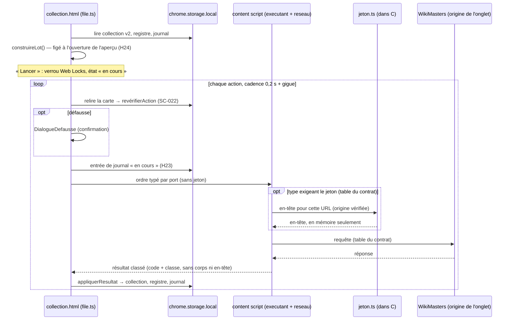

# Plan — Synchronisation complète : étiquettes, enchères et défausse appliquées sur le site

Entrées : `spec.refined.md` (prioritaire), `spec.md`, `design.md`, `contrat-api.md` (capture réelle d'Alexis, 2026-11-07), `AGENTS.md` (« Ne jamais faire » modifié par Alexis le 2026-11-07, option B sur le jeton de session), code de `main` au 2026-11-07.

> **Ordre imposé.** La spec interdit toute tâche de code avant que SC-001 et SC-002 soient franchis. La capture réelle en franchit l'essentiel ; ce qui reste à relever est listé en § 0 et rattaché aux lots qu'il bloque. La partition A / B sert à paralléliser *après* ce gate, pas à le contourner. Aucun point marqué « non relevé » dans `contrat-api.md` n'est deviné ici ni dans le code.

## Architecture

### Approche retenue
Trois contextes, une seule direction de commande :

1. **`collection.html` (page React) pilote** : construction du lot (logique pure), aperçu, « Lancer », file à cadence fixe, revérification, confirmations de défausse, journal, bouton « Arrêter ». Elle porte l'horloge et l'état d'exécution (H26 : la fermer interrompt le lot). **Elle ne voit jamais le jeton.**
2. **Le content script de l'unique onglet WikiMasters émet** : il reçoit un ordre typé (type d'action + paramètres validés) par un port `chrome.runtime`, le revalide, émet la requête par le **seul module réseau** `src/lib/reseau.ts`, valide la réponse contre la forme du contrat et renvoie un **résultat classé** (code HTTP, classe : réussie / échec / arrêt / inconnu). Aucun corps brut, aucun en-tête, aucun jeton ne remonte (SC-015). Au moment d'émettre, et seulement si la table du contrat l'exige pour ce type d'action, `reseau.ts` obtient l'en-tête d'authentification du **seul module jeton**.
3. **Le service worker ne change pas** : éphémère, il ne participe pas à l'exécution.

Logique pure dans `src/lib/` (sans `chrome.*`, testable avec horloge, transport et source de jeton fictifs injectés) ; `chrome.storage.local` reste confiné à `src/lib/stockage.ts`.

### Module jeton désigné (AGENTS.md, « Ne jamais faire »)
**`src/lib/jeton.ts` est le seul module autorisé à lire le jeton de session du site.** Il s'exécute uniquement dans le content script (monde isolé), jamais dans `collection.html` ni dans le service worker.

- Il n'est importé que par `src/lib/reseau.ts` (règle `no-restricted-imports`) ; `reseau.ts` l'appelle juste avant `fetch`, place la valeur dans l'en-tête exigé par la table du contrat, et ne la conserve dans aucune variable de module, aucun résultat, aucune erreur.
- API minimale envisagée : une fonction qui prend l'URL de la requête, **refuse si son origine n'est pas celle de l'onglet WikiMasters**, lit le jeton à l'endroit décrit par `contrat-api.md` et renvoie l'en-tête prêt à joindre, ou « absent » (l'action est alors en échec d'arrêt, classée comme 401, sans requête). Aucun cache : relu à chaque requête.
- Interdits dans ce module : écriture (stockage du site ou `chrome.storage`), `console.*`, journal, message `chrome.runtime`, retour du jeton dans un message d'erreur.
- **L'endroit où le site garde le jeton n'est pas relevé** (voir § 0) : le module est écrit à partir du contrat complété, jamais deviné. S'il n'est lisible que depuis le monde principal de la page, le module ne peut pas être écrit sans exécuter du code dans ce monde, ce qui sort du cadre décidé : escalade (risque B5).

### Fichiers créés / modifiés

| Fichier | Rôle | Partie |
|---|---|---|
| `src/lib/actions.ts` (créé) | Types partagés : `TypeAction` (lecture, creation-etiquette, retrait-etiquette, pose-etiquette, enchere, defausse), `Action`, `Lot`, `CarteEcartee` + raison, `ResultatAction`, `EntreeJournal`, `Registre`, `EtatExecution`. Types seuls ; aucun champ ne peut porter un jeton ou un en-tête. | A |
| `src/lib/collection.ts` (modifié) | `VERSION_SCHEMA` → 2 ; identifiants d'exemplaire sur le site par carte (le contrat montre que `user_card_id` désigne un **exemplaire**, H36) : champ `idsSite: string[] \| null`, `null` = inconnu (SC-019 « à `null` »), accès encapsulé par fonctions ; `migrerCollection` v1 → v2 idempotente ; séparation `analyserStockage` (v1 ou v2) / `analyserImport` (fichier d'échange v1, `idsSite` jamais lu) ; `fusionnerImport` conserve `idsSite` (H29). | A |
| `src/lib/exports.ts` (modifié) | `versJson` écrit `version: 1` sans `idsSite` (H30) ; `COLONNES` CSV inchangées. | A |
| `src/lib/lot.ts` (créé) | `construireLot(collection, registre, config, tableContrat)` : garde-fous, étiquettes, enchères, défausses (un exemplaire et un `user_card_id` par action), écartées avec raison, ordre H9 ; `revérifierAction` (SC-022) ; `appliquerResultat` (SC-014). Réutilise `prixDepart` de `src/lib/tri.ts` et `LIBELLES_STATUT`. | A |
| `src/lib/registre.ts` (créé) | Registre des étiquettes de l'extension (identifiant d'étiquette du site, liens posés par exemplaire), purge par carte, borne SC-026. | A |
| `src/lib/journal.ts` (créé) | Entrée « en cours » puis complétion, FIFO 1 000, lecture validée, entrée la plus récente par couple (carte, étiquette) pour SC-016, clôture « interrompue ». Construit ses entrées à partir de champs listés (pas d'étalement d'objet reçu). | A |
| `src/lib/file.ts` (créé) | Exécuteur pur : une requête en vol, départ = max(début précédent + 200 ms + supplément de 0 à 100 ms, réponse précédente, confirmation), arrêt sur 3 échecs cumulés ou cas SC-011 (b), arrêt manuel, ajout en fin de file. Horloge, transport, confirmation, lecture d'état et journal **injectés**. Tirage aléatoire de la gigue injecté hors de `file.ts` (avenant du 2026-11-12). | A |
| `src/lib/reseau.ts` (créé) | **Seul** module autorisé à appeler `fetch`. Refuse sans émettre : origine autre que `https://www.wiki-masters.com`, méthode/chemin hors table, identifiant invalide (non vide, ≤ 200 caractères, forme du contrat). `encodeURIComponent` des identifiants (chemin et filtre en query), en-têtes fixés : `Content-Type`, `Accept` et, en partie B, l'en-tête d'authentification **dont la valeur vient de `jeton.ts`** ; jamais `User-Agent`, `Referer`, `Origin`, `Cookie`. `redirect: 'manual'`, `credentials: 'same-origin'`, délai 30 s par `AbortController`, classement des réponses (SC-011). | A (squelette) / B |
| `src/lib/contrat.ts` (créé) | Table du contrat : par type, méthode + modèle de chemin + constructeur de corps + exigence d'authentification + validateur de réponse. **Livrée vide en partie A** ; remplie en B depuis `contrat-api.md` (écritures `POST /rest/v1/tags`, `POST`/`DELETE /rest/v1/user_card_tags`, `POST /api/marketplace`, `POST /api/user-cards/<user_card_id>/discard`, lecture `GET /api/my-collection` si B2 la retient). Un type dont un paramètre reste « non relevé » n'entre pas dans la table. | B |
| `src/lib/jeton.ts` (créé) | **Module jeton unique** (voir ci-dessus). | B |
| `src/lib/messages.ts` (créé) | Protocole du port page ↔ content script et validation par liste blanche de champs (tout champ inconnu = message rejeté). Ni ordre ni résultat n'a de champ libre pouvant transporter un jeton. | A |
| `src/lib/stockage.ts` (modifié) | Migration à la lecture sans écraser une donnée illisible ; clés versionnées `registre`, `journal`, `execution` ; écritures qui remontent l'échec (SC-011 (b)). | A |
| `src/content/executant.ts` (créé) | Côté site : ouvre le port, reçoit les ordres, appelle `reseau.ts`, renvoie le résultat classé. Ni `click`, ni `focus`, ni accès au stockage du site ou aux cookies (seul `jeton.ts`). | A |
| `src/content/index.ts` (modifié) | Démarre `executant.ts`. | A |
| `src/lib/lecteur.ts` (modifié, B2 seulement) | Relevé des `user_card_id` depuis `/collection` **seulement si** le contrat complété montre qu'ils y sont lisibles ; sinon B2 passe par la lecture `GET /api/my-collection` dans la file. | B |
| `src/app/Synchronisation.tsx` (créé) | Bandeau de risque, aperçu, totaux, durée estimée, écartées, « Lancer » et ses états désactivés, progression `role="status"`, « Arrêter ». | A |
| `src/app/DialogueDefausse.tsx` (créé) | Dialogue modal, focus piégé, focus initial « Passer », Échap = Passer, « Arrêter le lot ». | A |
| `src/app/Journal.tsx` (créé) | Journal, « Retirer l’étiquette », « Non annulable par l’extension », « Vider » confirmé (dialogue D-32). | A |
| `src/app/execution.ts` (créé) | Câblage navigateur de l'exécuteur : ports des content scripts (comptage des onglets), verrou Web Locks, horloge réelle, clôture des lots orphelins. | A |
| `src/app/App.tsx` (modifié) | Monte `Synchronisation` et `Journal`. | A |
| `src/config/prix.ts` (modifié, B4) | Durée d'enchère (`duration_minutes`, choix parmi les durées proposées par le site), bornes de `base_amount` une fois relevées (H33). | B |
| `src/config/synchro.ts` (créé, B3) | Couleur des étiquettes de l'extension (champ `color` exigé à la création), réglage à renseigner par Alexis. | B |
| `eslint.config.mjs` (modifié) | A2 : réseau interdit sauf `reseau.ts` ; aléatoire interdit dans `file.ts`/`reseau.ts`. A2 puis B5/B7 : `document.cookie`, `cookieStore`, `localStorage`, `sessionStorage`, `indexedDB` interdits dans tout `src/` **sauf `src/lib/jeton.ts`** ; import de `jeton.ts` interdit sauf depuis `reseau.ts` ; `no-console` dans `jeton.ts` et `reseau.ts`. | A / B |
| `src/styles/tokens.css` | **Inchangé** (D-01). | — |
| `public/manifest.json` | **Inchangé** : permission `storage` seule, aucun `host_permissions`. | — |
| `tests/unit/{lot,registre,journal,file,reseau,messages,contrat,jeton}.test.ts` (créés), `tests/unit/{collection,exports}.test.ts` (modifiés) | Tests unitaires. | A / B |
| `tests/unit/confinement-jeton.test.ts` (créé, B7) | ESLint (API `ESLint` de la dépendance existante) sur fichiers témoins : échec si un module autre que `jeton.ts` lit le stockage du site ou les cookies, ou importe `jeton.ts`. | B |
| `tests/unit/non-fuite-jeton.test.ts` (créé, B7) | Jeton témoin fictif : aucun message, résultat, entrée de journal, écriture de stockage ni appel `console` ne le contient. | B |
| `tests/e2e/synchro-complete.spec.ts` (créé), `tests/e2e/fixtures/` | Site simulé par `page.route`, données fictives, jamais `captures-site/`. | A / B |

### Flux de données

### Décisions techniques
- **Comptage des onglets WikiMasters** (SC-020, H25) : chaque content script ouvre un port `chrome.runtime.connect` ; `collection.html` compte les ports vivants par `sender.tab.id`. Déconnexion pendant l'exécution = onglet fermé ou rechargé (SC-013). Clé de signal (via `stockage.ts`) pour qu'un onglet déjà ouvert se reconnecte à une `collection.html` ouverte après lui. Aucune permission nouvelle.
- **Une seule exécution** (SC-023) : verrou `navigator.locks` ; à l'ouverture, un état « en cours » sans verrou détenu est clos « interrompue » (SC-013).
- **Identifiant de lot** : horodatage + compteur, jamais `crypto.randomUUID`.
- **Exemplaires** : le contrat montre que `user_card_id` désigne l'exemplaire possédé et sert à l'étiquette comme à la défausse. Une défausse = un `user_card_id`. Pour les étiquettes et l'enchère, la granularité (tous les exemplaires ou un seul) est une **question pour `refine`** (voir « Incohérences à lever ») : A3 encapsule ce choix dans une fonction unique.
- **Cadence** : 0,2 s au minimum plus 0 à 0,1 s de gigue injectée (avenant du 2026-11-12), sans plafond par minute, aucune simulation de comportement humain, aucune falsification d'en-tête. Les appels que le site fait lui-même autour d'une action (par exemple la relecture du profil après une défausse, la relecture d'une enchère) **ne sont pas reproduits** : seules les actions du lot partent.
- **Rendu de l'aperçu** (SC-025) : lot calculé une fois (mémoïsé), rendu paginé, totaux sur tout le lot.
- **Focus** : le piège de focus du dialogue vit dans `src/app/` (le lint n'interdit `focus` que dans le code exécuté sur le site).

### Alternatives écartées
- Exécution dans le service worker : éphémère et hors origine du site, donc `host_permissions` nécessaires.
- File et dialogue dans le content script : variante 2 refusée, et `focus` interdit dans le code du site.
- `chrome.tabs.query` pour compter les onglets : exige `tabs` ou des `host_permissions`.
- Verrou par clé `chrome.storage.local` : non atomique entre deux onglets.
- Jeton lu dans `collection.html` puis transmis par message : multiplie les contextes qui le voient, contraire à « un seul module ».
- Jeton mis en cache en mémoire dans le content script : inutile à ce débit (historique : 10 requêtes par minute), élargit la fenêtre de fuite.
- Exécution de code dans le monde principal de la page pour atteindre un jeton : hors du cadre décidé (code injecté dans la page), escalade si c'est la seule voie.
- `chrome.cookies` : permission supplémentaire, et cookies hors du module jeton.
- Bibliothèque de piège de focus ou de tests de composants : aucune nouvelle dépendance.

### Contraintes
- **Contextes** : page (pilote, sans jeton), content script (émetteur unique, même origine, seul porteur du jeton en mémoire), service worker inchangé.
- **Permissions** : `storage` seule ; aucun `host_permissions` (si `/rest/v1` est sur une autre origine, SC-002 (d) arrête les étiquettes, on n'ajoute pas de permission).
- **Stockage** : collection v1 → v2 migrée à la lecture, idempotente, jamais d'écrasement d'une donnée illisible ; fichier d'échange JSON en v1 ; `registre`, `journal`, `execution` versionnés et absents des exports ; aucun jeton dans aucune clé.
- **Dépendances** : aucune nouvelle.
- **Cadre** : cadence fixe (SC-010), aucun délai aléatoire, aucun en-tête falsifié, redirections non suivies, rappel du risque de bannissement maintenu (D-13).

### Incohérences à lever par `refine` avant les lots concernés
L'option B a été reportée dans « Jeton de session » et SC-002 (a), mais d'autres passages de `spec.refined.md` la contredisent encore. Le plan ne les tranche pas : il les signale.

1. **SC-017, SC-018, H31, SC-002 (c) et Constraints** limitent les en-têtes à `Content-Type`/`Accept` et interdisent de fixer `Authorization` ou de lire le stockage du site. L'option B exige au minimum l'en-tête qui porte le jeton, valeur fournie par `jeton.ts` seul. **Bloque B5, B7, et B1 pour les types authentifiés.** Si `/rest/v1` exige en plus un autre en-tête (non relevé), SC-002 (c) l'arrête sauf nouvelle décision d'Alexis.
2. **H29 / SC-019 / SC-024** parlent d'« un identifiant sur le site » par carte ; le contrat montre un identifiant par exemplaire (H36). Le plan retient `idsSite: string[] | null`. **Bloque A1** (à confirmer, sinon A1 part sur ce choix encapsulé).
3. **Granularité des étiquettes et de l'enchère** par rapport aux exemplaires (étiqueter chaque exemplaire ? quel exemplaire mettre aux enchères ?). **Bloque A3 (partie étiquettes et enchères), B2, B3.**
4. L'en-tête « État du prérequis » de `spec.refined.md` dit encore que `contrat-api.md` n'existe pas.

## 0. Gate L0 : état et relevés restants

**L0a — Capture (fait, Alexis).** `contrat-api.md` existe, écrit depuis la capture réelle ; les trois écritures sont capturées. SC-001 est largement franchi. Le jeton de session n'arrête plus la feature (option B, SC-002 (a)).

**L0b — Relevés restants (Alexis, sans code).** Points « Reste à relever » du contrat, plus trois points que le plan a besoin de connaître ; chacun est rattaché aux lots qu'il bloque. Tant qu'un point n'est pas relevé, le type d'action concerné reste « non disponible » (absent de la table) : il n'est jamais deviné.

| Point à relever | Verdict SC-002 concerné | Lots bloqués |
|---|---|---|
| `git check-ignore captures-site/` renvoie le chemin | SC-001 | tous (vérification immédiate) |
| Mode d'authentification de `/api/` (cookies de même origine ou jeton, nom de l'en-tête) | (a), (c) | B1 (enchère, défausse, lecture), B5 |
| Hôte exact de `/rest/v1` (même origine que l'onglet ?) | (d) | B1 (étiquettes), B3, B5 |
| En-têtes exigés par `/rest/v1` (nom de l'en-tête du jeton, autres en-têtes éventuels) | (c) | B1 (étiquettes), B3, B5 |
| Endroit où le site garde le jeton, lisible ou non depuis un content script (stockage du site, cookie non `HttpOnly`, autre) — *ajout du plan* | (a) | B5 |
| Forme des réponses de succès (`/api/my-collection`, enchère, défausse) et identifiants renvoyés par les créations (`tags`, `user_card_tags`) | SC-011 « hors contrat » | B1, B2, B3 |
| Forme des erreurs 401, 403, 429 | SC-011 (b) | B1 |
| Filtre de `DELETE /rest/v1/user_card_tags` | (e) | B1 (retrait), B3 ; SC-016 « Retirer l’étiquette » désactivé d'ici là |
| Origine de `user_id` exigé par la création d'étiquette — *ajout du plan* | (e) | B3 |
| Lien `card_id` (enchère) ↔ `user_card_id` | (b), (e) | B4, B2 |
| Bornes de `base_amount` ; durée par défaut du formulaire (les durées proposées sont connues, pas celle présélectionnée) | (e), H33 | B4 |
| Limites de nombre et de longueur des étiquettes, visibilité pour les autres joueurs | SC-007 (f), H34 | B3 |
| `user_card_id` lisible sur `/collection` ou seulement par `GET /api/my-collection` — *ajout du plan* | (b), SC-024 | B2 |

**Démarrage de la partie A** : elle ne dépend d'aucun de ces points. Elle démarre dès que SC-002 a laissé passer au moins une action ; le premier relevé à faire est donc le mode d'authentification de `/api/` (qui suffit à rendre le verdict pour la défausse) et l'hôte de `/rest/v1`. Le premier lot de code attend aussi les points 2 et 3 des incohérences ci-dessus pour A1 et A3.

## 1. Task list

Chaque lot de la partie B **cite `contrat-api.md`** pour ses méthodes, chemins et corps, et ne code un type d'action qu'une fois ses points de § 0 relevés.

| Lot | Description | Couche | Dépend de | SC | D-xx |
|---|---|---|---|---|---|
| L0b | Relevés restants (§ 0), sans code | spec (Alexis) | — | SC-001, SC-002 | — |
| R1 | Passe `refine` sur les incohérences 1 à 4 (sans code, hors agents de dev) | spec | L0b (partiel) | SC-002, SC-017, SC-018, SC-019, SC-024 | — |
| A1 | Types (`actions.ts`) ; schéma v2 + `idsSite` + migration idempotente ; séparation stockage / import ; `versJson` en v1 ; CSV inchangé | lib | R1 (incohérence 2) | SC-019, SC-024 (champ) | — |
| A2 | Lint : réseau interdit sauf `reseau.ts` ; `document.cookie`, `cookieStore`, `localStorage`, `sessionStorage`, `indexedDB` interdits dans tout `src/` (aucune exception tant que B5 n'existe pas) ; aléatoire interdit dans `file.ts`/`reseau.ts` ; `click`… conservés | outillage | L0a | SC-010 (grep), SC-017 (lint), SC-018 | — |
| A3 | `lot.ts` + `registre.ts` : garde-fous favori / `a-trier` / `decidePar`, étiquettes de statut et d'ami, retraits d'obsolètes, enchères (places libres, prix, tri, raisons), défausses par exemplaire, « non reliée au site », types « non disponibles », ordre H9, `revérifierAction`, `appliquerResultat` ; mesure 5 000 cartes | lib | A1, R1 (incohérence 3) | SC-003 à SC-006, SC-007 (a–e), SC-014, SC-022 (règles), SC-024, SC-025 (unitaire) | — |
| A4 | `journal.ts` + clés `registre`/`journal`/`execution` dans `stockage.ts` : « en cours » puis complétée, FIFO 1 000, champs listés, quota, échec d'écriture remonté | lib / stockage | A1 | SC-011 (c), SC-014, SC-015, SC-026 | — |
| A5 | `file.ts` : cadence fixe (horloge simulée), une requête en vol, revérification, classement des erreurs, cumul de 3, arrêts immédiats, arrêt manuel, ajout en fin de file | lib | A3, A4 | SC-010, SC-011 (a, b), SC-012 (logique), SC-022, SC-023 (unitaire) | — |
| A6 | `reseau.ts` (squelette, table vide), `messages.ts` (liste blanche), `content/executant.ts`, démarrage dans `content/index.ts` : refus sans émission, encodage, en-têtes limités, `redirect: 'manual'`, délai 30 s | lib / content | A2 | SC-011 (transport), SC-017 (hors table), SC-018 | — |
| A7 | `app/execution.ts` : ports, comptage d'onglets, signal de reconnexion, Web Locks, état `execution`, clôture « interrompue » | app | A5, A6 | SC-013 (logique), SC-020 (conditions), SC-023 | — |
| A8 | `Synchronisation.tsx` (bandeau, aperçu, totaux, durée, écartées, états désactivés, « Aucune action à envoyer ») + `Journal.tsx` en lecture + montage dans `App.tsx` | app / UI | A3, A4 | SC-008 (rendu), SC-016 (mentions), SC-020, SC-021 | D-01 à D-18, D-28 à D-31, D-33 à D-42 |
| A10 | Exécution : progression `role="status"`, barre, « Arrêter » + Échap, états de fin, `DialogueDefausse.tsx`, « Retirer l’étiquette », dialogue « Vider » | app / UI | A7, A8 | SC-009, SC-012, SC-016, SC-021 | D-10 à D-12, D-19 à D-27, D-32, D-35 à D-39, D-43, D-44 |
| A9 | E2e partie A (table vide) : 0 requête avant « Lancer », états désactivés (0, 1, 2 onglets, exécution en cours, table vide), import/export v1, aperçu 5 000 cartes < 500 ms, captures aperçu et journal (3 largeurs, 2 thèmes) | e2e | A10 | SC-008 (0 requête), SC-019, SC-020, SC-021, SC-023, SC-025 (e2e) | D-08, D-33 |
| B1 | Table du contrat dans `contrat.ts` depuis `contrat-api.md` : écritures capturées (tags, user_card_tags, marketplace, discard), lecture `my-collection` si B2 la retient ; corps, exigence d'authentification par type, validateurs de réponse. Un type n'entre qu'avec ses points de § 0 relevés | lib | L0b, A6, R1 (incohérence 1 pour les types authentifiés) | SC-011 (« hors contrat »), SC-017 (chemins du contrat) | — |
| B2 | Source des `user_card_id` : relevé dans `lecteur.ts` si lisible sur `/collection`, sinon action de lecture `GET /api/my-collection` dans la file (cadence, journal) ; validation de forme ; rattachement exemplaire ↔ `rareté\|titre` | lib / content | A1, A3, B1 | SC-024, SC-002 (b) | — |
| B3 | Étiquettes : création préalable (`POST /rest/v1/tags` avec `user_id`, `name`, `color` de `src/config/synchro.ts`), identifiant renvoyé au registre, pose et retrait sur `user_card_tags`, limite de longueur, homonymes si détectables sans requête hors lot, avertissement de visibilité | lib / UI | A3, A8, B1 | SC-007 (f), SC-016 (retrait), H34, H35 | D-13, D-15, D-17 |
| B4 | Enchère : `POST /api/marketplace` (`card_id` selon le lien relevé, `base_amount` = prix de départ, `duration_minutes` réglé dans `prix.ts`), bornes de prix | lib / config | A3, B1 | SC-006 (bornes), H33 | — |
| B5 | **Module jeton `src/lib/jeton.ts`** : lecture en mémoire à l'endroit relevé, origine vérifiée, aucun cache, aucune écriture ; branchement dans `reseau.ts` pour les seuls types qui l'exigent ; exception de lint limitée à ce fichier ; `no-restricted-imports` sauf depuis `reseau.ts` | content / sécurité | L0b (endroit du jeton, en-têtes), R1 (incohérence 1), A6, B1 | SC-002 (a), SC-017, SC-018 (révisés) | — |
| B7 | **Confinement et non-fuite du jeton** : (1) `confinement-jeton.test.ts` lance ESLint sur des fichiers témoins hors `jeton.ts` (`localStorage`, `window['sessionStorage']`, `globalThis.document.cookie`, `cookieStore`, `indexedDB`, import de `jeton.ts` depuis `executant.ts` ou `src/app/`) et exige une erreur pour chacun ; (2) `non-fuite-jeton.test.ts` exécute un lot complet (file + messages + executant + reseau + journal, transport et stockage fictifs) avec un jeton témoin fictif et vérifie qu'il n'apparaît dans aucun message de port, résultat, entrée de journal sérialisée, écriture de stockage, appel `console`, ni requête vers une autre origine (refusée avant lecture du jeton) | tests / sécurité | B5, A5 | SC-015, SC-018 (révisé), Jeton de session | — |
| B6 | Fixtures du site simulé conformes au contrat (fictives, jeton témoin fictif) et e2e : aperçu complet, dialogue de défausse, arrêt < 100 ms, interruptions, journal persistant, « Retirer l’étiquette », 401/403/429, captures du dialogue et de la progression | e2e | A10, B1 à B5, B7 | SC-008, SC-009, SC-012, SC-013, SC-015 (e2e), SC-016, SC-021 | D-08, D-19 à D-27, D-33 |

**Couverture des SC** : SC-001/002 (L0b, R1, B2, B5) · 003/004/005 (A3) · 006 (A3, B4) · 007 (A3, B3) · 008 (A8, A9, B6) · 009 (A10, B6) · 010 (A2, A5) · 011 (A4, A5, A6, B1) · 012 (A5, A10, B6) · 013 (A7, B6) · 014 (A3, A4) · 015 (A4, B7, B6) · 016 (A8, A10, B3, B6) · 017 (A2, A6, B1, B5) · 018 (A2, A6, B5, B7) · 019 (A1, A9) · 020 (A7, A8, A9) · 021 (A8, A10, A9, B6) · 022 (A3, A5) · 023 (A5, A7, A9) · 024 (A1, A3, B2) · 025 (A3, A9) · 026 (A4). Aucun SC orphelin.

## 2. Estimations

| Lot | Heures |
|---|---|
| L0b (Alexis), R1 (`refine`) | hors agents de dev, non comptés (≈ 1 à 2 h de relevés) |
| A1 | 5 |
| A2 | 2 |
| A3 | 7 |
| A4 | 5 |
| A5 | 7 |
| A6 | 5 |
| A7 | 5 |
| A8 | 5 |
| A10 | 6 |
| A9 | 4 |
| B1 | 5 |
| B2 | 6 |
| B3 | 4 |
| B4 | 2 |
| B5 | 4 |
| B7 | 3 |
| B6 | 7 |
| **Total** | **82 h** (A : 51 h, B : 31 h) |

Si un relevé fait tomber une action (SC-002), ses parts de B1, B3 ou B4 et de B6 disparaissent ; la feature ne s'arrête entièrement que si les trois actions tombent.

## 3. Risques

| Lot | Risque | Probabilité | Impact | Mitigation |
|---|---|---|---|---|
| L0b | `/rest/v1` sur une autre origine que l'onglet (SC-002 (d)) | Moyenne | Étiquettes arrêtées (enchère et défausse restent) | Relevé prioritaire ; aucun `host_permissions` ajouté ; le jeton n'est jamais envoyé hors origine. |
| L0b | `/rest/v1` exige un en-tête en plus de celui du jeton (SC-002 (c)) | Moyenne | Étiquettes arrêtées sauf nouvelle décision d'Alexis | Relevé des en-têtes ; R1 précise la liste admise ; pas de devinette. |
| L0b | `card_id` non relié à `user_card_id`, ou `user_id` sans source dans l'extension (SC-002 (b), (e)) | Moyenne | Enchère ou création d'étiquette arrêtée | Relevés dédiés ; type « non disponible » en attendant. |
| L0b | Interception du trafic = rétro-ingénierie interdite par les règles § 3 | Certaine | Risque de bannissement, assumé par Alexis | Rappel D-13 ; captures hors git ; aucun secret dans `contrat-api.md`. |
| R1 | Spec contradictoire sur les en-têtes et le stockage du site (SC-017, SC-018, H31) | Certaine aujourd'hui | B5/B7 bloqués, lint de A2 incompatible avec B5 | R1 avant B1 authentifié ; A2 sans exception, B5 ajoute la seule. |
| A1 | Régression d'import/export ou perte lors de la migration | Moyenne | Élevé | Tests v1 → v2 sur toutes les propriétés, idempotence, illisible jamais écrasé ; échange figé en v1. |
| A1, B2 | Granularité par exemplaire mal modélisée (`idsSite`) | Moyenne | Moyen (migration à reprendre) | Accès encapsulé ; choix confirmé par R1 avant A1. |
| A2 | Règles trop larges (cassent `src/app/`, tests) ou trop étroites (`globalThis.fetch`, `window['localStorage']`) | Moyenne | Moyen | `no-restricted-globals` + `no-restricted-properties` + sélecteurs ; fichiers témoins (repris par B7). |
| A3 | Règles croisées (favori, `a-trier`, obsolètes, attente de place) mal ordonnées | Moyenne | Élevé (action définitive erronée) | Un test par SC et par H16–H19 ; ordre H9 testé. |
| A5 | Minuteurs ralentis en onglet masqué : intervalle > 6 050 ms | Moyenne | Faible (jamais plus rapide) | Échéances en temps absolu ; aucune compensation par délai variable. |
| A5 | Double émission après un délai de 30 s | Faible | Élevé | Arrêt immédiat, `AbortController`, « inconnu », aucune relance. |
| A6 | Redirection suivie, ou en-tête ajouté par le navigateur confondu avec une falsification | Faible | Moyen | `redirect: 'manual'` ; tests sur les en-têtes fixés par le code seulement. |
| A7 | Content script orphelin ou onglet non compté | Moyenne | Moyen | Signal de reconnexion ; message invitant à recharger l'onglet. |
| A7 | Deux `collection.html` lancent ensemble | Faible | Élevé (cadence doublée) | Web Locks + e2e du second « Lancer ». |
| A8 | Aperçu de 5 000 cartes au-delà de 500 ms | Moyenne | Faible | Calcul mémoïsé, rendu paginé. |
| B1–B4 | Contrat incomplet (erreurs non observées, formes variables) | Élevée | Moyen | Forme non décrite = « hors contrat » = arrêt ; type non relevé = « non disponible ». |
| B5 | Jeton illisible depuis le monde isolé (mémoire JS de la page, cookie `HttpOnly`) | Moyenne | Bloquant pour les types qui l'exigent | Relevé dédié ; si cookie `HttpOnly` de même origine, le navigateur le joint seul et B5 devient inutile pour ce type ; pas d'injection dans le monde principal sans nouvelle décision. |
| B5, B7 | Fuite du jeton (journal, message, stockage, erreur, console, autre origine) | Moyenne | **Critique** | Module unique, import restreint, aucun cache, liste blanche des messages, entrées de journal construites champ par champ, tests de non-fuite par jeton témoin, revue `security-reviewer` renforcée. |
| B6 | Fixtures dérivées de `captures-site/` | Faible | Élevé | Fixtures écrites à la main depuis `contrat-api.md`, jeton témoin fictif, contrôle `security-reviewer`. |

## 4. Ordre d'exécution

- **Vague 0 (bloquante, sans code)** : `git check-ignore captures-site/` ; relevé du mode d'authentification de `/api/` et de l'hôte de `/rest/v1` (verdict SC-002 pour au moins une action) ; R1 sur les incohérences 2 et 3 (A1, A3). Le reste de L0b et l'incohérence 1 se poursuivent en parallèle des vagues 1 à 3.
- **Vague 1 (parallèle)** : A1, A2.
- **Vague 2 (parallèle)** : A3, A4 (après A1) ; A6 (après A2).
- **Vague 3 (parallèle)** : A5 ; A8 ; B1 (après A6, L0b et R1 pour les types concernés ; les types sans jeton peuvent entrer en premier).
- **Vague 4 (parallèle)** : A7 ; B2 (après A3, B1) ; B3 (après A8, B1) ; B4 (après A3, B1) ; B5 (après B1, R1 incohérence 1).
- **Vague 5 (parallèle)** : A10 ; B7 (après B5, A5).
- **Vague 6 (parallèle)** : A9 ; B6 (après A10, B1 à B5, B7).
- **Chemin critique** : vague 0 → A1 (5) → A3 (7) → A5 (7) → A7 (5) → A10 (6) → B6 (7) = **37 h** après la vague 0. La chaîne jeton A2 (2) → A6 (5) → B1 (5) → B5 (4) → B7 (3) = 19 h reste en marge, sauf si les relevés de L0b ou R1 (incohérence 1) tardent.

Conflits de fichiers à surveiller dans `tasks` : `reseau.ts` (A6, B1, B5), `eslint.config.mjs` (A2, puis B5 pour l'unique exception ; B7 n'y touche pas, il le teste), `content/index.ts` (A6, B2), `stockage.ts` (A4 seul ; A1 lui confie le branchement de la migration), `App.tsx` (A8 seul), `prix.ts` (B4 seul).

## 5. Quick wins vs long terme

- **Quick wins** (utiles même si une action tombe au gate) : migration v2 et séparation stockage / échange (A1) ; resserrement du lint réseau et stockage du site (A2), qui rétablit un garde-fou retiré le 2026-11-07 et prépare le confinement du jeton ; construction du lot et aperçu avec raisons d'écart (A3, A8), qui rendent visibles les cartes mal renseignées ; la défausse, dont le contrat est le plus simple (aucun corps), peut être la première action branchée de bout en bout si `/api/` s'authentifie par cookies de même origine.
- **Long terme** (chacun exige une nouvelle spec) : lecture de `GET /api/marketplace/mine` pour compter les places libres (aujourd'hui exclu du Scope) ; relevé automatique de la fin d'enchère ; réutilisation du lot comme liste guidée d'actions manuelles pour les actions arrêtées par SC-002 ; mise à jour du cadre d'usage d'AGENTS.md si WikiMasters ouvre une API publique ou donne un accord écrit.

## Avenant du 2026-11-11
Décision d’Alexis (voir AGENTS.md) : synchronisation automatique **activée par défaut**, `GET /api/marketplace/mine` ajouté au périmètre de lecture, délai variable (gigue de 0 à 6 s) ajouté à l’intervalle de 6 s. L’écriture sur le site est autorisée ; ses contrats attendent les relevés de `specs/synchro-complete/releves-a-faire.md`. En cas d’écart avec le texte ci-dessus, AGENTS.md prime.

## Avenant du 2026-11-12 : cadence actuelle

Décisions d’Alexis du 2026-11-12, les PR #72 à #76 sont livrées ; les deux puces « Défausse » et « Étiquettes préexistantes » sont **en cours** (PR #79 et #77, non fusionnées à la rédaction) ; `AGENTS.md` prime sur tout texte de ce document. Les passages historiques de ce document (revues `R-13`, `R-48`, hypothèse `H28`, etc.) qui parlent de 6 s, de 10 par minute ou de « cadence fixe » sont **remplacés** par ce qui suit.

- **Cadence** : 0,2 s au minimum entre deux débuts de requête (`INTERVALLE_MS`) plus un supplément aléatoire de 0 à 0,1 s (`SUPPLEMENT_MAX_MS`, `GIGUE_MAX_MS`), tiré hors de `file.ts` (source injectée) ; **aucun plafond par minute** ni par session. Le délai n’est donc plus « fixe » et le code contient un tirage aléatoire (injecté). SC-010 se lit : début de requête ≥ max(début précédent + 0,2 s + supplément, réponse précédente), sans fenêtre glissante de 60 s.
- **Parallélisme** : poses et retraits d’étiquettes en parallèle par défaut, 3 en vol (`CONCURRENCE_MAX` = 4 en plafond ; 4 ordres en attente au plus côté page, chacun avec un identifiant de corrélation dans le protocole page ↔ content script). Les débuts de requête restent espacés de 0,2 s plus la gigue. Création d’étiquettes, enchères, défausses et lectures : une seule requête en vol.
- **Arrêts** : 401, 403, 429 (et 409 sur enchère ou défausse) et 3 échecs arrêtent le lot ; pause de 30 min. En parallèle, un arrêt bloque tout nouveau départ, les requêtes en vol vont à leur terme (le seuil de 3 échecs peut être dépassé de 2 au plus).
- **Bail** : un lot d’écriture prend le bail de la synchro automatique pour toute sa durée, et ne démarre pas si la synchro tourne (et inversement), pour ne pas additionner les débits.
- **Relance** : le bouton « Relancer la synchro » (spec `synchro-auto`) n’est proposé qu’après un arrêt manuel ou un 403.
- **Durée estimée** (SC-008, H28) : nombre de requêtes × 0,25 s en moyenne (`SECONDES_PAR_REQUETE`), arrondi à la minute supérieure (`dureeMinutesApercu`).
- **Défausse** : plafond de valeur marchande de 5 (`PLAFOND_VALEUR_DEFAUSSE`, décision du 2026-11-11), jamais dépassé même sur décision manuelle. La confirmation individuelle de chaque défausse (SC-009, G2, D-xx du dialogue) est supprimée sur demande d’Alexis le 2026-11-12 (PR #79, T-906) ; la réécriture détaillée de ces passages suit cette PR.
- **Cartes en vente** : une carte `en-vente` ne reçoit aucune étiquette (ni création, ni pose, ni retrait), le site refusant la pose (403) ; elle est écartée avec la raison « en vente sur le site » (PR #71). « Statut · En vente » n’est donc plus posée par l’extension, ce qui remplace H17 et les lignes qui disent qu’elle est posée au lot suivant.
- **Étiquettes préexistantes (en cours, PR #77, non fusionnée ; `AGENTS.md` de `main` ne la couvre pas encore)** : suppression d’étiquettes du compte non posées par l’extension (action `suppression-etiquette`, `POST /rest/v1/rpc/delete_tag`), demandée par Alexis le 2026-11-12 : uniquement sur étiquettes cochées une à une puis confirmées, même file, mêmes arrêts et même cadence, non parallèle.
