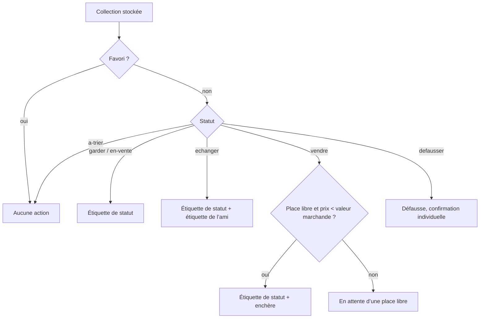
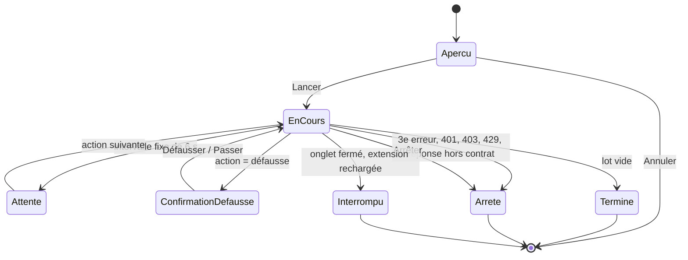

# Spec — Synchronisation complète : étiquettes, enchères et défausse appliquées sur le site

- **Feature** : `synchro-complete` · **Auteur** : agent spec · **Date** : 2026-11-07
- **Besoin d'origine** : « Synchronisation complète entre WikiMasters et l'extension : étiquettes (tags), mise en vente aux enchères et défausse des cartes, appliquées sur le site à partir des décisions de l'extension. »
- **Validation** : voir `STATUS.md` (gate humain). Cette spec n'est pas validée tant qu'Alexis ne l'a pas écrit dans `STATUS.md`.
- **Remplacée sur certains points par `spec.refined.md`** (R-37 à R-48 : jeton de session, en-têtes, `idsSite`, granularité). En cas de contradiction, `spec.refined.md` fait foi.

## 0. Décision d'Alexis et risque assumé

Décision prise par Alexis le 2026-11-07, en réponse aux questions du premier passage.

**Ce que fait la feature.** L'extension appelle directement **l'API interne de WikiMasters**, à la place du joueur, pour trois actions : poser ou retirer une étiquette, mettre une carte aux enchères, défausser une carte. C'est la portée la plus large qui ait été proposée (option C), devant l'assistance sans clic et les clics simulés.

**Risque rappelé, et assumé par Alexis.** C'est l'option où le risque de bannissement du compte est **le plus élevé** :
- les règles de la communauté (section 3) interdisent les bots, scripts, macros et tout outil qui échange ou interagit à la place du joueur, ainsi que **la rétro-ingénierie et l'interception du trafic** pour obtenir un avantage. Or le contrat de l'API n'est pas public : le connaître suppose d'observer le trafic du site, ce qui tombe sous cette interdiction ;
- les conditions d'utilisation (section 6) prévoient un bannissement pour automatisation ;
- le `robots.txt` du site contient `Disallow: /api/` ;
- une enchère lancée et une carte défaussée ne peuvent pas être annulées par l'extension. Une erreur de l'extension (mauvais prix, mauvaise carte) a donc des effets définitifs sur le compte.

**Levée ciblée de l'interdiction d'AGENTS.md** (« Tout code qui clique, envoie un formulaire ou appelle l'API interne du site à la place du joueur exige une décision explicite d'Alexis, écrite dans la spec »). Elle est **limitée** à ceci :
- **Autorisé** : des requêtes HTTP vers les seuls points d'accès de l'API de WikiMasters décrits dans `specs/synchro-complete/contrat-api.md` (voir SC-001), pour les seules actions suivantes : poser une étiquette, retirer une étiquette posée par l'extension, créer une étiquette de l'extension si le site l'exige, mettre aux enchères, défausser, et les lectures strictement nécessaires à ces actions (par exemple obtenir l'identifiant d'une carte sur le site), si le contrat les impose.
- **Toujours interdit** : `click`, `submit`, `dispatchEvent` et `focus` dans le code exécuté sur le site. L'option C n'en a pas besoin, ils restent bloqués par le lint. Restent aussi interdits : toute autre action de jeu (ouvrir des paquets, jouer, accepter ou proposer un échange, enchérir, acheter), tout autre point d'accès, toute requête vers un autre domaine.
- **Inchangé** : la cadence est fixe et régulière, rien ne cherche à masquer l'automatisation (voir Non-Goals). AGENTS.md n'est pas modifié par cette feature.

**Demande refusée.** Alexis a aussi demandé des délais aléatoires et le retrait de la règle d'AGENTS.md qui les interdit. Cette demande n'est **pas** retenue : des délais aléatoires servent à éviter la détection, ce qu'AGENTS.md interdit (« Aucun code ne cherche à masquer une automatisation »). Changer cette règle relève d'une modification d'AGENTS.md par Alexis lui-même, hors de cette spec.

**Complément du 2026-11-10 (étiquettes).** Alexis autorise l’écriture des étiquettes sur l’hôte Supabase du site (`/rest/v1`), avec le jeton de session et l’en-tête `apikey` public, vers cet hôte seul (AGENTS.md amendé). Les étiquettes sont supposées visibles des autres joueurs (avertissement dans l’aperçu). **Délai variable (2026-11-11)** : Alexis demande des délais variables pour éviter erreurs et sanctions serveur. Retenu : 6 000 ms minimum plus un supplément de 0 à 4 000 ms tiré par l’appelant, qui remplace la « demande refusée » ci-dessous et la cadence « fixe » de SC-010 (plafond de 10 par minute inchangé, aucun en-tête falsifié). **Décodage du jeton (2026-11-11)** : Alexis autorise l’extension à décoder le jeton d’accès en mémoire pour en tirer `sub`, utilisé comme `user_id` à la création d’une étiquette (T-024 AC2) ; `refresh_token` et `user` ne sont jamais extraits. **Apikey** en dur dans `src/config/synchro.ts`. Le relevé du 2026-11-11 (hôte, en-têtes, filtre `DELETE`, session, réponse de création) est dans `contrat-api.md`.

**Réponses retenues.**

| # | Question | Réponse d'Alexis |
|---|---|---|
| 1 | Portée | C : appels directs à l'API interne pour les étiquettes, les enchères et la défausse |
| 2 | Confirmation | A : aperçu du lot dans `collection.html`, une validation pour tout le lot, plus une confirmation propre à chaque défausse |
| 3 | Rythme | B : 10 actions par minute au plus, pas de plafond par session, arrêt après 3 erreurs. Cadence fixe |
| 4 | Journal | A : journal local horodaté dans `chrome.storage.local`, visible dans `collection.html`, bouton « Retirer l’étiquette » ; enchères et défausses marquées non annulables par l'extension |

## 1. Goals
- G1 — Appliquer sur WikiMasters, en un lot validé une seule fois, les décisions déjà prises dans l'extension (statuts, amis, prix de départ), sans refaire les actions carte par carte sur le site.
- G2 — Voir avant de lancer exactement ce qui sera envoyé au site, et confirmer une à une les défausses, seules actions qui détruisent une carte.
- G3 — Garder une trace locale, horodatée et consultable de tout ce que l'extension a fait sur le compte, et pouvoir défaire ce qui peut l'être (les étiquettes).
- G4 — Limiter les dégâts d'une erreur : garde-fous sur les cartes protégées, cadence plafonnée, arrêt automatique, arrêt manuel immédiat.

## 2. Scope
**Inclus**
- **Étape 0, investigation (prérequis, sans code)** : Alexis observe lui-même dans les outils de développement de Chrome les requêtes du site pour les actions retenues ; les captures brutes restent dans `captures-site/` (déjà ignoré par git) ; un résumé sans donnée sensible est écrit dans `specs/synchro-complete/contrat-api.md`. Aucun code de la feature n'est écrit avant que ce document existe et qu'il ait passé le point d'arrêt de SC-002.
- **Construction du lot** (logique pure, sans `chrome.*`) à partir des cartes stockées : une liste ordonnée d'actions (étiquette, enchère, défausse) avec leurs paramètres, filtrée par les garde-fous.
- **Étiquettes** : une étiquette par ami (pour les cartes `echanger` avec un `ami` renseigné) et une étiquette par statut. L'extension ne pose, ne remplace et ne retire que les étiquettes qu'elle a elle-même créées.
- **Enchères** : mise aux enchères des cartes `vendre`, de la plus chère à la moins chère, au prix de départ de la carte, dans la limite des places libres (`maxVentesSimultanees`).
- **Défausse** : défausse des cartes `defausser`, chacune après sa propre confirmation.
- **Aperçu du lot** dans `collection.html` (variante 1 des wireframes, adaptée), avec le rappel du risque, une validation unique « Lancer », et un bouton « Arrêter » actif pendant l'exécution.
- **Exécution** depuis l'onglet WikiMasters ouvert, à cadence fixe (une action toutes les 6 s au plus vite, soit 10 par minute), avec arrêt après 3 erreurs.
- **Mise à jour locale** après chaque action réussie (statut `en-vente`, quantité, étiquettes posées).
- **Journal** local horodaté, persistant, consultable dans `collection.html`, avec « Retirer l’étiquette » sur les étiquettes posées.
- **Migration** du schéma de stockage si le modèle s'enrichit (identifiant de la carte sur le site, étiquettes posées, journal).

**Exclu**
- Toute action autre que les trois retenues : ouvrir des paquets, jouer, proposer ou accepter un échange, enchérir, acheter, retirer une enchère en cours, récupérer une carte défaussée.
- Les clics simulés et le remplissage de formulaires du site (option B), et l'assistance sans clic (variante 3).
- L'annulation d'une enchère ou d'une défausse par l'extension.
- La lecture de l'état des enchères sur le site pour compter les places libres (le joueur l'indique, comme dans `FileVente`), sauf si le contrat de l'API impose cette lecture pour lancer une enchère.
- L'exécution sans onglet WikiMasters ouvert, en arrière-plan ou planifiée.
- Toute modification d'AGENTS.md.

## 3. Success Criteria
| ID | Critère (page/module · action · résultat observable · seuil) | Vérifiable par |
|---|---|---|
| SC-001 | **Investigation, avant tout code.** `specs/synchro-complete/contrat-api.md` existe et décrit, pour chacune des actions retenues (poser une étiquette, retirer une étiquette, créer une étiquette si nécessaire, mettre aux enchères, défausser) : méthode, chemin, champs du corps, réponses de succès et d'erreur observées, et l'origine de l'identifiant de carte attendu par le site. Les captures brutes sont dans `captures-site/` et `git check-ignore captures-site/` renvoie le chemin. Le document ne contient ni cookie, ni jeton, ni en-tête d'authentification, ni pseudo, ni donnée de compte. Aucun fichier de `src/` n'est modifié par cette étape. | manuel (relecture) + `git check-ignore` |
| SC-002 | **Point d'arrêt.** Si `contrat-api.md` montre qu'une action exige de lire, copier ou envoyer explicitement un cookie, un jeton anti-CSRF ou tout autre secret que le jeton de session (le jeton de session n'arrête plus la feature : option B choisie par Alexis le 2026-11-07, voir spec.refined.md § Jeton de session) (au-delà des cookies que le navigateur joint seul à une requête de même origine), ou qu'aucun moyen fiable ne relie une carte de l'extension à son identifiant sur le site, la feature s'arrête : issue `sdd-escalade`, aucune tâche de code n'est lancée pour cette action. | manuel |
| SC-003 | **Module de lot** (logique pure) · construire le lot à partir d'une collection · une carte `favori: true` ne produit **aucune** action (ni étiquette, ni enchère, ni défausse), quel que soit son statut. Seuil : 0 action sur un jeu de test où chaque statut est présent avec `favori: true`. | unitaire |
| SC-004 | Module de lot · une carte au statut `a-trier` ne produit **aucune** action. Seuil : 0 action. | unitaire |
| SC-005 | Module de lot · le lot se construit à partir du statut stocké ; une carte `decidePar: 'moi'` produit l'action de son statut manuel même si l'assistant de tri proposerait autre chose. Seuil : sur un jeu où la proposition de l'assistant diffère du statut manuel, 100 % des actions suivent le statut manuel. | unitaire |
| SC-006 | Module de lot · enchères : au plus `maxVentesSimultanees − (nombre de cartes en-vente)` actions d'enchère, triées par prix de départ décroissant ; aucune enchère pour une carte sans prix de départ ou sans valeur marchande ; tout prix de départ est strictement inférieur à la valeur marchande de la carte. Les ventes au-delà des places libres apparaissent dans l'aperçu comme « en attente d’une place libre », sans action. | unitaire |
| SC-007 | Module de lot · étiquettes : une carte `echanger` avec `ami` renseigné reçoit l'étiquette de cet ami et celle de son statut ; une autre carte (hors `a-trier`, favori et `defausser`) reçoit seulement l'étiquette de son statut. Une carte qui porte déjà une étiquette de statut de l'extension pour un ancien statut reçoit une action de retrait de l'ancienne. Aucune action ne vise une étiquette absente du registre des étiquettes créées par l'extension. | unitaire |
| SC-008 | `collection.html` · ouvrir l'aperçu · chaque action du lot est listée avec carte (rareté et titre), type d'action et détail (nom de l'étiquette, prix de départ et valeur marchande, ou « défausse »), avec le total par type ; le rappel du risque (règles § 3, CGU § 6) est visible au-dessus du bouton « Lancer ». Tant que « Lancer » n'est pas activé, **0** requête vers le site n'est émise. | e2e (site simulé) |
| SC-009 | `collection.html` · pendant l'exécution, à chaque défausse · une confirmation propre à la carte (rareté, titre, quantité) s'affiche ; sans « Défausser cette carte », aucune requête de défausse n'est émise ; « Passer » saute la carte et l'inscrit au journal comme « passée ». Seuil : 0 requête de défausse sans confirmation. | e2e (site simulé) |
| SC-010 | Module d'exécution · cadence : l'intervalle entre le début de deux requêtes d'action consécutives est **fixe**, égal à 6 000 ms (± 50 ms de tolérance d'horloge), et aucune fenêtre glissante de 60 s ne contient plus de 10 requêtes d'action. L'attente d'une confirmation de défausse ne raccourcit jamais l'intervalle. Le code ne contient aucun tirage aléatoire dans le calcul des délais. | unitaire (horloge simulée) + lint/grep |
| SC-011 | Module d'exécution · erreurs : à la 3e action en échec d'un même lot, l'exécution s'arrête et aucune requête suivante n'est émise. Une réponse 401, 403 ou 429, ou une réponse dont la forme ne correspond pas au contrat, arrête l'exécution dès la première occurrence. Le journal indique la cause de l'arrêt. | unitaire |
| SC-012 | `collection.html` · cliquer « Arrêter » (ou Échap quand le focus est dans la zone d'exécution) · aucune nouvelle requête n'est émise après le clic ; une requête déjà partie peut aboutir et est journalisée. Seuil : 0 requête émise plus de 100 ms après le clic. | e2e (site simulé) |
| SC-013 | Exécution interrompue (onglet WikiMasters fermé ou rechargé, service worker endormi, extension rechargée) · l'exécution ne reprend jamais seule ; le journal porte une entrée « interrompue » et les actions restantes ne sont pas émises. | e2e (site simulé) |
| SC-014 | Module de stockage · après chaque action réussie, l'état local est mis à jour : enchère → statut `en-vente` ; défausse → quantité diminuée de 1, carte retirée à 0 ; étiquette posée ou retirée → registre mis à jour. Une action en échec ne modifie pas l'état local. | unitaire |
| SC-015 | Journal · chaque action tentée produit une entrée avec horodatage ISO 8601, identifiant et titre de la carte, type d'action, paramètres (étiquette ou prix), résultat (réussie, échouée, passée, interrompue) et code HTTP. Les entrées survivent à un rechargement de `collection.html` et de l'extension. Le journal garde les 1 000 dernières entrées. Aucune entrée ne contient de cookie, de jeton, d'en-tête ni de corps de réponse brut. | unitaire + e2e |
| SC-016 | `collection.html` · journal · le bouton « Retirer l’étiquette » apparaît sur chaque étiquette posée avec succès et encore présente au registre ; le retrait passe par la même file à cadence fixe, est journalisé et retire l'étiquette du registre. Les entrées d'enchère et de défausse réussies portent la mention « Non annulable par l’extension » et n'ont aucun bouton d'annulation. | e2e (site simulé) |
| SC-017 | Confinement réseau · les requêtes vers le site partent d'un seul module dédié, le seul exempté de l'interdiction réseau dans la configuration du lint ; il refuse (sans émettre) toute URL hors de l'origine WikiMasters ou hors des chemins de `contrat-api.md`. `click`, `submit`, `dispatchEvent` et `focus` restent interdits par le lint dans tout le code exécuté sur le site, et `npm run lint` passe. | unitaire + lint |
| SC-018 | Secrets · aucun code de la feature ne lit `document.cookie`, ni le `localStorage` ou le `sessionStorage` du site, ni un en-tête d'authentification ; les requêtes ne fixent ni `Cookie` ni `Authorization`. Le manifeste garde la seule permission `storage` ; toute permission ou `host_permissions` supplémentaire est justifiée dans la PR qui l'ajoute. | lint/grep + relecture sécurité |
| SC-019 | Migration · une collection stockée au schéma actuel (`version: 1`) est migrée vers le nouveau schéma sans perte : 100 % des cartes, statuts, prix, notes, amis et `decidePar` conservés. Un fichier JSON `version: 1` reste importable, et l'export JSON reste lisible par l'import. | unitaire |
| SC-020 | `collection.html` · sans onglet WikiMasters ouvert, ou avant que `contrat-api.md` soit intégré, « Lancer » est désactivé et un message dit pourquoi ; le lot vide affiche « Aucune action à envoyer ». | e2e |
| SC-021 | Accessibilité · aperçu, confirmations et journal sont utilisables au clavier seul ; la confirmation de défausse est un dialogue qui reçoit le focus et le rend à l'élément d'origine ; la progression et les arrêts sont annoncés par une région `aria-live="polite"` ; contrastes AA (4,5:1 texte normal) dans les deux thèmes ; aucune perte de contenu à 375 px ; captures à 375, 768 et 1280 px. | e2e + capture |

## 4. Constraints
- **Délai** : aucun délai imposé. Ordre imposé : SC-001 et SC-002 sont franchis avant toute tâche de code.
- **Rétrocompatibilité** : le schéma de stockage passe à une nouvelle version avec migration depuis `version: 1` (SC-019) ; l'import JSON `version: 1` reste accepté ; les exports CSV et JSON existants gardent leurs colonnes et champs, les nouveaux champs ne s'y ajoutent que s'ils ne cassent pas l'import.
- **Performance** : la construction du lot et l'affichage de l'aperçu prennent moins de 500 ms pour 5 000 cartes. Le journal plafonné (1 000 entrées) et le registre des étiquettes tiennent dans le quota de `chrome.storage.local` avec une collection de `MAX_CARTES`.
- **Accessibilité** : voir SC-021 ; `prefers-reduced-motion` coupe toute animation de progression ; cibles tactiles d'au moins 44 px.
- **Cadre WikiMasters** : action sur le site à la place du joueur, **décidée par Alexis le 2026-11-07, risque de bannissement écrit en section 0**. Limites : seuls les points d'accès de `contrat-api.md`, même origine que le site, aucun secret lu ni stocké, cadence fixe de 10 actions par minute au plus, aucune tentative de masquage. `click`, `submit`, `dispatchEvent`, `focus` restent interdits.
- **Garde-fous non négociables** : favori jamais touché ; `a-trier` jamais touché ; `maxVentesSimultanees` respecté ; `decidePar: 'moi'` prime sur toute proposition ; une seule action en vol à la fois ; pas de reprise automatique.
- **Vie privée** : le journal et le registre ne gardent que ce qui sert à l'utilisateur (carte, action, résultat, code HTTP) ; rien n'est envoyé ailleurs qu'au site WikiMasters lui-même.
- **Sécurité** : les réponses de l'API sont des données non fiables : validées contre la forme du contrat, jamais affichées par `innerHTML` ni `dangerouslySetInnerHTML`.

## 5. Non-Goals
- Pas d'automatisation d'autres actions de jeu (paquets, parties, échanges, enchères sur les cartes des autres, achats).
- Pas d'annulation d'enchère ni de récupération de défausse par l'extension.
- Pas d'exécution planifiée, en arrière-plan ou sans onglet WikiMasters ouvert.
- Pas de plafond par session (choix d'Alexis) ; seul le plafond par minute et l'arrêt sur erreur limitent un lot.

## Visuels

Variante retenue : `specs/synchro-complete/wireframes/variante-1.html` (aperçu du lot dans `collection.html`), avec ces écarts : plus de plafond de session, cadence affichée « 10 actions par minute », arrêt après 3 erreurs, bouton « Arrêter » pendant l'exécution, mention « Non annulable par l’extension » au journal. Les variantes 2 (panneau sur le site, clic par clic) et 3 (assistance sans clic) ne sont pas retenues.

```
collection.html › Synchronisation avec WikiMasters
┌──────────────────────────────────────────────────────────────┐
│ ! Action sur le site à votre place                           │
│   Règles § 3 (rétro-ingénierie, interception du trafic),     │
│   CGU § 6, robots.txt « Disallow: /api/ ». Risque de         │
│   bannissement accepté le 07/11/2026.                        │
├──────────────────────────────────────────────────────────────┤
│ Lot prêt : 12 actions · 6 étiquettes · 3 enchères · 3 défausses│
│ Carte            │ Action                 │ Détail           │
│ [R] Titre        │ Mettre aux enchères    │ départ 50 · v 140│
│ [C] Titre        │ Étiquette « Ami · Léa »│ thème d’un ami   │
│ [C] Titre        │ Défausser              │ confirmation 1/1 │
│ … 2 ventes en attente d’une place libre (5 / 5)              │
│ Cadence fixe : 10 actions par minute · arrêt après 3 erreurs │
│ [ Lancer les 12 actions ]  [ Annuler ]                       │
├──────────────────────────────────────────────────────────────┤
│ En cours : 4 / 12 · 0 erreur        [ Arrêter ]  (aria-live) │
├──────────────────────────────────────────────────────────────┤
│ Journal                                                      │
│ 2026-11-07 14:02:11 · [R] Titre · enchère à 50 · réussie     │
│                      Non annulable par l’extension           │
│ 2026-11-07 14:02:17 · [C] Titre · étiquette « Ami · Léa » ·  │
│                      réussie · [ Retirer l’étiquette ]       │
│ 2026-11-07 14:02:23 · arrêt : réponse 429                    │
└──────────────────────────────────────────────────────────────┘

Dialogue de défausse (focus piégé, Échap = Passer)
┌──────────────────────────────────────────────┐
│ Défausser [C] Titre de carte (1 exemplaire) ?│
│ Cette action est définitive sur le site.     │
│ [ Défausser cette carte ]  [ Passer ]        │
└──────────────────────────────────────────────┘
```





## Hypothèses
- H1 — Les requêtes partent du content script de l'onglet WikiMasters (même origine) : le navigateur joint seul les cookies, l'extension ne les lit jamais, et aucune `host_permissions` n'est ajoutée. Si le contrat l'empêche, SC-002 s'applique.
- H2 — Le lot couvre toute la collection locale dont l'identifiant sur le site est connu, pas seulement la page `/collection` affichée ; une carte sans identifiant connu est listée « non reliée au site » sans action.
- H3 — Une action porte sur un seul exemplaire ; une carte en n exemplaires produit au plus n actions, chacune comptée dans la cadence.
- H4 — Le prix de départ est `prixCible` s'il est renseigné, sinon celui de la matrice de `src/config/prix.ts`, comme dans `FileVente`.
- H5 — Les places libres se calculent comme dans `FileVente` (limite moins les cartes `en-vente` locales).
- H6 — Les étiquettes s'appellent « Statut · <libellé> » et « Ami · <nom> » ; pas d'étiquette pour `a-trier` ni pour `defausser` (la carte disparaît) ; si le site limite le nombre ou la longueur des étiquettes, `contrat-api.md` le note et le lot s'y plie.
- H7 — L'extension ne touche jamais une étiquette créée par le joueur : elle ne gère que celles de son registre.
- H8 — « 3 erreurs » se compte en cumulé sur un même lot (pas seulement consécutives) ; 401, 403, 429 et réponse hors contrat arrêtent dès la première.
- H9 — Ordre d'exécution : retraits d'étiquettes, poses d'étiquettes, enchères (prix décroissant), puis défausses en dernier.
- H10 — Pas de case à cocher supplémentaire d'acceptation du risque : la décision écrite en section 0 suffit, le rappel reste affiché au-dessus de « Lancer ».
- H11 — Le journal garde les 1 000 dernières entrées et peut être vidé par l'utilisateur ; il n'est pas inclus dans l'export JSON.
- H12 — Les fixtures de test suivent la forme réelle décrite dans `contrat-api.md`, sans aucune donnée tirée de `captures-site/` (ni pseudo, ni identifiant réel, ni jeton).
