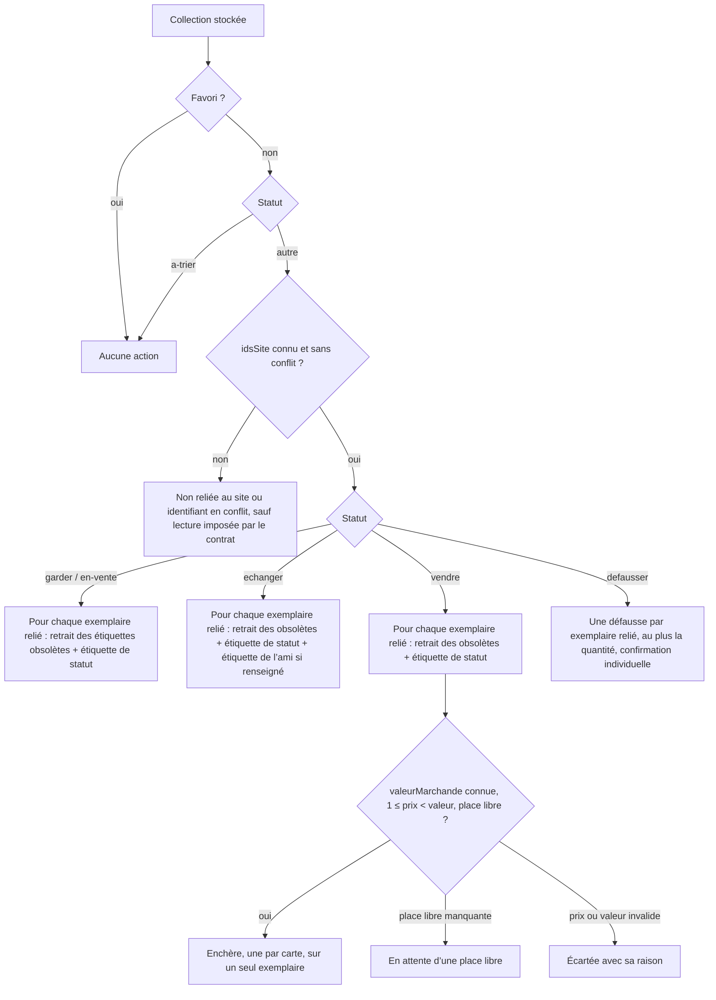
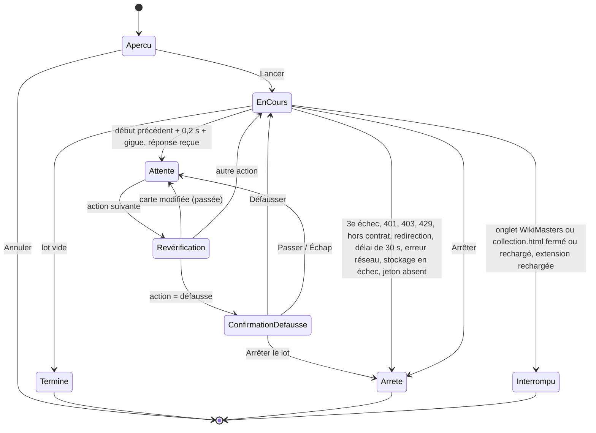

# Spec raffinée — Synchronisation complète : étiquettes, enchères et défausse appliquées sur le site


> **Amendement du 2026-11-12 (décision d’Alexis)** : « les lots sont correctement vendus, par contre pour les défausses il demande confirmation à chaque carte, enlève-la » (message d’Alexis dans le fil « Supprimer la confirmation à chaque défausse »). **Plus aucune confirmation avant une défausse** : ce qui précède sur la confirmation par carte (G2, H3, SC-009, SC-010, SC-021, diagramme d’états, D-24 à D-27 et D-43 du design, calcul de cadence du plan) est **retiré**. Garde-fous conservés : un seul « Lancer » après l’aperçu, plafond de valeur (5) même pour une décision manuelle, revérification avant l’envoi, arrêts sur 401, 403, 429, 409 et après 3 échecs. Risque rappelé et assumé : une défausse est définitive (aucune annulation) et le risque de bannissement demeure. Le détail des passages à réécrire est dans `retouches.md` § « À reprendre ».
- **Feature** : `synchro-complete` · **Auteur** : agent refine (à partir de `spec.md`, agent spec) · **Date** : 2026-11-07 (passe R1 le même jour)
- **Besoin d'origine** : « Synchronisation complète entre WikiMasters et l'extension : étiquettes (tags), mise en vente aux enchères et défausse des cartes, appliquées sur le site à partir des décisions de l'extension. »
- **Validation** : `spec.md` validée par Alexis le 2026-11-07 (voir `STATUS.md`), puis modifiée par lui (règle anti-masquage retirée d'AGENTS.md, trois Non-Goals supprimés, option B sur le jeton de session reportée dans AGENTS.md « Ne jamais faire »). Ce document la précise sans en changer l'intention. En cas d'écart avec `spec.md`, ce document fait foi (voir le Journal de relecture, R-37 à R-48).
- **Numérotation** : les SC-001 à SC-021 gardent le numéro de `spec.md`. Les SC-022 à SC-026 sont nouveaux. Aucun SC n'est renuméroté.
- **État du prérequis** : `specs/synchro-complete/contrat-api.md` existe. Il résume la capture réelle faite par Alexis le 2026-11-07 (captures brutes dans `captures-site/`, ignoré par git). Les trois écritures (étiquettes, enchère, défausse) et les lectures de la collection y sont capturées : SC-001 est franchi pour ces points. Les points de la section « Reste à relever » du contrat (hôte et en-têtes exigés de `/rest/v1`, mode d'authentification de `/api/`, filtre du `DELETE user_card_tags`, lien `card_id` ↔ `user_card_id`, limites et visibilité des étiquettes, bornes de `base_amount`, forme des erreurs 401, 403 et 429, réponses de création) restent à relever par Alexis. S'y ajoutent, au titre de SC-001, le nom de l'en-tête d'authentification et l'endroit où le site garde le jeton de session (jamais leur valeur). Le verdict de SC-002 se rend action par action à mesure de ces relevés ; tant qu'un point utile à un type d'action n'est pas relevé, ce type reste « non disponible » (absent de la table du contrat). Ce document ne nomme aucun point d'accès, champ ni format de requête : tout ce qui en dépend renvoie à `contrat-api.md`, et rien de ce qui y est marqué « non relevé » n'est deviné.

## 0. Décision d'Alexis et risque assumé

Décision prise par Alexis le 2026-11-07, en réponse aux questions du premier passage.

**Ce que fait la feature.** L'extension appelle directement **l'API interne de WikiMasters**, à la place du joueur, pour trois actions : poser ou retirer une étiquette, mettre une carte aux enchères, défausser une carte. C'est la portée la plus large qui ait été proposée (option C). Elle passe devant l'assistance sans clic et les clics simulés.

**Risque rappelé, et assumé par Alexis.** C'est l'option où le risque de bannissement du compte est **le plus élevé** :
- les règles de la communauté (section 3) interdisent les bots, scripts, macros et tout outil qui échange ou interagit à la place du joueur, ainsi que **la rétro-ingénierie et l'interception du trafic** pour obtenir un avantage. Or le contrat de l'API n'est pas public : pour le connaître, il faut observer le trafic du site, ce qui tombe sous cette interdiction ;
- les conditions d'utilisation (section 6) prévoient un bannissement pour automatisation ;
- le `robots.txt` du site contient `Disallow: /api/` ;
- une enchère lancée et une carte défaussée ne peuvent pas être annulées par l'extension. Une erreur de l'extension (mauvais prix, mauvaise carte) a donc des effets définitifs sur le compte ;
- l'extension lit en mémoire le jeton de session du compte pour s'authentifier comme le joueur (option B, voir « Jeton de session »).

**Levée ciblée de l'interdiction d'AGENTS.md** (« Tout code qui clique, envoie un formulaire ou appelle l'API interne du site à la place du joueur exige une décision explicite d'Alexis, écrite dans la spec »). Elle est **limitée** à ceci :
- **Autorisé** : des requêtes HTTP vers les seuls points d'accès de l'API de WikiMasters décrits dans `specs/synchro-complete/contrat-api.md` (voir SC-001), pour ces seules actions : poser une étiquette, retirer une étiquette posée par l'extension, créer une étiquette de l'extension si le site l'exige, mettre aux enchères, défausser. S'y ajoutent les lectures strictement nécessaires à ces actions (par exemple obtenir l'identifiant d'un exemplaire sur le site), si le contrat les impose. Ces requêtes portent, quand le contrat l'exige, l'en-tête d'authentification du site, dont la valeur est le jeton de session lu en mémoire par le seul module `src/lib/jeton.ts` (SC-017, SC-018).
- **Toujours interdit** : `click`, `submit`, `requestSubmit`, `dispatchEvent` et `focus` dans le code exécuté sur le site. L'option C n'en a pas besoin et ils restent bloqués par le lint. Restent aussi interdits : toute autre action de jeu (ouvrir des paquets, jouer, accepter ou proposer un échange, enchérir, acheter), tout autre point d'accès, toute requête vers un autre domaine, la suppression d'une étiquette sur le site (seul le retrait d'une étiquette posée sur une carte est autorisé), les appels annexes que le site fait de lui-même autour d'une action (H48).
- **Inchangé** : la cadence est fixe et régulière, et rien ne cherche à masquer l'automatisation : pas de délai aléatoire, pas de simulation de comportement humain, pas d'en-tête falsifié ni imité (`User-Agent`, `Referer`, `Origin`, `Cookie` ne sont jamais fixés ; voir SC-010, SC-017 et Constraints). Cette feature ne modifie pas AGENTS.md ; les amendements d'AGENTS.md du 2026-11-07 sont d'Alexis lui-même.

**Demande refusée.** Alexis a aussi demandé des délais aléatoires et le retrait de la règle d'AGENTS.md qui les interdisait. La spec validée ne retient pas les délais aléatoires : la cadence est fixe (SC-010).
> **Note de relecture.** Depuis la validation, Alexis a retiré lui-même cette règle d'AGENTS.md et trois Non-Goals de la spec. Le refus ne peut donc plus s'appuyer sur AGENTS.md. Il repose désormais sur cette spec seule : SC-010 (cadence fixe, aucun tirage aléatoire) et la contrainte « aucune tentative de masquage », toutes deux présentes dans le texte validé. Le raffinement ne transforme pas la demande refusée en fonctionnalité. Si Alexis veut des délais aléatoires, il doit modifier lui-même SC-010 et les Constraints, puis valider de nouveau (voir le Journal de relecture, R-01). L'option B sur le jeton de session n'ouvre aucune exception à cette règle.

**Réponses retenues.**

| # | Question | Réponse d'Alexis |
|---|---|---|
| 1 | Portée | C : appels directs à l'API interne pour les étiquettes, les enchères et la défausse |
| 2 | Confirmation | A : aperçu du lot dans `collection.html`, une validation pour tout le lot, plus une confirmation propre à chaque défausse |
| 3 | Rythme | B (révisée le 2026-11-12) : 0,2 s au minimum entre deux débuts de requête plus 0 à 0,1 s de gigue, ni plafond par minute ni plafond par session, arrêt après 3 erreurs |
| 4 | Journal | A : journal local horodaté dans `chrome.storage.local`, visible dans `collection.html`, bouton « Retirer l’étiquette » ; enchères et défausses marquées non annulables par l'extension |
| 5 | Jeton de session | B : lecture en mémoire du jeton dans un seul module, au moment d'émettre, jamais stocké, journalisé, affiché, copié dans `chrome.storage` ni envoyé hors de l'origine du site (AGENTS.md « Ne jamais faire », 2026-11-07) |

## 1. Goals
- G1 — Appliquer sur WikiMasters les décisions déjà prises dans l'extension (statuts, amis, prix de départ), en un lot validé une seule fois, sans refaire les actions carte par carte sur le site.
- G2 — Voir avant de lancer exactement ce qui sera envoyé au site. Confirmer une à une les défausses, seules actions qui détruisent une carte.
- G3 — Garder une trace locale, horodatée et consultable de tout ce que l'extension a fait sur le compte, et pouvoir défaire ce qui peut l'être (les étiquettes).
- G4 — Limiter les dégâts d'une erreur : garde-fous sur les cartes protégées, cadence plafonnée, arrêt automatique, arrêt manuel immédiat, jeton de session confiné.

## 2. Scope
**Inclus**
- **Étape 0, investigation (prérequis, sans code)** : Alexis observe lui-même, dans les outils de développement de Chrome, les requêtes du site pour les actions retenues. Les captures brutes restent dans `captures-site/` (déjà ignoré par git). Un résumé sans donnée sensible est écrit dans `specs/synchro-complete/contrat-api.md` (fait le 2026-11-07 ; relevés restants listés dans le contrat). Un type d'action n'est codé contre le site qu'une fois ses points relevés et le verdict de SC-002 rendu pour lui. Les agents n'écrivent pas ce document à la place d'Alexis et ne déduisent rien du site par eux-mêmes.
- **Construction du lot** (logique pure, sans `chrome.*`) à partir des cartes stockées. Elle produit une liste ordonnée d'actions (création d'étiquette, retrait d'étiquette, pose d'étiquette, enchère, défausse, et lecture si le contrat l'impose) avec leurs paramètres, filtrée par les garde-fous. Chaque action qui vise une carte vise un seul exemplaire relié (H43). Elle produit aussi la liste des cartes écartées, chacune avec sa raison.
- **Étiquettes** : une étiquette par ami (pour les cartes `echanger` dont l'`ami` est renseigné) et une étiquette par statut (`garder`, `echanger`, `vendre`, `en-vente`), posées sur chaque exemplaire relié de la carte (H44). L'extension ne pose, ne remplace et ne retire que les étiquettes de son registre.
- **Enchères** : mise aux enchères des cartes `vendre`, de la plus chère à la moins chère, au prix de départ de la carte, dans la limite des places libres (`maxVentesSimultanees`). Une enchère par carte et par lot, sur un seul exemplaire (H45).
- **Défausse** : défausse des cartes `defausser`, un exemplaire relié par action, chaque action après sa propre confirmation (H46).
- **Aperçu du lot** dans `collection.html` (variante 1 des wireframes, adaptée) : rappel du risque, durée estimée, une validation unique « Lancer », un bouton « Arrêter » actif pendant l'exécution.
- **Exécution** depuis l'unique onglet WikiMasters ouvert, à la cadence la plus rapide (0,2 s au minimum entre deux débuts de requête plus 0 à 0,1 s de gigue, sans plafond par minute), avec arrêt après 3 erreurs.
- **Jeton de session** : lecture en mémoire par le seul module `src/lib/jeton.ts`, importé seulement par `src/lib/reseau.ts`, pour les seuls types d'action dont le contrat exige l'authentification (SC-018).
- **Mise à jour locale** après chaque action réussie (statut `en-vente`, quantité, identifiants d'exemplaire, registre des étiquettes).
- **Journal** local horodaté, persistant, consultable dans `collection.html`, avec « Retirer l’étiquette » sur les étiquettes posées.
- **Migration** du schéma de stockage de la collection (`version: 1` → `version: 2`, ajout des identifiants d'exemplaire sur le site, `idsSite`). Le registre des étiquettes, le journal et l'état d'exécution sont stockés sous des clés à part, chacune versionnée.
- **Lint** : nouvelles interdictions (réseau hors `src/lib/reseau.ts` ; lecture des cookies et du stockage du site hors `src/lib/jeton.ts` ; import de `jeton.ts` hors `reseau.ts`), voir SC-017 et SC-018.

**Exclu**
- Toute action autre que les trois retenues : ouvrir des paquets, jouer, proposer ou accepter un échange, enchérir, acheter, retirer une enchère en cours, récupérer une carte défaussée, supprimer une étiquette du site.
- Les clics simulés et le remplissage de formulaires du site (option B des portées), et l'assistance sans clic (variante 3).
- L'annulation d'une enchère ou d'une défausse par l'extension.
- La lecture de l'état des enchères sur le site pour compter les places libres (le joueur l'indique, comme dans `FileVente`), sauf si le contrat de l'API impose cette lecture pour lancer une enchère.
- La reproduction des appels que le site fait de lui-même autour d'une action (relecture du profil après une défausse, relecture d'une enchère créée), H48.
- L'exécution sans onglet WikiMasters ouvert, en arrière-plan ou planifiée.
- La fin d'une enchère : elle reste déclarée à la main avec « Enchère terminée » dans `FileVente`.
- Toute exécution de code dans le monde principal de la page pour atteindre le jeton (H41).
- Toute modification d'AGENTS.md par la feature.

## 3. Success Criteria

Vocabulaire commun à tous les SC :
- **Requête vers le site** : toute requête HTTP émise par le module réseau `src/lib/reseau.ts` (SC-017), lectures comprises.
- **Action** : un élément du lot. Une action émet une requête vers le site, ou aucune si elle est passée.
- **Exemplaire relié** : exemplaire d'une carte dont l'identifiant sur le site (`user_card_id` du contrat) figure dans `idsSite` de la carte (SC-024).
- **Site simulé** : en e2e, l'origine WikiMasters est servie par Playwright (`page.route`) avec une page et des réponses fictives conformes à `contrat-api.md`, et un jeton témoin fictif. Aucune donnée ne vient de `captures-site/`.
- **Table du contrat** : constante qui liste, par type d'action, la méthode, le modèle de chemin, le corps et l'exigence d'authentification (nom de l'en-tête et forme de sa valeur, jamais une valeur réelle) repris de `contrat-api.md`. Un type d'action sans entrée est « non disponible ».

| ID | Critère (page/module · action · résultat observable · seuil) | Vérifiable par |
|---|---|---|
| SC-001 | **Investigation, avant tout code.** `specs/synchro-complete/contrat-api.md` existe. Il est écrit par Alexis ou à partir de ses captures, jamais deviné. Il décrit, pour chacune des actions retenues (poser une étiquette, retirer une étiquette, créer une étiquette si nécessaire, mettre aux enchères, défausser, lecture nécessaire s'il y en a) : méthode, chemin, champs du corps, en-têtes exigés (nom seulement pour l'en-tête d'authentification), réponses de succès et d'erreur observées, et l'origine de l'identifiant d'exemplaire attendu par le site. Il précise aussi : l'origine exacte de l'API (même origine que l'onglet ou non) ; si l'identifiant désigne une carte ou un exemplaire (relevé : `user_card_id` désigne un exemplaire) ; le mode d'authentification de chaque famille de chemins (cookies de même origine ou jeton) et l'endroit où le site garde le jeton de session, lisible ou non depuis un content script ; les limites de nombre et de longueur des étiquettes ; si les étiquettes sont visibles des autres joueurs ; les paramètres d'enchère exigés autres que le prix (durée par exemple) avec la valeur par défaut du formulaire du site ; les bornes de prix. Les captures brutes sont dans `captures-site/` et `git check-ignore captures-site/` renvoie le chemin. Le document ne contient ni cookie, ni valeur de jeton, ni valeur d'en-tête d'authentification, ni pseudo, ni donnée de compte, ni identifiant réel de carte. Cette étape ne modifie aucun fichier de `src/`. | manuel (relecture) + `git check-ignore` |
| SC-002 | **Point d'arrêt.** La feature s'arrête **pour l'action concernée** (issue `sdd-escalade`, aucune tâche de code pour cette action) si `contrat-api.md` montre l'un de ces cas : (a) l'action exige de lire, copier ou envoyer explicitement un cookie, un jeton anti-CSRF ou tout autre secret que le jeton de session (au-delà des cookies que le navigateur joint seul à une requête de même origine), ou le jeton de session n'est lisible que par du code exécuté dans le monde principal de la page (H41). **Le jeton de session lui-même n'arrête plus la feature** : Alexis a choisi l'option B le 2026-11-07 et AGENTS.md l'autorise, aux conditions de la section « Jeton de session » ; (b) aucun moyen fiable ne relie une carte de l'extension aux identifiants de ses exemplaires sur le site, ou plusieurs cartes du site partagent le même `rareté\|titre` sans moyen de les distinguer ; (c) l'action exige un en-tête autre que `Content-Type`, `Accept` et l'en-tête d'authentification qui porte le jeton de session (H40) ; (d) l'API est sur une autre origine que l'onglet WikiMasters ; (e) un paramètre exigé ne peut être ni déduit de l'extension ni fixé par un réglage. Si les trois actions (étiquettes, enchères, défausse) sont arrêtées, toute la feature s'arrête. | manuel |
| SC-003 | **Module de lot** (logique pure) · construire le lot à partir d'une collection · une carte `favori: true` ne produit **aucune** action (ni étiquette, ni retrait, ni enchère, ni défausse), quel que soit son statut. Seuil : 0 action sur un jeu de test où chaque statut est présent avec `favori: true`, y compris pour une carte qui porte au registre une étiquette obsolète. | unitaire |
| SC-004 | Module de lot · une carte au statut `a-trier` ne produit **aucune** action, même si elle porte au registre une étiquette obsolète. Seuil : 0 action. | unitaire |
| SC-005 | Module de lot · le lot se construit à partir du statut stocké, sans appeler l'assistant de tri. Une carte `decidePar: 'moi'` produit l'action de son statut manuel même si l'assistant proposerait autre chose. Seuil : sur un jeu où la proposition de l'assistant diffère du statut manuel, 100 % des actions suivent le statut manuel. | unitaire |
| SC-006 | Module de lot · enchères. Places libres = `max(0, maxVentesSimultanees − nombre de cartes en-vente)`. Le lot contient au plus ce nombre d'actions d'enchère, au plus une par carte, chacune sur un seul exemplaire désigné selon H45. Prix de départ = `prixCible` s'il est renseigné, sinon `prixDepart(valeurMarchande)` de la matrice. Les enchères sont triées par prix de départ décroissant, puis par valeur marchande décroissante, puis par `id` croissant. Une carte n'a aucune enchère dans quatre cas, chacun listé dans l'aperçu avec sa raison : `valeurMarchande` absente (la valeur de repli par rareté ne suffit pas), prix de départ absent ou inférieur à 1, prix de départ supérieur ou égal à la valeur marchande, carte non reliée au site. Les cartes valides au-delà des places libres apparaissent dans l'aperçu comme « en attente d’une place libre », sans action. | unitaire |
| SC-007 | Module de lot · étiquettes, pour toute carte hors favori, `a-trier` et `defausser`, et pour **chaque exemplaire relié** de cette carte (H44). (a) L'exemplaire reçoit l'étiquette du statut de la carte, « Statut · <libellé> ». C'est vrai aussi pour une carte `vendre` en attente d'une place libre. (b) Si la carte est `echanger` et que son `ami` est renseigné (après suppression des espaces aux extrémités), l'exemplaire reçoit aussi « Ami · <nom> ». (c) Toute étiquette de l'extension inscrite au registre pour cet exemplaire et qui n'est plus attendue (ancien statut, ancien ami) reçoit une action de retrait. (d) Un couple (exemplaire, étiquette) déjà inscrit au registre et attendu ne produit aucune action. (e) Aucune action de retrait ne vise un couple absent du registre. (f) Une pose ne vise qu'une étiquette créée par l'extension ou une étiquette dont le contrat dit qu'elle n'a pas besoin d'être créée. Si le site exige une création, le lot contient au plus une action de création par nom, avant la première pose de ce nom, et aucune pour un nom déjà créé au registre. Un nom qui dépasse la limite du contrat, ou qui reprend celui d'une étiquette créée par le joueur, ne produit aucune action et est signalé dans l'aperçu. | unitaire |
| SC-008 | `collection.html` · ouvrir l'aperçu · chaque action du lot est listée avec la carte (rareté et titre), le type d'action et le détail (nom de l'étiquette, prix de départ et valeur marchande, ou « défausse » avec « exemplaire k sur n »). L'aperçu affiche aussi le total par type, la durée estimée (nombre de requêtes × 0,25 s, arrondi à la minute supérieure) et les cartes écartées avec leur raison (« non reliée au site », « identifiant en conflit », « en attente d’une place libre », « action non disponible », etc.). Le rappel du risque (règles § 3, CGU § 6, `robots.txt`) précède le bouton « Lancer » dans l'ordre du document. Tant que « Lancer » n'est pas activé, **0** requête vers le site n'est émise, lectures comprises, et le jeton de session n'est pas lu. | e2e (site simulé) |
| SC-009 | `collection.html` · pendant l'exécution, à chaque défausse · un dialogue propre à l'exemplaire s'affiche (rareté, titre, « exemplaire k sur n », n étant le nombre de défausses de cette carte dans le lot). Sans « Défausser cette carte », aucune requête de défausse n'est émise. « Passer » ou Échap saute cet exemplaire et l'inscrit au journal comme « passée ». « Arrêter le lot » arrête l'exécution comme SC-012. Le focus initial est sur « Passer ». Seuil : 0 requête de défausse sans confirmation. | e2e (site simulé) |
| SC-010 | Module d'exécution · cadence. Le début de chaque requête vers le site (lectures comprises) a lieu à la plus tardive de ces trois dates : début de la requête précédente + 6 000 ms ; réception de la réponse précédente ; confirmation de la défausse si l'action en demande une. Quand la réponse et la confirmation arrivent avant 6 000 ms, l'intervalle vaut 6 000 ms (± 50 ms). Il n'est jamais inférieur à 5 950 ms. Aucune fenêtre glissante de 60 s ne contient plus de 10 requêtes. Une action passée, ou arrêtée faute de jeton (SC-011 (b)), n'émet rien et n'avance pas la date de la requête suivante. Le code ne contient aucun tirage aléatoire (`Math.random`, `crypto.getRandomValues`, `crypto.randomUUID`) dans le module d'exécution, le module réseau ni le module jeton, ni aucun délai qui varie d'une requête à l'autre. | unitaire (horloge simulée) + lint/grep |
| SC-011 | Module d'exécution · erreurs. (a) Une réponse non 2xx qui n'est pas dans la liste (b) compte comme un échec. À la 3e action en échec d'un même lot (en cumul, passées exclues), l'exécution s'arrête et aucune requête suivante n'est émise. (b) Arrêtent l'exécution dès la première occurrence : réponse 401, 403 ou 429 ; réponse 2xx dont la forme ne correspond pas au contrat ; redirection ; absence de réponse après 30 s ; erreur réseau ; échec d'écriture dans `chrome.storage.local` ; jeton de session absent ou illisible pour un type qui l'exige (aucune requête émise, journalisé « jeton de session absent : reconnectez-vous sur le site », H42). (c) Le journal indique la cause de l'arrêt, en libellé fixe de l'extension. Une absence de réponse ou une erreur réseau est journalisée « résultat inconnu, à vérifier sur le site », et l'état local n'est pas modifié. | unitaire |
| SC-012 | `collection.html` · cliquer « Arrêter », ou appuyer sur Échap quand le focus est dans la zone d'exécution et qu'aucun dialogue n'est ouvert · aucune nouvelle requête n'est émise après le clic. Une requête déjà partie peut aboutir et est journalisée. Seuil : 0 requête émise plus de 100 ms après le clic. | e2e (site simulé) |
| SC-013 | Exécution interrompue (onglet WikiMasters fermé ou rechargé, `collection.html` fermée ou rechargée, service worker endormi, extension rechargée) · l'exécution ne reprend jamais seule et les actions restantes ne sont pas émises. Le journal porte une entrée « interrompue » pour le lot. Il porte aussi, pour l'action dont la requête était partie sans réponse, « interrompue, résultat inconnu, à vérifier sur le site ». À la réouverture de `collection.html`, un lot resté « en cours » au stockage sans exécution active est clos de cette façon. | e2e (site simulé) |
| SC-014 | Module de stockage · après chaque action réussie, l'état local est mis à jour : enchère → statut `en-vente`, quantité et `idsSite` inchangés ; défausse → l'identifiant de l'exemplaire défaussé est retiré de `idsSite` (`null` s'il n'en reste aucun), ses couples du registre sont purgés, la quantité diminue de 1, et la carte est retirée à 0 avec toutes ses entrées du registre ; étiquette créée → identifiant d'étiquette du site inscrit au registre ; étiquette posée ou retirée → couple (exemplaire, étiquette) ajouté ou retiré du registre. Une action en échec, passée ou au résultat inconnu ne modifie pas l'état local. | unitaire |
| SC-015 | Journal · chaque action produit une entrée. Pour une action qui émet une requête, l'entrée est écrite « en cours » avant l'envoi, puis complétée. Champs : horodatage ISO 8601, identifiant local et titre de la carte, type d'action, paramètres (étiquette ou prix), résultat (réussie, échouée, passée, interrompue, résultat inconnu) et code HTTP (vide s'il n'y en a pas). Les entrées survivent au rechargement de `collection.html` et de l'extension. Le journal garde les 1 000 dernières entrées : la plus ancienne sort en premier. Aucune entrée ne contient de cookie, de jeton, d'en-tête, d'identifiant d'exemplaire sur le site ni de corps de réponse brut. | unitaire + e2e |
| SC-016 | `collection.html` · journal. Le bouton « Retirer l’étiquette » apparaît sur l'entrée de pose réussie la plus récente de chaque couple (carte, étiquette) dont au moins un exemplaire porte encore l'étiquette au registre. Il est désactivé, avec sa raison, sans onglet WikiMasters ou si le type « retrait » est non disponible. Un clic crée une action de retrait par exemplaire de la carte qui porte cette étiquette au registre (H49). Hors exécution, elles forment un lot lancé par ce clic. Pendant une exécution, elles s'ajoutent en fin de file. Les retraits passent par la même file à cadence fixe, sont journalisés et retirent les couples du registre. Les entrées d'enchère et de défausse réussies portent la mention « Non annulable par l’extension » et n'ont aucun bouton d'annulation. | e2e (site simulé) |
| SC-017 | Confinement réseau et en-têtes. Les requêtes vers le site partent du seul module `src/lib/reseau.ts`. La configuration du lint interdit `fetch`, `XMLHttpRequest`, `WebSocket`, `EventSource` et `navigator.sendBeacon` dans tout `src/`, sauf dans ce module. Le module refuse, sans rien émettre ni lire le jeton : toute URL hors de l'origine de l'onglet WikiMasters (`https://www.wiki-masters.com`), toute méthode ou tout chemin hors de la table du contrat, tout identifiant qui ne passe pas la validation. Un identifiant placé dans un chemin ou un paramètre de requête est encodé (`encodeURIComponent`). **En-têtes fixés par le code** : uniquement `Content-Type`, `Accept` et, pour les seuls types dont l'entrée de la table du contrat exige l'authentification, l'en-tête d'authentification nommé dans `contrat-api.md` (par exemple `Authorization` si c'est celui que le site exige), dont la valeur est fournie par `src/lib/jeton.ts` au moment d'émettre (H39). Jamais `User-Agent`, `Referer`, `Origin`, `Cookie`, ni aucun en-tête qui imite le navigateur ou le site, ou qui sert à masquer l'automatisation. Seuil : pour chaque type de la table, l'ensemble des noms d'en-têtes fixés est exactement celui attendu ; un type sans exigence d'authentification n'appelle pas `jeton.ts` et ne porte pas l'en-tête. Les redirections ne sont pas suivies, et les cookies ne partent que vers la même origine. `click`, `submit`, `requestSubmit`, `dispatchEvent` et `focus` restent interdits par le lint dans tout le code exécuté sur le site, et `npm run lint` passe. | unitaire + lint |
| SC-018 | Secrets et jeton de session. (a) **Seul `src/lib/jeton.ts` lit le jeton de session du site**, en mémoire, à l'endroit décrit par `contrat-api.md`, au moment d'émettre une requête qui l'exige, après avoir vérifié que l'URL est sur l'origine de l'onglet. Il ne s'exécute que dans le content script, n'est importé que par `src/lib/reseau.ts`, ne garde aucun cache (relu à chaque requête) et n'extrait que la valeur du jeton (aucun autre cookie ni aucune autre clé n'est conservé). (b) Le lint interdit `document.cookie`, `cookieStore`, `localStorage`, `sessionStorage` et `indexedDB` dans tout `src/` sauf `src/lib/jeton.ts` (sans aucune exception tant que ce module n'existe pas), interdit l'import de `jeton.ts` ailleurs que dans `reseau.ts`, et interdit `console` dans ces deux modules. Un test lance ESLint sur des fichiers témoins hors `jeton.ts` (accès direct, `window['localStorage']`, `globalThis.document.cookie`, import de `jeton.ts` depuis `src/content/` ou `src/app/`) et exige une erreur pour chacun. (c) Avec un jeton témoin fictif, un lot complet (transport et stockage fictifs) ne fait apparaître le jeton dans aucun message entre contextes, résultat, message d'erreur, entrée de journal, écriture de `chrome.storage`, appel `console`, ni dans aucune requête autre que celles vers l'origine du site qui l'exigent. Seuil : 0 occurrence. `collection.html` et le service worker ne le reçoivent jamais. (d) Aucun code ne lit un en-tête d'authentification ni `Set-Cookie` d'une réponse, et aucune requête ne fixe `Cookie`. (e) Le manifeste garde la seule permission `storage` ; toute permission ou `host_permissions` supplémentaire est justifiée dans la PR qui l'ajoute. | lint + unitaire + relecture sécurité |
| SC-019 | Migration. Une collection stockée au schéma `version: 1` est migrée vers `version: 2` sans perte : 100 % des cartes, statuts, prix, notes, amis, valeurs marchandes, favoris et `decidePar` conservés, et `idsSite` à `null` pour chaque carte. La migration est idempotente. Une donnée stockée illisible n'est jamais écrasée (comportement actuel conservé). Le fichier d'échange JSON reste au format `version: 1` : un fichier `version: 1` existant s'importe (un champ `idsSite` éventuel y est ignoré), l'export JSON écrit `version: 1` sans `idsSite` et reste lisible par l'import. Les colonnes de l'export CSV ne changent pas. | unitaire |
| SC-020 | `collection.html` · « Lancer » est désactivé, avec un message qui dit pourquoi, dans chacun de ces cas : aucun onglet WikiMasters ouvert ; plus d'un onglet WikiMasters ouvert ; une exécution déjà en cours (dans cet onglet ou un autre de l'extension) ; aucune action du lot n'est disponible (table du contrat vide pour tous ses types). Une action dont le type est non disponible est listée « action non disponible » et ne compte pas dans « Lancer les N actions ». Une collection vide, ou un lot sans action, affiche « Aucune action à envoyer ». | e2e |
| SC-021 | Accessibilité. Aperçu, confirmations et journal sont utilisables au clavier seul. La confirmation de défausse est un dialogue (`role="dialog"`, `aria-modal="true"`, titre relié par `aria-labelledby`) qui piège le focus, le reçoit à l'ouverture et le rend à l'élément d'origine à la fermeture. Progression, résultats et arrêts sont annoncés par une région `aria-live="polite"`. Contrastes AA (4,5:1 pour le texte normal) dans les deux thèmes. Aucune perte de contenu à 375 px. Cibles d'au moins 44 px. Avec `prefers-reduced-motion: reduce`, aucune animation ni transition sur la progression. Captures à 375, 768 et 1280 px, dans les deux thèmes. | e2e + capture |
| SC-022 | Module d'exécution · revérification. Juste avant chaque requête, l'action est revérifiée contre l'état stocké à cet instant. Si la carte n'existe plus, est devenue favori, a changé de statut, de prix de départ ou d'ami, ou si l'identifiant d'exemplaire visé n'est plus dans son `idsSite`, l'action est « passée (carte modifiée) », sans requête. Seuil : 0 requête pour une carte modifiée après l'ouverture de l'aperçu. | unitaire |
| SC-023 | Module d'exécution · une seule exécution à la fois et une seule requête en vol. Aucune requête ne part avant la réponse (ou l'arrêt) de la précédente. Un second « Lancer », depuis le même onglet de `collection.html` ou un autre, est refusé tant qu'une exécution est en cours. | unitaire + e2e |
| SC-024 | Module de lot · identifiants d'exemplaire sur le site. Chaque carte porte `idsSite: string[] \| null` : `null` = inconnu ; sinon un tableau non vide d'identifiants distincts, chacun valide (Constraints, Sécurité). Une carte à `idsSite: null` est listée « non reliée au site », sans action, sauf si le contrat impose une lecture pour obtenir les identifiants : la lecture est alors une action du lot, émise après « Lancer », soumise à la cadence et au journal. Un identifiant présent dans `idsSite` de deux cartes rend ces deux cartes « identifiant en conflit », sans action (H47). Les identifiants ne viennent que du site (lecture de `/collection` ou lecture prévue par le contrat), jamais d'un fichier importé ; un import conserve `idsSite` de la carte existante. Chaque action qui vise une carte porte un seul identifiant, pris dans `idsSite` (H44 à H46). Seuil : 0 action pour une carte non reliée ou en conflit. | unitaire |
| SC-025 | Performance. Pour une collection fictive de 5 000 cartes, la construction du lot prend moins de 500 ms (unitaire) et l'aperçu s'affiche moins de 500 ms après le clic qui l'ouvre (e2e). | unitaire + e2e |
| SC-026 | Quota. Avec 1 000 entrées de journal aux longueurs maximales des champs (titre de 300 caractères, nom d'ami de 300 caractères) et un registre de 2 étiquettes par exemplaire relié, le journal sérialisé pèse au plus 1 Mo et le registre compte au plus 2 couples par exemplaire relié, plus une entrée par étiquette créée. Si une écriture échoue, SC-011 (b) s'applique. | unitaire |

### 3.1 Ce qui dépend du site et ce qui n'en dépend pas

L'ordre de `spec.md` reste imposé : **aucune tâche de code avant que SC-001 et SC-002 soient franchis** pour au moins une action. Cette répartition sert au plan. Après le gate, la partie A peut avancer sans attendre l'intégration du contrat. Si SC-002 arrête une action, la partie A reste valable pour les actions restantes.

**A. Indépendant du site** (aucun point d'accès, champ ni format de requête nécessaire ; la logique se teste avec un transport et une source de jeton fictifs injectés) :
- types du lot, des actions, du registre et du journal ; champ `idsSite` et granularité par exemplaire (H43 à H47, H49) ;
- construction du lot et garde-fous : SC-003, SC-004, SC-005, SC-006, SC-007 (a à e, et règles sur les noms d'étiquettes), SC-024 (cas « non reliée au site » et « identifiant en conflit ») ;
- file d'actions, cadence, une seule requête en vol, arrêt : SC-010, SC-011 (classement des codes HTTP, délai, cumul, jeton absent), SC-022, SC-023 ;
- mise à jour locale et journal : SC-014, SC-015, SC-026 ;
- migration et compatibilité des exports : SC-019 ;
- interface : aperçu, dialogue de défausse, bouton « Arrêter », journal, états désactivés, accessibilité : logique et rendu de SC-008, SC-009, SC-012, SC-016, SC-020, SC-021 ; performance SC-025 ;
- lint : interdictions réseau, cookies et stockage du site, sans exception tant que `jeton.ts` n'existe pas (SC-017 et SC-018 (b), hors table du contrat) ; en-têtes limités à `Content-Type` et `Accept` tant que la table est vide.

**B. Dépendant du contrat** (`contrat-api.md`, points « Reste à relever » compris) :
- SC-001 et SC-002 eux-mêmes ;
- table du contrat (méthodes, modèles de chemin, corps, exigence d'authentification par type), validation de la forme des réponses (SC-011 « hors contrat », SC-017 « chemins du contrat ») ;
- module `src/lib/jeton.ts` et son branchement dans `reseau.ts` (SC-017 en-tête d'authentification, SC-018 (a) et (c)), une fois relevés le nom de l'en-tête et l'endroit du jeton ;
- origine des identifiants d'exemplaire, et lecture éventuelle pour les obtenir (SC-024) ; lien entre l'identifiant d'enchère et l'exemplaire (H45) ;
- nécessité de créer une étiquette, limites de noms, détection d'un homonyme créé par le joueur, visibilité des étiquettes (SC-007 (f), H34, H35) ;
- paramètres d'enchère autres que le prix, bornes de prix (H33) ;
- fixtures du site simulé, donc vérification e2e de SC-008, SC-009, SC-012, SC-013, SC-016. Le comportement de ces SC relève de A ; seule leur preuve e2e attend le contrat.

## 4. Constraints
- **Délai** : aucun délai imposé. Ordre imposé : SC-001 et SC-002 sont franchis avant toute tâche de code pour l'action concernée. Le contrat est écrit à partir de la capture réelle faite par Alexis, jamais deviné.
- **Rétrocompatibilité** : le schéma de stockage de la collection passe à `version: 2`, avec une migration depuis `version: 1` (SC-019). Le fichier d'échange JSON reste en `version: 1`. Les exports CSV et JSON gardent leurs colonnes et leurs champs. Le registre, le journal et l'état d'exécution sont des clés nouvelles, versionnées, absentes des exports.
- **Performance** : SC-025 (500 ms pour 5 000 cartes). Durée d'un lot : 0,25 s par requête en moyenne, sans plafond par session (choix d'Alexis). La durée estimée est affichée (SC-008).
- **Quota** : SC-026. Un échec d'écriture arrête l'exécution (SC-011).
- **Accessibilité** : voir SC-021. `prefers-reduced-motion` coupe toute animation de progression. Cibles d'au moins 44 px.
- **Thèmes** : couleurs uniquement via `src/styles/tokens.css`. Le bandeau de risque et les mentions « Non annulable » utilisent des tokens existants ou des tokens ajoutés d'abord dans `design.md`.
- **Cadre WikiMasters** : action sur le site à la place du joueur, **décidée par Alexis le 2026-11-07, risque de bannissement écrit en section 0**. Limites : seuls les points d'accès de `contrat-api.md`, même origine que l'onglet, aucun secret lu ni stocké hormis le jeton de session lu en mémoire aux conditions ci-dessous, en-têtes limités à `Content-Type`, `Accept` et l'en-tête d'authentification exigé par le contrat (SC-017), cadence fixe de 10 requêtes par minute au plus, aucune tentative de masquage (pas de délai aléatoire, pas de simulation de comportement humain, pas d'en-tête falsifié ou imité : `User-Agent`, `Referer`, `Origin` et `Cookie` ne sont jamais fixés). `click`, `submit`, `requestSubmit`, `dispatchEvent` et `focus` restent interdits.
- **Garde-fous non négociables** : un lot ne touche jamais une carte favori ; il ne touche jamais une carte `a-trier` ; `maxVentesSimultanees` est respecté ; `decidePar: 'moi'` prime sur toute proposition ; une seule requête en vol à la fois ; une seule exécution à la fois ; aucune reprise automatique ; revérification avant chaque requête (SC-022) ; jamais plus de défausses pour une carte que sa quantité locale (H46).
- **Vie privée** : le journal et le registre ne gardent que ce qui sert à l'utilisateur (carte, action, paramètres, résultat, code HTTP ; le registre garde en plus les identifiants d'exemplaire et d'étiquette du site, nécessaires aux retraits). Rien n'est envoyé ailleurs qu'au site WikiMasters lui-même. Les noms d'amis ne quittent l'extension que dans les étiquettes « Ami · <nom> », que le joueur voit dans l'aperçu avant « Lancer ».
- **Sécurité** : les réponses de l'API sont des données non fiables. Elles sont validées contre la forme du contrat et ne sont jamais affichées par `innerHTML` ni `dangerouslySetInnerHTML`. Chaque identifiant sur le site (exemplaire ou étiquette) est validé (chaîne non vide de 200 caractères au plus, forme du contrat) puis encodé dans l'URL. Le jeton de session suit la section ci-dessous.

### Jeton de session (décision d'Alexis, option B, 2026-11-07)
AGENTS.md (« Ne jamais faire ») autorise la lecture **en mémoire** du jeton de session du site, dans **un seul module désigné par le plan : `src/lib/jeton.ts`**, au moment d'émettre une requête vers l'origine du site. Conditions : jamais stocké, journalisé, affiché, copié dans `chrome.storage`, ni envoyé ailleurs qu'à l'origine du site. `jeton.ts` n'est importé que par `src/lib/reseau.ts`, qui seul pose l'en-tête d'authentification avec la valeur lue, sans la garder dans une variable de module, un résultat ou une erreur. Vérification outillée : SC-018 (b) (lint et fichiers témoins) et SC-018 (c) (jeton témoin, 0 occurrence hors requêtes autorisées). Si le jeton n'est lisible que depuis le monde principal de la page, SC-002 (a) s'applique (H41). Cette autorisation ne lève ni le rappel du risque de bannissement, ni la cadence fixe, ni l'interdiction de masquer l'automatisation.

## 5. Non-Goals
- Pas d'automatisation d'autres actions de jeu (paquets, parties, échanges, enchères sur les cartes des autres, achats).
- Pas d'annulation d'enchère ni de récupération de défausse par l'extension.
- Pas d'exécution planifiée, en arrière-plan ou sans onglet WikiMasters ouvert.
- Pas de plafond par session (choix d'Alexis) : seul l'arrêt sur erreur limite un lot (plus de plafond par minute depuis le 2026-11-12).

## Visuels

Variante retenue : `specs/synchro-complete/wireframes/variante-1.html` (aperçu du lot dans `collection.html`), avec ces écarts : plus de plafond de session, cadence affichée « 0,2 s + 0 à 0,1 s », durée estimée, arrêt après 3 erreurs, bouton « Arrêter » pendant l'exécution, cartes écartées avec leur raison, mention « Non annulable par l’extension » au journal, troisième bouton « Arrêter le lot » dans le dialogue de défausse. Les variantes 2 (panneau sur le site, clic par clic) et 3 (assistance sans clic) ne sont pas retenues.

```
collection.html › Synchronisation avec WikiMasters
┌──────────────────────────────────────────────────────────────┐
│ ! Action sur le site à votre place                           │
│   Règles § 3 (rétro-ingénierie, interception du trafic),     │
│   CGU § 6, robots.txt « Disallow: /api/ ». Risque de         │
│   bannissement accepté le 07/11/2026.                        │
├──────────────────────────────────────────────────────────────┤
│ Lot prêt : 12 actions · 6 étiquettes · 3 enchères · 3 défausses│
│ Durée estimée : 2 min                                        │
│ Carte            │ Action                 │ Détail           │
│ [R] Titre        │ Mettre aux enchères    │ départ 50 · v 140│
│ [C] Titre        │ Étiquette « Ami · Léa »│ thème d’un ami   │
│ [C] Titre        │ Défausser              │ exemplaire 1 / 1 │
│ … 2 ventes en attente d’une place libre (5 / 5)              │
│ … 4 cartes non reliées au site · 1 prix ≥ valeur marchande   │
│ Cadence : 0,2 s + 0 à 0,1 s · arrêt après 3 erreurs │
│ [ Lancer les 12 actions ]  [ Annuler ]                       │
├──────────────────────────────────────────────────────────────┤
│ En cours : 4 / 12 · 0 erreur        [ Arrêter ]  (aria-live) │
├──────────────────────────────────────────────────────────────┤
│ Journal                                     [ Vider ]        │
│ 2026-11-07 14:02:11 · [R] Titre · enchère à 50 · réussie     │
│                      Non annulable par l’extension           │
│ 2026-11-07 14:02:17 · [C] Titre · étiquette « Ami · Léa » ·  │
│                      réussie · [ Retirer l’étiquette ]       │
│ 2026-11-07 14:02:23 · arrêt : réponse 429                    │
└──────────────────────────────────────────────────────────────┘

Dialogue de défausse (focus piégé, focus initial sur Passer, Échap = Passer)
┌──────────────────────────────────────────────┐
│ Défausser [C] Titre de carte ?               │
│ Exemplaire 1 sur 2.                          │
│ Cette action est définitive sur le site.     │
│ [ Défausser cette carte ] [ Passer ]         │
│ [ Arrêter le lot ]                           │
└──────────────────────────────────────────────┘
```





## Hypothèses

Adoptées par défaut. H1 à H12 viennent de `spec.md` (certaines sont précisées). H13 et les suivantes sont des décisions du raffinement ; H39 à H49 viennent de la passe R1.

- H1 — *(précisée en R1)* Les requêtes partent du content script de l'onglet WikiMasters (même origine). Le navigateur joint seul les cookies de même origine ; l'extension ne lit aucun cookie, sauf, si le contrat montre que le jeton de session y est gardé, la seule valeur du jeton lue par `src/lib/jeton.ts`. Aucune `host_permissions` n'est ajoutée. Si le contrat l'empêche, SC-002 (d) s'applique.
- H2 — Le lot couvre toute la collection locale, pas seulement la page `/collection` affichée. Une carte dont les identifiants sur le site sont inconnus est listée « non reliée au site », sans action (SC-024).
- H3 — *(précisée)* Une enchère porte sur une carte et un seul exemplaire, et il y en a au plus une par carte et par lot : le statut `en-vente` est porté par la carte et les places libres comptent les cartes. Une défausse porte sur un exemplaire relié : une carte `defausser` produit une action par exemplaire relié, au plus sa quantité (H46), chacune confirmée et comptée dans la cadence.
- H4 — Le prix de départ est `prixCible` s'il est renseigné, sinon celui de la matrice de `src/config/prix.ts`, comme dans `FileVente`.
- H5 — Les places libres se calculent comme dans `FileVente` (limite moins les cartes `en-vente` locales, minimum 0).
- H6 — *(précisée)* Les étiquettes s'appellent « Statut · <libellé de LIBELLES_STATUT> » et « Ami · <nom> ». Il n'y a pas d'étiquette pour `a-trier` ni pour `defausser`. Si un nom dépasse la limite notée dans `contrat-api.md`, la carte n'a aucune action d'étiquette pour ce nom et l'aperçu le signale : le nom n'est jamais tronqué, pour éviter que deux amis se confondent.
- H7 — L'extension ne touche jamais une étiquette créée par le joueur : elle ne gère que celles de son registre.
- H8 — « 3 erreurs » se compte en cumul sur un même lot, pas seulement en erreurs consécutives. Les cas de SC-011 (b) arrêtent dès la première occurrence.
- H9 — Ordre d'exécution : lectures imposées par le contrat, créations d'étiquettes, retraits d'étiquettes, poses d'étiquettes, enchères (dans l'ordre de SC-006), puis défausses en dernier. À l'intérieur d'un groupe, l'ordre suit l'`id` croissant de la carte, puis l'ordre des exemplaires dans `idsSite`.
- H10 — Pas de case à cocher supplémentaire pour accepter le risque : la décision écrite en section 0 suffit, et le rappel reste affiché au-dessus de « Lancer ».
- H11 — *(précisée)* Le journal garde les 1 000 dernières entrées. Il n'est pas inclus dans l'export JSON. « Vider » demande une confirmation, et le vidage ne touche ni au registre ni à la collection.
- H12 — Les fixtures de test suivent la forme réelle décrite dans `contrat-api.md`, sans aucune donnée tirée de `captures-site/` (ni pseudo, ni identifiant réel, ni jeton) ; le jeton des tests est un témoin fictif.
- H13 — La « valeur marchande » exigée pour une enchère est le champ `valeurMarchande` (relevé ou saisi). La valeur de repli par rareté ne suffit pas pour une action définitive.
- H14 — Un prix de départ inférieur à 1 (ou nul) n'est jamais envoyé.
- H15 — À prix de départ égal, les enchères sont départagées par valeur marchande décroissante, puis par `id` croissant (ordre déterministe).
- H16 — Une carte `vendre` en attente d'une place libre reçoit quand même « Statut · Vendre ». SC-007 l'emporte sur l'ancien flowchart, qui ne lui donnait aucune étiquette.
- H17 — Après une enchère réussie, « Statut · Vendre » reste posée jusqu'au lot suivant, qui la remplace par « Statut · En vente » sur chaque exemplaire relié. Pas de remplacement au cours du même lot.
- H18 — Les étiquettes obsolètes d'une carte devenue favori ou `a-trier` sont conservées par le lot (SC-003 et SC-004 priment) et signalées dans l'aperçu. Le bouton « Retirer l’étiquette » du journal reste disponible pour elles, car c'est un geste manuel qui défait ce que l'extension a fait.
- H19 — Une carte `defausser` ne reçoit pas de retrait d'étiquette avant sa défausse. Les couples du registre d'un exemplaire défaussé sont purgés ; quand la carte est retirée à 0, toutes ses entrées du registre le sont.
- H20 — Toute requête vers le site, lectures comprises, passe par la même file : même cadence, même plafond, même journal. Aucune requête ne part avant « Lancer ».
- H21 — Le délai de réponse est de 30 s. Au-delà, ou en cas d'erreur réseau, le résultat est inconnu (la requête a pu aboutir) : arrêt immédiat, état local inchangé, journal « à vérifier sur le site ».
- H22 — Les autres réponses non 2xx (400, 404, 409, 5xx…) comptent comme des échecs dans le cumul de 3.
- H23 — L'entrée de journal est écrite « en cours » avant l'envoi : une interruption laisse une trace de l'action en vol.
- H24 — Le lot est figé à l'ouverture de l'aperçu. Les changements faits ensuite (édition, lecture du site, import) sont rattrapés par la revérification avant chaque requête (SC-022), sans recalcul automatique de l'aperçu.
- H25 — Exactement un onglet WikiMasters doit être ouvert pour lancer. Avec plusieurs onglets, « Lancer » est désactivé avec le message « Plusieurs onglets WikiMasters sont ouverts : gardez-en un seul. »
- H26 — Fermer ou recharger `collection.html` interrompt l'exécution : c'est là que s'affichent les confirmations de défausse et le bouton « Arrêter ».
- H27 — Le dialogue de défausse a un troisième bouton, « Arrêter le lot ». Le focus initial est sur « Passer », pour qu'Entrée ne détruise rien par mégarde.
- H28 — La durée estimée vaut nombre de requêtes × 0,25 s, arrondi à la minute supérieure, sans compter l'attente des confirmations.
- H29 — *(révisée en R1)* Les identifiants d'exemplaire sur le site sont stockés dans la carte, champ `idsSite: string[] | null` (schéma `version: 2`, H43). Ils ne viennent que du site, ne sont ni exportés ni importés, et restent conservés quand un import touche la même carte.
- H30 — Le fichier d'échange JSON reste en `version: 1`. `versJson` écrit `version: 1` sans `idsSite`, et l'import n'accepte que `version: 1`.
- H31 — *(révisée en R1)* Les seuls en-têtes fixés par le code sont `Content-Type`, `Accept` et, pour les types qui l'exigent, l'en-tête d'authentification nommé dans le contrat, posé par `reseau.ts` avec la valeur fournie par `jeton.ts` (H39). Tout autre en-tête exigé par le site relève de SC-002 (c) (H40).
- H32 — *(révisée en R1)* Le lint rétablit l'interdiction réseau (`fetch`, `XMLHttpRequest`, `WebSocket`, `EventSource`, `navigator.sendBeacon`) partout sauf dans `src/lib/reseau.ts`, et interdit `document.cookie`, `cookieStore`, `localStorage`, `sessionStorage` et `indexedDB` dans tout `src/` sauf `src/lib/jeton.ts`. C'est un resserrement, compatible avec AGENTS.md.
- H33 — Un paramètre d'enchère exigé par le site sans équivalent dans l'extension (durée par exemple) devient un réglage de `src/config/prix.ts`. Sa valeur par défaut est celle du formulaire du site, notée dans `contrat-api.md`. S'il ne peut pas être fixé ainsi, SC-002 (e) s'applique.
- H34 — Si `contrat-api.md` montre que les étiquettes sont visibles par d'autres joueurs, l'aperçu l'indique au-dessus de « Lancer » (les noms d'amis y apparaissent).
- H35 — Si une étiquette créée par le joueur porte déjà un nom de l'extension, et que le contrat permet de le savoir sans requête supplémentaire hors lot, ce nom ne produit aucune action et l'aperçu le signale. Si le contrat ne permet pas de le savoir, H7 suffit : l'extension ne retire que ce qu'elle a posé.
- H36 — *(tranchée en R1)* Le contrat montre que `user_card_id` désigne un exemplaire : chaque action d'un exemplaire utilise un identifiant distinct, pris dans `idsSite` (H43). Si les identifiants d'exemplaire ne peuvent pas être obtenus, SC-002 (b) s'applique.
- H37 — Le retrait lancé depuis le journal hors exécution forme un lot à part : le clic sur « Retirer l’étiquette » tient lieu de validation, sans aperçu supplémentaire (H49).
- H38 — Une enchère réussie ne diminue pas la quantité. La fin de l'enchère reste déclarée à la main dans `FileVente` (`terminerEnchere`, inchangé).
- H39 — L'en-tête d'authentification admis est celui que `contrat-api.md` nomme pour le type d'action (le nom et la forme de la valeur viennent du contrat, jamais devinés). Il n'est posé que par `reseau.ts`, que vers l'origine de l'onglet, que pour les types dont la table du contrat l'exige.
- H40 — Si un type exige un autre en-tête que `Content-Type`, `Accept` et l'en-tête d'authentification, même non secret, ce type est arrêté par SC-002 (c) : ouvrir un autre en-tête relève d'une nouvelle décision d'Alexis écrite dans la spec.
- H41 — Si le jeton de session n'est lisible que par du code exécuté dans le monde principal de la page (mémoire JavaScript du site, script injecté), les types qui l'exigent sont arrêtés par SC-002 (a) : aucun code n'est injecté dans la page sans nouvelle décision d'Alexis. Un cookie `HttpOnly` de même origine que le navigateur joint seul ne demande pas de lecture : le type concerné n'appelle alors pas `jeton.ts`.
- H42 — Un jeton absent ou illisible au moment d'émettre arrête le lot sans requête (classé comme une réponse 401, SC-011 (b)) : l'extension ne tente ni de relire en boucle, ni de reconnecter le joueur.
- H43 — Modèle : `idsSite: string[] | null` dans la carte, `null` = inconnu, jamais de tableau vide (le dernier identifiant retiré remet `null`). Les identifiants sont distincts dans une carte. L'accès passe par des fonctions de `src/lib/collection.ts`, pour pouvoir changer de modèle sans toucher aux appelants.
- H44 — Étiquettes : posées sur **tous** les exemplaires reliés de la carte, car le statut et l'ami sont portés par la carte et chaque exemplaire apparaît à part sur le site (une étiquette sur un seul exemplaire rendrait le filtre du site incomplet). Le coût est visible : chaque pose compte dans le total et la durée estimée de l'aperçu. Registre tenu par couple (exemplaire, étiquette).
- H45 — Enchère : un seul exemplaire par carte et par lot. Si le contrat montre que `card_id` désigne un exemplaire, c'est le premier identifiant de `idsSite` ; s'il désigne la carte du catalogue, aucun choix n'est fait par l'extension. Tant que le lien `card_id` ↔ `user_card_id` n'est pas relevé, le type « enchère » est non disponible.
- H46 — Défausse : une action par exemplaire relié, dans l'ordre de `idsSite`, au plus `quantite` actions par carte. Si `idsSite` compte moins d'identifiants que la quantité, les exemplaires restants sont listés « exemplaires non reliés au site » dans l'aperçu ; s'il en compte plus, les identifiants en trop ne sont pas utilisés (l'extension ne défausse jamais plus que la quantité locale décidée).
- H47 — Un identifiant d'exemplaire présent dans deux cartes signale une incohérence de lecture : les deux cartes sont écartées « identifiant en conflit », sans action, jusqu'à la prochaine lecture du site.
- H48 — Les appels que le site fait de lui-même autour d'une action (relecture du profil après une défausse, relecture d'une enchère créée, compte des enchères en cours) ne sont pas reproduits : seules les actions du lot partent.
- H49 — « Retirer l’étiquette » agit sur le couple (carte, étiquette) : un clic crée une action de retrait par exemplaire de la carte qui porte cette étiquette au registre. Toutes passent par la file à cadence fixe et sont journalisées une à une.

## Journal de relecture

- R-01 — Section 0 : « Demande refusée » justifiait le refus par une règle d'AGENTS.md qu'Alexis a retirée depuis, et « Inchangé » renvoyait aux Non-Goals supprimés. → Refus maintenu tel que validé, mais fondé sur SC-010 et les Constraints ; renvoi corrigé vers SC-010, SC-017 et Constraints ; note de relecture ajoutée. Aucune fonctionnalité de délai aléatoire. Incohérence signalée : le retrait de la règle par Alexis peut traduire une intention différente, qu'il lui revient de réécrire dans la spec. `STATUS.md` (« AGENTS.md inchangé ») n'est plus exact sur ce point.
- R-02 — `requestSubmit` est interdit par le lint actuel mais absent de la liste de la spec. → Ajouté à la section 0, à SC-017 et aux Constraints.
- R-03 — SC-001 n'exigeait pas les éléments nécessaires à plusieurs décisions (origine de l'API, identifiant par carte ou par exemplaire, limites et visibilité des étiquettes, paramètres d'enchère, bornes de prix, en-têtes). → Liste complétée, et rappel : le contrat n'est jamais deviné.
- R-04 — SC-002 était global alors que le texte parlait de « cette action », et ignorait les en-têtes exigés, l'origine de l'API et les paramètres impossibles à fixer. → Arrêt par action, cas (a) à (e), arrêt total si les trois actions tombent.
- R-05 — Contradiction : SC-007 retirait l'étiquette d'un ancien statut, SC-003 et SC-004 interdisaient toute action sur un favori ou une carte `a-trier`. → Les garde-fous priment ; étiquettes obsolètes signalées (H18).
- R-06 — Contradiction : le flowchart ne donnait aucune étiquette à une carte `vendre` en attente, SC-007 lui en donnait une. → SC-007 retenu (H16), flowchart corrigé.
- R-07 — SC-007 ne traitait que l'ancien statut, pas un ancien ami. → Règle générale : retrait de toute étiquette du registre qui n'est plus attendue.
- R-08 — H3 (n actions pour n exemplaires) contredisait le modèle (statut par carte, places libres comptées en cartes) : trois enchères d'une même carte auraient dépassé `maxVentesSimultanees` sur le site. → Une enchère par carte et par lot ; défausse par exemplaire.
- R-09 — SC-006 : « sans valeur marchande » pouvait inclure ou non la valeur de repli par rareté. → Champ `valeurMarchande` exigé (H13).
- R-10 — SC-006 : prix de départ 0 accepté par `estPrixValide`. → Prix minimum de 1 (H14).
- R-11 — SC-006 : tri non déterministe à prix égal, et formule des places libres négative possible. → Départage (H15) et `max(0, …)`.
- R-12 — SC-006 : les cartes écartées pour prix ou valeur n'étaient pas visibles. → Listées avec leur raison dans l'aperçu (SC-008).
- R-13 — SC-010 : « intervalle fixe égal à 6 000 ms » était impossible si la réponse ou la confirmation dépassait 6 s, et le statut des lectures et des actions passées n'était pas défini. → Formule de la date de départ, minimum de 5 950 ms, lectures comprises, passées sans effet ; liste des fonctions aléatoires à détecter.
- R-14 — SC-011 : rien sur le délai de réponse, l'erreur réseau, la redirection (page de connexion), l'échec d'écriture du stockage ; pas de définition de l'« échec ». → Cas (a) et (b), délai de 30 s, « résultat inconnu » (H21, H22).
- R-15 — SC-012 : Échap servait à la fois à arrêter le lot et à passer une défausse. → Échap = Passer dans le dialogue, Arrêter hors dialogue ; « Arrêter le lot » ajouté au dialogue, qui piégeait le focus et rendait « Arrêter » inaccessible (H27).
- R-16 — SC-009 : le focus initial n'était pas défini pour une action destructrice, et « quantité » était ambigu pour une défausse par exemplaire. → Focus sur « Passer », mention « exemplaire k sur n ».
- R-17 — SC-013 : une requête partie sans réponse au moment de l'interruption n'avait pas de statut, et la clôture après un rechargement de l'extension n'était pas définie. → « Résultat inconnu », entrée écrite avant l'envoi (H23), clôture à la réouverture de `collection.html`. La fermeture de `collection.html` est ajoutée aux causes d'interruption (H26).
- R-18 — SC-014 : on ne savait pas si une enchère diminuait la quantité, ni ce que devenaient les entrées du registre d'une carte défaussée. → Quantité inchangée (H38), purge du registre (H19).
- R-19 — SC-015 : l'ordre de sortie à 1 000 entrées et le code HTTP absent n'étaient pas définis. → La plus ancienne sort en premier ; code vide.
- R-20 — SC-016 : on ne savait pas quelle entrée porte le bouton quand un même couple est posé plusieurs fois, ni comment se lance un retrait hors exécution ou pendant une exécution. → Entrée la plus récente ; lot d'une action ou ajout en fin de file (H37) ; désactivation motivée.
- R-21 — SC-017 renvoyait à une « interdiction réseau du lint » qui n'existe plus (AGENTS.md : le lint n'interdit plus `fetch`). → Interdiction rétablie et précisée (H32). Ajouts : encodage de l'identifiant dans le chemin (risque de viser un autre point d'accès), redirections non suivies, en-têtes limités (pas de falsification).
- R-22 — SC-018 « lint/grep » sans règle définie. → Règles de lint nommées.
- R-23 — SC-019 : `versJson` aurait exporté `version: 2` et l'identifiant sur le site ; l'import rejette toute version autre que la courante. → Fichier d'échange maintenu en `version: 1` (H30), identifiant ni exporté ni importé (H29). Idempotence, non-écrasement et champs `valeurMarchande` et `favori` ajoutés à la liste.
- R-24 — Sécurité : un fichier importé aurait pu fixer l'identifiant sur le site d'une autre carte, et donc faire défausser la mauvaise carte. → L'identifiant ne vient que du site (SC-024, H29).
- R-25 — SC-020 : « avant que `contrat-api.md` soit intégré » n'était pas vérifiable. → Notion de table du contrat ; type non disponible listé à part ; cas de plusieurs onglets et d'exécution déjà en cours ajoutés.
- R-26 — Cas oublié : deux onglets de `collection.html` pouvaient lancer deux lots en parallèle et doubler la cadence. → SC-023 (une seule exécution).
- R-27 — Cas oublié : une carte modifiée pendant un long lot (édition, lecture, import) aurait reçu une action périmée, éventuellement définitive. → SC-022 (revérification) et H24.
- R-28 — Les lectures « strictement nécessaires » n'avaient ni moment ni cadence, et SC-008 interdisait toute requête avant « Lancer ». → Lectures dans la file après « Lancer » (SC-024, H20).
- R-29 — Performance et quota étaient des contraintes sans SC, et le quota n'était pas mesurable. → SC-025 et SC-026.
- R-30 — SC-021 ne couvrait ni `prefers-reduced-motion`, ni les attributs du dialogue, ni les deux thèmes dans les captures. → Ajoutés.
- R-31 — H6 : on ne savait pas comment « se plier » à une limite de longueur (une troncature crée des collisions). → Pas de troncature, action écartée (H6).
- R-32 — Paramètres d'enchère autres que le prix non prévus. → Réglage dans `prix.ts` ou SC-002 (e) (H33).
- R-33 — Vie privée : les noms d'amis partent sur le site dans les étiquettes, sans que leur visibilité soit connue. → Point à relever dans le contrat, avertissement dans l'aperçu (H34), mention dans les Constraints.
- R-34 — Durée d'un lot sans plafond (5 000 étiquettes ≈ 8 h) non visible. → Durée estimée dans l'aperçu (SC-008, H28).
- R-35 — Ajout de la section 3.1 : répartition des SC entre partie indépendante du site et partie dépendante du contrat, sans changer l'ordre imposé (aucun code avant SC-001 et SC-002).
- R-36 — Exclusions précisées : suppression d'une étiquette sur le site et fin d'enchère, qui reste manuelle.

**Passe R1 (2026-11-07, incohérences signalées par `plan.md`)**

- R-37 — Contradiction (plan, incohérence 1) : SC-017, H31, SC-002 (c) et les Constraints limitaient les en-têtes à `Content-Type`/`Accept`, alors que l'option B d'Alexis (AGENTS.md « Ne jamais faire », 2026-11-07) suppose l'en-tête qui porte le jeton. → En-tête d'authentification nommé par le contrat admis, posé uniquement par `reseau.ts`, valeur fournie par `jeton.ts`, seulement vers l'origine de l'onglet et pour les types qui l'exigent (H39). `User-Agent`, `Referer`, `Origin`, `Cookie` et tout en-tête d'imitation ou de masquage restent interdits. Tout autre en-tête exigé reste un arrêt SC-002 (c) (H40). Seuil testable ajouté : ensemble exact des en-têtes par type.
- R-38 — Contradiction (plan, incohérence 1) : SC-018 interdisait de lire le stockage du site et de fixer `Authorization`, H32 interdisait `localStorage`/`sessionStorage` dans `src/lib/` sans exception, H1 disait que l'extension ne lit jamais de cookie. → SC-018 réécrit en cinq points vérifiables : (a) lecture du jeton par le seul `src/lib/jeton.ts`, en mémoire, sans cache, dans le content script, importé seulement par `reseau.ts` ; (b) lint sur `document.cookie`, `cookieStore`, `localStorage`, `sessionStorage`, `indexedDB` dans tout `src/` sauf `jeton.ts`, `no-restricted-imports`, `no-console`, test sur fichiers témoins ; (c) test de non-fuite par jeton témoin, seuil 0 occurrence ; (d) aucune lecture d'en-tête d'authentification ni de `Set-Cookie`, jamais `Cookie` ; (e) manifeste inchangé. H1, H32 et la section « Jeton de session » (module nommé) mis en cohérence ; Scope (Lint, Jeton de session) et 3.1 mis à jour.
- R-39 — Cas oubliés autour du jeton : jeton absent au moment d'émettre, jeton lisible seulement depuis le monde principal de la page, lecture du jeton avant « Lancer ». → Arrêt sans requête classé 401 (SC-011 (b), H42) ; arrêt SC-002 (a) sans injection de code dans la page (H41, Scope Exclu) ; SC-008 : jeton non lu avant « Lancer ». SC-010 étend l'interdiction d'aléatoire au module jeton.
- R-40 — SC-001 ne demandait ni le mode d'authentification par famille de chemins, ni l'endroit où le site garde le jeton, nécessaires à `jeton.ts`. → Ajoutés (nom et endroit seulement, jamais de valeur). Aucun point d'accès n'est deviné : ces points s'ajoutent à « Reste à relever » sans être tranchés ici.
- R-41 — Contradiction (plan, incohérence 2) : H29, SC-019 et SC-024 parlaient d'« un identifiant sur le site » par carte, alors que `contrat-api.md` montre que `user_card_id` désigne un exemplaire. → Modèle `idsSite: string[] | null` adopté (option du plan, la plus raisonnable : elle garde le modèle par carte et porte un identifiant par exemplaire) (H43). SC-014 (retrait de l'identifiant défaussé), SC-015 (aucun identifiant du site au journal), SC-019 (`idsSite` à `null`, ignoré à l'import), SC-022 (exemplaire visé encore présent), SC-024 (règles du champ), H29 et H36 mis en cohérence.
- R-42 — Cas oublié : un même `user_card_id` lu dans deux cartes aurait permis d'étiqueter ou de défausser la mauvaise carte. → Les deux cartes sont écartées « identifiant en conflit » (SC-024, H47).
- R-43 — Ambiguïté (plan, incohérence 3), granularité des étiquettes. → Tranchée par défaut sans question bloquante : étiquettes posées sur tous les exemplaires reliés, registre par couple (exemplaire, étiquette), une création par nom et par lot (SC-007, H44). SC-026 (registre par exemplaire) et SC-016 (retrait de toutes les poses du couple carte, étiquette, H49) mis en cohérence ; le coût apparaît dans le total et la durée de l'aperçu.
- R-44 — Ambiguïté (plan, incohérence 3), granularité de l'enchère et de la défausse. → Enchère : un seul exemplaire par carte, premier de `idsSite` si `card_id` désigne un exemplaire, type non disponible tant que le lien `card_id` ↔ `user_card_id` n'est pas relevé (SC-006, H45). Défausse : une action par exemplaire relié, au plus la quantité locale, exemplaires sans identifiant signalés (SC-009, H3, H46, garde-fou ajouté aux Constraints). Ordre intra-groupe précisé (H9).
- R-45 — En-tête « État du prérequis » périmé (plan, incohérence 4) : il disait que `contrat-api.md` restait à écrire. → Réécrit : contrat écrit le 2026-11-07 depuis la capture réelle, SC-001 franchi pour les points capturés, renvoi à « Reste à relever », verdict SC-002 rendu action par action, types non relevés « non disponibles ». Scope (Étape 0) et Constraints (Délai) alignés : le gate vaut par action.
- R-46 — Section 0 « AGENTS.md n'est pas modifié par cette feature » pouvait se lire comme « AGENTS.md est inchangé », alors qu'Alexis l'a amendé le 2026-11-07. → Précisé : la feature ne le modifie pas, les amendements sont d'Alexis ; réponse 5 (jeton) ajoutée au tableau ; lecture du jeton ajoutée au rappel du risque.
- R-47 — Cas oublié : `contrat-api.md` montre des appels que le site fait de lui-même (`rpc/get_my_profile` après une défausse, relecture de l'enchère créée). Les reproduire aurait élargi les points d'accès. → Non reproduits (H48, section 0, Scope Exclu).
- R-48 — Cadence revue après l'option B : rien ne change. SC-010 reste fixe à 6 000 ms, aucun délai aléatoire, aucune simulation de comportement humain, aucune falsification d'en-tête ; une action arrêtée faute de jeton n'émet rien et n'avance pas la cadence.

## Avenant du 2026-11-12 : cadence actuelle

Décisions d’Alexis du 2026-11-12, les PR #72 à #76 sont livrées ; les deux puces « Défausse » et « Étiquettes préexistantes » sont **en cours** (PR #79 et #77, non fusionnées à la rédaction) ; `AGENTS.md` prime sur tout texte de ce document. Les passages historiques de ce document (revues `R-13`, `R-48`, hypothèse `H28`, etc.) qui parlent de 6 s, de 10 par minute ou de « cadence fixe » sont **remplacés** par ce qui suit.

- **Cadence** : 0,2 s au minimum entre deux débuts de requête (`INTERVALLE_MS`) plus un supplément aléatoire de 0 à 0,1 s (`SUPPLEMENT_MAX_MS`, `GIGUE_MAX_MS`), tiré hors de `file.ts` (source injectée) ; **aucun plafond par minute** ni par session. Le délai n’est donc plus « fixe » et le code contient un tirage aléatoire (injecté). SC-010 se lit : début de requête ≥ max(début précédent + 0,2 s + supplément, réponse précédente), sans fenêtre glissante de 60 s.
- **Parallélisme** : poses et retraits d’étiquettes en parallèle par défaut, 3 en vol (`CONCURRENCE_MAX` = 4 en plafond ; 4 ordres en attente au plus côté page, chacun avec un identifiant de corrélation dans le protocole page ↔ content script). Les débuts de requête restent espacés de 0,2 s plus la gigue. Création d’étiquettes, enchères, défausses et lectures : une seule requête en vol.
- **Arrêts** : 401, 403, 429 (et 409 sur enchère ou défausse) et 3 échecs arrêtent le lot ; pause de 30 min. En parallèle, un arrêt bloque tout nouveau départ, les requêtes en vol vont à leur terme (le seuil de 3 échecs peut être dépassé de 2 au plus).
- **Bail** : un lot d’écriture prend le bail de la synchro automatique pour toute sa durée, et ne démarre pas si la synchro tourne (et inversement), pour ne pas additionner les débits.
- **Relance** : le bouton « Relancer la synchro » (spec `synchro-auto`) n’est proposé qu’après un arrêt manuel ou un 403.
- **Durée estimée** (SC-008, H28) : nombre de requêtes × 0,25 s en moyenne (`SECONDES_PAR_REQUETE`), arrondi à la minute supérieure (`dureeMinutesApercu`).
- **Défausse** : plafond de valeur marchande de 5 (`PLAFOND_VALEUR_DEFAUSSE`, décision du 2026-11-11), jamais dépassé même sur décision manuelle. La confirmation individuelle de chaque défausse (SC-009, G2, D-xx du dialogue) est supprimée sur demande d’Alexis le 2026-11-12 (PR #79, T-906) ; la réécriture détaillée de ces passages suit cette PR.
- **Cartes en vente** : une carte `en-vente` ne reçoit aucune étiquette (ni création, ni pose, ni retrait), le site refusant la pose (403) ; elle est écartée avec la raison « en vente sur le site » (PR #71). « Statut · En vente » n’est donc plus posée par l’extension, ce qui remplace H17 et les lignes qui disent qu’elle est posée au lot suivant.
- **Étiquettes préexistantes (en cours, PR #77, non fusionnée ; `AGENTS.md` de `main` ne la couvre pas encore)** : suppression d’étiquettes du compte non posées par l’extension (action `suppression-etiquette`, `POST /rest/v1/rpc/delete_tag`), demandée par Alexis le 2026-11-12 : uniquement sur étiquettes cochées une à une puis confirmées, même file, mêmes arrêts et même cadence, non parallèle.
