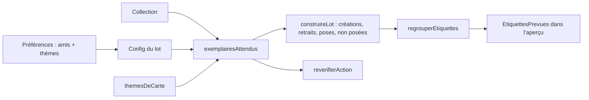

# Plan — Thèmes précis, étiquettes de thème et d’échange

Entrées : `spec.refined.md` (prioritaire), `design.md`, `AGENTS.md`, code de `main` au 2026-11-09 (`50a1d31`). Dépend de `specs/synchro-complete/` (lot, registre, revérification, aperçu livrés jusqu’à T-017/T-018 ; la pose réelle attend T-024, hors de cette feature).

## Architecture

### Approche retenue
Tout se joue en logique pure et dans l’aperçu : **aucune requête, aucun type d’action nouveau**. On étend la liste des étiquettes attendues par exemplaire (déjà consommée par `construireLot` et `reverifierAction`) avec les étiquettes d’échange puis les thèmes, et on laisse la règle générale existante produire créations, poses et retraits.

1. **Taxonomie** (`src/lib/themes.ts`) : +60 thèmes (58 de la spec + `tibet`, `ukraine`), table de données, motifs compilés une fois. Aucun changement d’identifiant existant.
2. **Règle « un ami suit un thème de la carte »** (`src/lib/tri.ts`) : une fonction exportée `amisConcernes(themesCarte, amis)` (tous les amis, ordre de la liste) ; `proposerTri` prend le premier (comportement inchangé), le lot prend tous (H13).
3. **Étiquettes attendues** (`src/lib/lot.ts`) : `exemplairesAttendus(carte, config)` renvoie, par exemplaire relié : `Statut · …`, puis `#À échanger <nom>` (si `echanger`), puis les thèmes sauf `autres`, ordonnés par H5. La même fonction sert `revision.ts` (H12). `Config` gagne `amis`, `limiteParExemplaire` et `limiteNoms` (`number | null`).
4. **Limites du site** (SC-010) : appliquées dans `exemplairesAttendus` (par exemplaire) et dans `construireLot` (par compte, H6). Une étiquette écartée est rapportée dans un nouveau champ `LotConstruit.nonPosees` (nom, carte, raison). Raisons existantes réutilisées (`nom-trop-long`, `homonyme`) et une nouvelle `au-dela-limite`.
5. **Registre v2** (`src/lib/registre.ts`) : `VERSION_REGISTRE = 2`, plafond de 256 couples (forme), migration v1 → v2 sans perte, idempotente ; `poserCouple` ne refuse plus le 3ᵉ couple.
6. **Aperçu** : fonction pure `regrouperEtiquettes(lot, collection, registre, config)` (`src/lib/apercuEtiquettes.ts`) → lignes, totaux, volumes, non posées ; composant `EtiquettesPrevues.tsx` ; `Synchronisation.tsx` l’insère et passe les amis au lot (`CONFIG_LOT` devient dérivé des préférences). `App.tsx` transmet `preferences`.
7. **Amis initiaux** (`src/config/amis.ts`, `stockage.ts`) : Léa (`barrage`, `tibet`), Hugo (`ukraine`), fusionnés automatiquement une seule fois dans les préférences, même déjà stockées (SC-024, décision d’Alexis du 2026-11-09). Fonction pure `fusionnerAmisInitiaux` dans `tri.ts` (T-103), drapeau `amisInitiaux` séparé dans `stockage.ts` (T-107).

### Flux de données

### Fichiers créés / modifiés
| Fichier | Rôle | Tâche |
|---|---|---|
| `src/lib/themes.ts` | +60 thèmes et motifs | T-101 |
| `src/lib/registre.ts` | v2, 256 couples, migration | T-102 |
| `src/lib/tri.ts` | `amisConcernes`, `fusionnerAmisInitiaux`, `proposerTri` utilise la première | T-103 |
| `src/lib/lot.ts`, `src/lib/actions.ts` | étiquettes attendues, limites, non posées, raison `au-dela-limite` | T-104 |
| `src/lib/revision.ts` | revérification avec `Config` | T-105 |
| `src/lib/apercuEtiquettes.ts` (créé) | regroupement, totaux, durée | T-106 |
| `src/config/amis.ts` (créé), `src/lib/stockage.ts` | amis initiaux | T-107 |
| `src/app/EtiquettesPrevues.tsx` (créé), `src/app/Synchronisation.tsx`, `src/app/App.tsx` | section d’aperçu et config du lot | T-108 |
| `tests/e2e/etiquettes.spec.ts` (créé) | e2e, captures | T-109 |
| `AGENTS.md`, `README.md` | documentation | T-110 |
| `src/styles/tokens.css`, `public/manifest.json`, `package.json` | **inchangés** | — |

### Alternatives écartées
- Poser seulement le thème le plus précis : va contre la réponse 1 d’Alexis (spec § Volume).
- Garder aussi « Ami · <nom> » : une pose de plus par exemplaire sans information (spec § 0 B).
- Appeler `proposerTri` depuis le lot : interdit (le statut stocké décide, SC-005 de synchro-complete).
- Réappliquer les amis initiaux à chaque chargement : rajouterait un thème décoché (fusion une seule fois, drapeau).
- Registre compact (SC-018) : à n’envisager que si le test de quota dépasse 5 Mo (risque R4).

### Contraintes
Contextes inchangés (page `collection.html` pour lot et aperçu ; pas de service worker). `chrome.storage` reste confiné à `stockage.ts`. Registre `version: 1` → `2` avec migration ; préférences `version: 2`, collection `version: 2` et exports inchangés. Aucune permission, aucune dépendance.

## 1. Task list
| Lot | Description | Couche | Dépend de | SC | D-xx |
|---|---|---|---|---|---|
| L1 (T-101) | Taxonomie, Tibet, Ukraine, Barrage pluriel | logique | — | SC-001 à 006, 020, 023 | — |
| L2 (T-102) | Registre v2 et migration | données | — | SC-013, SC-018 | — |
| L3 (T-103) | `amisConcernes` partagée | logique | L1 | SC-007, SC-025 (tri) | — |
| L4 (T-104) | Étiquettes attendues, limites, homonymes, retraits | logique | L1, L2, L3 | SC-008 à 011, 021, 022, 025 | — |
| L5 (T-105) | Revérification | logique | L4 | SC-012 | — |
| L6 (T-106) | Regroupement d’aperçu et volumes | logique | L4 | SC-014 (logique), SC-016, SC-017 | — |
| L7 (T-107) | Amis initiaux | données | L3 | SC-024 | — |
| L8 (T-108) | UI : section d’aperçu, config du lot | ui | L5, L6, L7 | SC-014, 015, 016, 019 | DT-01 à 15 |
| L9 (T-109) | E2e et captures | tests | L8 | SC-014, 015, 017, 019, 020 | DT-03 à 14 |
| L10 (T-110) | Documentation | docs | L8 | — | — |

## 2. Estimations
| Lot | Heures |
|---|---|
| L1 | 5 |
| L2 | 2 |
| L3 | 1,5 |
| L4 | 5 |
| L5 | 1,5 |
| L6 | 3 |
| L7 | 1,5 |
| L8 | 5 |
| L9 | 3 |
| L10 | 1 |
| **Total** | **28,5** |

## 3. Risques
| Lot | Risque | Probabilité | Impact | Mitigation |
|---|---|---|---|---|
| L1 | Faux positifs des motifs (château/chat, chevalier/cheval, Tibia/Tibet) | élevée | moyen | Liste SC-005/SC-023 en tests d’abord ; motifs en mots entiers ; SC-006 de non-régression |
| L1 | Perte d’un thème existant en élargissant un motif | moyenne | élevé | SC-002 fige la table id → libellé ; SC-006 compare avant/après |
| L2 | Registre illisible écrasé par la migration | faible | élevé | Migration à la lecture, jamais d’écriture sur forme illisible ; idempotente |
| L4 | `revision.ts` diverge du lot | moyenne | élevé | Une seule fonction `exemplairesAttendus` (H12) ; test croisé lot / revision |
| L4 | Retraits massifs inattendus après changement de taxonomie ou d’amis (H11) | moyenne | moyen | L’aperçu montre le volume avant « Lancer » ; seules les étiquettes du registre sont retirées |
| L4 | Perf. 5 000 cartes × 20 amis | faible | moyen | Regex compilées au chargement ; `Set` pour les thèmes d’amis ; SC-017 |
| L6/L8 | Aperçu lent sur de gros lots | moyenne | moyen | Agrégation en un passage ; 100 lignes affichées au plus |
| L7 | La fusion écrase ou duplique des choix d’Alexis | faible | moyen | Union sans retrait, noms comparés sans casse ni accents, drapeau unique, tests sur préférences existantes |
| L2/L4 | Quota de 5 Mo du registre dépassé (SC-018) | faible | moyen | Test de taille ; forme compacte proposée seulement si dépassé |

## 4. Ordre d’exécution
- Vague 1 (parallèle) : T-101, T-102
- Vague 2 : T-103
- Vague 3 (parallèle) : T-104, T-107
- Vague 4 (parallèle) : T-105, T-106
- Vague 5 : T-108
- Vague 6 (parallèle) : T-109, T-110
- Chemin critique : T-101 → T-103 → T-104 → T-106 → T-108 → T-109 (≈ 22 h).

## 5. Quick wins vs long terme
- **Quick wins** : T-101 (thèmes disponibles tout de suite dans l’assistant et le filtre), T-107 (Léa et Hugo prêts dès le premier usage).
- **Long terme** (hors de cette feature) : pose réelle (T-024 de synchro-complete), vue par carte de l’aperçu (variante 2), arbre des thèmes (variante 3), forme compacte du registre si le quota l’exige.
