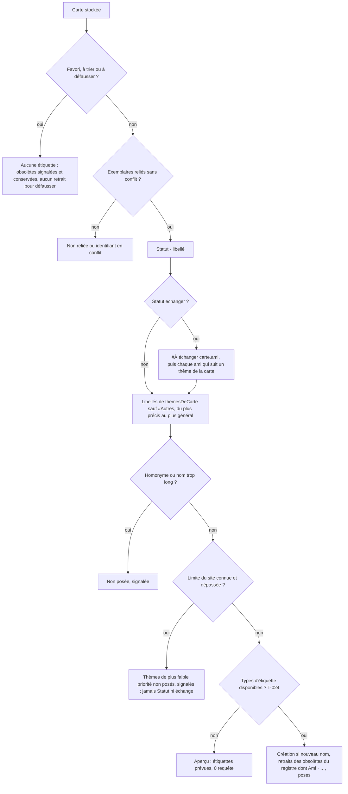

# Spec affinée — Thèmes précis, étiquettes de thème et étiquettes d’échange sur le site

- **Feature** : `theme-etiquettes` · **Auteur** : agent spec · **Date** : 2026-11-08
- **Besoin d'origine** : « Thèmes précis et étiquettes de thème sur le site. (1) Étendre la liste des thèmes de `src/lib/themes.ts` avec des thèmes plus spécifiques (pont, tunnel, chien, chat, cheval, et d'autres du même niveau de précision). (2) L'application du statut « Garder » quand la carte contient un thème qui m'intéresse, et « Échanger » avec le nom de la personne quand le thème intéresse un ami […] doit rester cohérente avec les nouveaux thèmes. (3) Les thèmes précis deviennent AUSSI des étiquettes sur le site, posées sur chaque carte concernée, en plus des étiquettes Statut et Ami. » Complément du même jour : « il faut aussi les étiquettes pour les échanges avec amis : #à échanger [nom ami] qui suit donc les étiquettes qui l'intéressent ».
- **Validation** : voir `STATUS.md` (gate humain). Cette spec n'est pas validée tant qu'Alexis ne l'a pas écrit dans `STATUS.md`.
- **Dépend de** : `specs/synchro-complete/` (spec.refined.md, contrat-api.md, tâche T-024). Rien de cette spec ne lève, n'élargit ni ne remplace la décision d'Alexis du 2026-11-07 (section 0 de `synchro-complete/spec.refined.md`). Un seul point de synchro-complete est modifié, et il est soumis à ce gate : l'étiquette « Ami · <nom> » de SC-007 (b) est remplacée par l'étiquette d'échange (§ 0, point B).

## 0. Décisions d'Alexis et interprétations à valider

| # | Question | Réponse d'Alexis (2026-11-08) |
|---|---|---|
| 1 | Quels thèmes deviennent des étiquettes | « les thèmes et étiquettes (tags) sont censés être la même chose » |
| 2 | Plafond d'étiquettes par exemplaire | Pas de plafond propre ; seule la limite du site (relevée en T-024) compte. Si elle est plus basse, on retire d'abord des thèmes, jamais Statut ni Ami |
| 3 | Plafond de noms distincts sur le compte | Pas de plafond propre ; seule la limite du site compte |
| 4 | Format du nom de thème | Le libellé actuel du thème, avec le « # » (« #Chien »), sans préfixe « Thème · » |
| 5 | Étiquettes d'échange | « il faut aussi les étiquettes pour les échanges avec amis : #à échanger [nom ami] qui suit donc les étiquettes qui l'intéressent » |
| — | Taxonomie | Celle du premier passage est acceptée comme point de départ, à confirmer à ce gate |
| — | Visuels | Variante 1 retenue |

### A. Interprétation de la réponse 1 (à valider ou corriger au gate)
Un thème de l'application **est** une étiquette du site, et il n'y a **aucun filtre** du type « thème suivi par moi ou par un ami ». Chaque carte étiquetée reçoit une étiquette par thème que `themesDeCarte` lui attribue, **parents compris**, exactement comme l'application les calcule et les affiche déjà : colonne Thèmes de `CarteLigne`, filtre par thème, export CSV. Le nom de l'étiquette est le libellé du thème, tel quel. Seul le pseudo-thème `#Autres` (aucun thème détecté) n'est pas posé (H2).

### B. Interprétation de la réponse 5 (à valider ou corriger au gate)
- **Forme** : « #À échanger <nom> », par exemple « #À échanger Léa ». Le « # » reprend la forme des thèmes, avec un « À » majuscule accentué et une espace simple entre les mots. Le nom est celui de l'ami tel que saisi dans l'assistant, sans les espaces aux extrémités. **Les crochets du message sont lus comme un emplacement à remplir**, pas comme des caractères à écrire. Si Alexis veut des crochets littéraux (« #À échanger [Léa] »), il le dit au gate : le reste de la spec ne change pas.
- **Cartes concernées** : seulement les cartes au statut stocké `echanger`. Une carte que je garde (thème à moi, favori) ou que je vends ne porte pas « à échanger », même si un ami suit l'un de ses thèmes : sinon l'étiquette dirait le contraire de ma décision.
- **Pour qui** : sur une carte `echanger`, une étiquette par ami concerné, c'est-à-dire (1) l'ami inscrit sur la carte (`carte.ami`, choisi par l'assistant ou à la main), puis (2) chaque autre ami de `amis` dont un thème figure parmi les thèmes de la carte, parents compris, avec la même règle que `proposerTri`. Si Léa et Hugo suivent tous deux #Animaux, une carte « chien » à échanger porte « #Chien », « #Animaux », « #Nature », « #À échanger Léa » et « #À échanger Hugo ». Deux amis de même nom ne donnent qu'une étiquette.
- **Rapport avec les étiquettes actuelles (option recommandée, à valider)** : « #À échanger <nom> » **remplace** « Ami · <nom> », qui porte la même information pour un seul ami. « Statut · Échanger » est **conservée**, parce qu'elle reste l'étiquette de statut commune à tous les statuts et qu'elle sert au filtre « toutes mes cartes à échanger ». Ce remplacement modifie SC-007 (b) de synchro-complete. Une étiquette « Ami · … » déjà inscrite au registre devient obsolète et reçoit un retrait au lot suivant. En pratique, il n'y en a aucune tant que T-024 n'est pas livré. L'autre option, garder aussi « Ami · <nom> », ajouterait une pose par exemplaire à échanger sans information nouvelle. Elle n'est pas retenue par défaut.

### Volume à valider en connaissance de cause
Chaque pose est une requête, à 6 s au plus vite (SC-010 de synchro-complete), sur **chaque exemplaire relié** (H44 de synchro-complete). Avec les parents, une carte « chien » reçoit #Chien, #Animaux et #Nature. D'après la taxonomie ci-dessous, une carte reçoit en moyenne 2 à 4 thèmes, souvent plus quand plusieurs branches se recoupent.

| Exemplaires reliés étiquetables | Thèmes par exemplaire (moyenne) | Poses de thème du premier lot | Durée à 6 s par pose |
|---|---|---|---|
| 1 000 | 2 | 2 000 | 3 h 20 |
| 1 000 | 4 | 4 000 | 6 h 40 |
| 3 000 | 2 | 6 000 | 10 h |
| 3 000 | 4 | 12 000 | 20 h |
| 5 000 | 4 | 20 000 | 33 h 20 |

**Étiquettes d'échange** : une pose par exemplaire à échanger et par ami concerné. Par exemple, avec 3 000 exemplaires dont 20 % à échanger et 1,5 ami concerné en moyenne : 900 poses, soit 1 h 30. Le remplacement de « Ami · <nom> » en économise 600 (1 h). Un nom d'ami nouveau sur le compte ajoute aussi une création.

S'y ajoutent l'étiquette Statut (une par exemplaire) et une création par nom de thème présent (environ 115 au plus, soit environ 12 min). Seul le premier lot est aussi long : les suivants n'envoient que les différences, grâce au registre. Un lot s'arrête à tout moment avec « Arrêter », et le lot suivant reprend ce qui reste. **Alternative possible au gate** : ne poser que le thème le plus précis de chaque branche (#Chien sans #Animaux ni #Nature). Le volume serait divisé par 2 à 3 environ, mais les étiquettes ne correspondraient plus aux thèmes affichés dans l'application, ce qui va contre la réponse 1. Elle n'est pas retenue par défaut.

### Cadre WikiMasters
Cette feature n'ajoute aucun type d'action, aucun point d'accès ni aucune requête. Elle ajoute seulement des noms d'étiquettes au lot de synchro-complete, dont les types « création », « pose » et « retrait » d'étiquette sont déjà couverts par la décision du 2026-11-07, risque de bannissement compris. Rappel : poser des milliers d'étiquettes et créer une centaine de noms sur le compte augmente le volume d'automatisation visible par le site, donc le risque. **Les prénoms des amis apparaîtront sur le site** dans les étiquettes « #À échanger <nom> », peut-être visibles des autres joueurs (point non relevé, SC-015). Tant que T-024 n'est pas livré, ces types restent « non disponibles » et **rien n'est envoyé**.

## 1. Goals
- G1 — Disposer de thèmes plus précis (pont, tunnel, chien, chat, cheval…), rattachés aux thèmes existants, pour trier, filtrer et choisir ses thèmes et ceux des amis plus finement.
- G2 — Garder l'assistant de tri cohérent : un thème suivi par Alexis donne « Garder », un thème suivi par un ami donne « Échanger » avec son nom, y compris quand ce thème, ou l'un de ses parents, est détecté par un nouveau mot-clé.
- G3 — Retrouver sur le site, sous forme d'étiquettes, les thèmes que l'application attribue à chaque carte, en plus de « Statut · … ».
- G4 — Retrouver sur le site, pour chaque ami, les cartes à lui échanger (« #À échanger <nom> »), selon les thèmes qu'il suit.
- G5 — Voir dès maintenant, dans l'aperçu du lot, les étiquettes de thème et d'échange qui seraient posées, et leur volume, sans rien envoyer tant que T-024 n'est pas livré.

## 2. Scope
**Inclus**
- **Taxonomie** (`src/lib/themes.ts`) : ajout des thèmes du § « Taxonomie » avec leurs parents. Les identifiants et libellés existants ne changent pas. Des motifs de détection précis sont prévus pour éviter les faux positifs listés en SC-005.
- **Assistant de tri** (`src/lib/tri.ts`) : règles et ordre inchangés (favori, mes thèmes, premier ami concerné, valeur). Les nouveaux thèmes peuvent être choisis dans « Mes thèmes » et pour chaque ami. Les préférences stockées (`version: 2`) restent lisibles sans migration. La règle « un ami suit un thème de la carte, parents compris » est exposée par une seule fonction, partagée par `proposerTri` et le lot (H13).
- **Étiquettes attendues** (`src/lib/lot.ts`, `exemplairesAttendus`) : pour les statuts déjà étiquetés (`garder`, `echanger`, `vendre`, `en-vente`) d'une carte non favori et reliée, chaque exemplaire attend « Statut · … », puis, si la carte est `echanger`, les étiquettes « #À échanger <nom> » (§ 0 B), puis le libellé de chacun de ses thèmes, dans l'ordre de priorité de H5. « Ami · <nom> » n'est plus attendue.
- **Préférences dans le lot** : la liste des amis et de leurs thèmes est passée au lot et à la revérification par leurs réglages (`Config`), lue au moment où l'aperçu est figé. Le lot n'appelle toujours pas l'assistant de tri et le statut stocké décide toujours (SC-005 de synchro-complete).
- **Limite du site** : si `contrat-api.md` (T-024) relève une limite du nombre d'étiquettes par exemplaire ou par compte, le lot s'y plie en retirant d'abord des thèmes (H5, H6). Les thèmes non posés sont signalés dans l'aperçu.
- **Retrait des étiquettes obsolètes** par la règle générale existante. Toute étiquette inscrite au registre pour un exemplaire et qui n'est plus attendue reçoit un retrait au lot suivant : thème plus détecté, ami qui ne suit plus le thème ou retiré de la liste, carte qui n'est plus à échanger, « Ami · … » remplacée. L'extension ne retire jamais une étiquette absente de son registre.
- **Homonymes** : un nom de thème ou d'échange qui existe déjà sur le site comme étiquette du joueur (`nomsExistants`) n'est ni créé ni posé (règle existante), et l'aperçu le signale.
- **Registre** (`src/lib/registre.ts`) : levée du plafond de 2 couples par exemplaire, nouvelle version du registre (1 → 2) avec migration.
- **Revérification** (`src/lib/revision.ts`) : une pose ou un retrait de thème ou d'échange est revérifié comme une étiquette de statut, avec les préférences stockées au moment de la revérification.
- **Aperçu du lot** (`src/app/Synchronisation.tsx`, variante 1) : section « Étiquettes prévues » regroupée par nom, avec le nombre de cartes et d'exemplaires et l'état (« nouvelle », « non disponible »). Elle affiche aussi le total des poses prévues, la durée estimée une fois disponible, les étiquettes non posées avec leur raison, et l'avertissement de visibilité, qui mentionne les prénoms des amis.

**Exclu**
- Tout nouveau type d'action, point d'accès ou requête vers le site ; toute pose réelle avant T-024.
- La suppression d'une étiquette sur le site (seul le retrait d'une carte est autorisé), et le renommage d'une étiquette.
- L'adoption d'une étiquette créée par le joueur (homonyme) : la poser ou la retirer exigerait une nouvelle décision d'Alexis.
- Un filtre « thèmes suivis seulement » pour les étiquettes de thème (réponse 1).
- « #À échanger <nom> » sur une carte qui n'est pas au statut `echanger`.
- L'arbre des thèmes et le choix thème par thème dans l'assistant (variante 3), ainsi que la vue par carte de l'aperçu (variante 2).
- La détection des thèmes par un modèle. Le calcul reste local, par mots-clés. **Exception décidée par Alexis le 2026-11-11** : les catégories de la page Wikipédia de la carte (GET en lecture seule, voir `AGENTS.md`) s’ajoutent aux mots-clés, avec un cache local de 30 jours, vérifiées automatiquement pour les cartes consultées (affichées).

## Taxonomie

Point de départ accepté par Alexis, à confirmer au gate. Les identifiants sont en ASCII et ne changeront plus. Les libellés, qui sont aussi les noms d'étiquette, ne changeront plus non plus. `parents` liste **tous** les ancêtres, comme le fait déjà `themes.ts` (`voiture` → `automobile`, `vehicule`). Les motifs sont indicatifs : le plan les arrête, sous le contrôle de SC-004 à SC-006. Dans un motif, une espace finale vise le mot entier.

| Parent direct | id · libellé · motifs indicatifs |
|---|---|
| `animaux` (→ `nature`) | `chien` #Chien (`chien `, `chiens `, `chienne`, `canis lupus familiaris`) · `chat` #Chat (`chat `, `chats `, `chaton`, `felis catus`) · `cheval` #Cheval (`cheval `, `chevaux`, `equide`, `jument`, `poney`) · `felin` #Félin (`lion `, `lionne`, `tigre`, `guepard`, `leopard`, `panthere`, `felide`) · `ours` #Ours (`ours `, `ourse `) · `singe` #Singe (`singe`, `primate`, `gorille`, `chimpanze`, `orang-outan`) · `cetace` #Cétacé (`cetace`, `baleine`, `orque`, `cachalot`, `marsouin`) · `requin` #Requin (`requin`) · `serpent` #Serpent (`serpent`, `vipere`, `cobra`, `boa `) · `rapace` #Rapace (`rapace`, `aigle`, `faucon`, `hibou`, `chouette`, `vautour`, `strigide`) · `dinosaure` #Dinosaure (`dinosaure`, `theropode`, `sauropode`) · `insecte` #Insecte (`insecte`, `coleoptere`, `fourmi`, `abeille`, `guepe`) · `papillon` #Papillon (`papillon`, `lepidoptere`) · `araignee` #Araignée (`araignee`, `arachnide`) |
| `architecture` (→ `arts`) | `pont` #Pont (`pont `, `ponts `, `viaduc`, `passerelle`) · `tunnel` #Tunnel (`tunnel`) · `tour` #Tour (`tour eiffel`, `tour de guet`, `donjon`, `beffroi`, `minaret`, `campanile`) · `chateau` #Château (`chateau`, `forteresse`, `citadelle`) · `cathedrale` #Cathédrale (`cathedrale`, `basilique`, `abbaye`) · `phare` #Phare (`phare de `, `phare du `, `phare d'`, `phares `, `gardien de phare`) · `barrage` #Barrage (`barrage hydroelectrique`, `barrages hydroelectriques`, `barrage-voute`, `barrage-poids`, `grand barrage`, `retenue d'eau`, `barrages `) · `gratteciel` #Gratte-ciel (`gratte-ciel`) |
| `geographie` | `tibet` #Tibet (`tibet`, `tibetain`, `lhassa`, `dalai-lama`, `dalai lama`) · `ukraine` #Ukraine, parents `pays`, `geographie` (`ukrain`, `kiev `, `kyiv`, `kharkiv`, `odessa`, `donbass`) · `montagne` #Montagne (`montagne`, `massif `, `mont `) · `volcan` #Volcan (`volcan`) · `ile` #Île (`ile `, `iles `, `archipel`, `atoll`) · `fleuve` #Fleuve (`fleuve`, `riviere`, `affluent`) · `lac` #Lac (`lac `, `lacs `) · `desert` #Désert (`desert `, `deserts `, `desertique`) · `ocean` #Océan (`ocean`, `mer `) |
| `espace` (→ `sciences`) | `planete` #Planète (`planete`, `exoplanete`) · `etoile` #Étoile (`etoile `, `supernova`, `naine blanche`) · `galaxie` #Galaxie (`galaxie`) · `comete` #Comète (`comete`, `asteroide`) |
| `plantes` (→ `nature`) | `arbre` #Arbre (`arbre`, `conifere`) · `fleur` #Fleur (`fleur`, `orchidee`) · `champignon` #Champignon (`champignon`) |
| `gastronomie` | `fromage` #Fromage (`fromage`) · `vin` #Vin (`vin `, `vignoble`, `cepage`) · `biere` #Bière (`biere`) · `fruit` #Fruit (`fruit`, `agrume`) · `dessert` #Dessert (`dessert`, `patisserie`, `gateau`) |
| `sport` | `tennis` #Tennis (`tennis`) · `rugby` #Rugby (`rugby`) · `basketball` #Basketball (`basket`) · `ski` #Ski (`ski `, `skieur`, `skieuse`) · `golf` #Golf (`golf `, `golfeur`, `golfeuse`) · `natation` #Natation (`natation`, `nageur`, `nageuse`) |
| `histoire` | `egypteantique` #Égypte antique (`pharaon`, `egypte antique`, `ancienne egypte`) · `romeantique` #Rome antique (`rome antique`, `empire romain`, `empereur romain`, `legion romaine`) · `greceantique` #Grèce antique (`grece antique`, `antiquite grecque`, `cite grecque`) · `moyenage` #Moyen Âge (`moyen age`, `medieval`, `chevalier`) · `prehistoire` #Préhistoire (`prehistor`, `neolithique`, `paleolithique`) |
| `guerre` (→ `histoire`) | `premiereguerre` #Première Guerre mondiale (`premiere guerre mondiale`, `grande guerre`) · `secondeguerre` #Seconde Guerre mondiale (`seconde guerre mondiale`, `deuxieme guerre mondiale`) |
| `religion` | `mythologie` #Mythologie (`mytholog`, `divinite`) |
| `bd` (→ `litterature`) | `superheros` #Super-héros (`super-heros`, `super heros`, `super-heroine`) |
| `vehicule` | `velo` #Vélo (`velo `, `velos `, `bicyclette`) · `fusee` #Fusée, parents `vehicule`, `espace`, `sciences` (`fusee`, `lanceur spatial`) |

Cela fait 60 thèmes ajoutés aux 57 existants, plus `autres`. Les thèmes existants (#Voiture, #Rock, #Football, etc.) gardent leurs motifs. Un motif ajouté à un thème enfant n'est jamais retiré d'un parent qui le portait déjà : `pont `, `chateau` et `cathedrale` restent aussi dans `architecture`.

## 3. Success Criteria
| ID | Critère (page/module · action · résultat observable · seuil) | Vérifiable par |
|---|---|---|
| SC-001 | `src/lib/themes.ts` · taxonomie. `DEFINITIONS_THEMES` contient les 60 identifiants du § Taxonomie, avec le libellé et les parents indiqués. Chaque parent cité existe. La liste `parents` de chaque thème est close : tout ancêtre d'un parent y figure aussi. Il n'y a aucun cycle. Aucun identifiant n'est en double. `IDS_THEMES` reste trié par libellé, avec `autres` en dernier. | unitaire |
| SC-002 | `src/lib/themes.ts` · stabilité. Les identifiants et libellés des 57 thèmes existants, et de `autres` (« #Autres »), sont exactement ceux d'avant la feature : un test fige la table id → libellé. Aucun identifiant n'est retiré ni renommé. | unitaire |
| SC-003 | `src/lib/themes.ts` · libellés utilisables comme noms d'étiquette. Chaque libellé commence par « # », compte au plus 32 caractères, ne commence ni par « Statut · », ni par « Ami · », ni par « #À échanger », et aucun n'est en double, même en ignorant la casse et les accents. | unitaire |
| SC-004 | `themesDeCarte` · détection. Pour chacun des 60 nouveaux thèmes, au moins 2 cartes fictives (titre et description) le reçoivent, avec tous ses parents. Exemple : « Berger allemand, race de chien » → `chien`, `animaux`, `nature`. Seuil : 100 % des cas. | unitaire |
| SC-005 | `themesDeCarte` · faux positifs. Aucune de ces cartes fictives ne reçoit le thème entre parenthèses : « château » (`chat`) ; « chevalier » (`cheval`, alors que `moyenage` est attendu) ; « pontife » et « pontifical » (`pont`) ; « Tour de France » (`tour`) ; « golfe » (`golf`) ; « match de barrage » (`barrage`) ; « son œuvre phare » (`phare`) ; « Jaguar, constructeur automobile » (`felin`) ; « Python, langage de programmation » (`serpent`) ; « dauphin de France » (`cetace`) ; « vélodrome » (`velo`). Seuil : 0 faux positif dans cette liste. | unitaire |
| SC-006 | `themesDeCarte` · non-régression. Sur toutes les cartes fictives des tests existants de `tests/unit/themes.test.ts` et `tests/unit/tri.test.ts`, l'ensemble des thèmes détectés avant la feature reste inclus dans l'ensemble détecté après. Seuil : 0 thème perdu. | unitaire |
| SC-007 | `src/lib/tri.ts` · cohérence. (a) `mesThemes: ['chien']` → une carte « chien » non favori est `garder`. (b) Un ami « Léa » qui suit `animaux` → une carte « chien » est `echanger` avec `ami: 'Léa'` (le parent est atteint par le nouveau thème). (c) Si un thème à moi et un thème d'ami sont tous deux présents, `garder` l'emporte. (d) Si deux amis correspondent, `carte.ami` reçoit le premier de la liste (comportement actuel). (e) Favori → `garder`, et `decidePar: 'moi'` n'est jamais remplacé. (f) Des préférences `version: 2` stockées avant la feature sont relues à l'identique par `lirePreferences`. | unitaire |
| SC-008 | `src/lib/lot.ts` · étiquettes attendues. Pour une carte non favori, reliée, au statut `garder`, `echanger`, `vendre` ou `en-vente`, chaque exemplaire relié attend, dans cet ordre : « Statut · <libellé> » ; si la carte est `echanger`, les étiquettes d'échange de SC-021 ; puis le libellé de chaque thème renvoyé par `themesDeCarte`, sauf `autres`, ordonnés selon H5. Aucun exemplaire n'attend plus « Ami · <nom> ». Une carte favori, `a-trier` ou `defausser` n'attend aucune étiquette de thème ni d'échange et ne produit aucune action (garde-fous SC-003 et SC-004 de synchro-complete). Les étiquettes de thème ne dépendent pas des préférences. | unitaire |
| SC-009 | `src/lib/lot.ts` · homonymes. Un nom de thème ou d'échange présent dans `config.nomsExistants` et absent du registre ne produit ni création ni pose. La carte est écartée « homonyme » et l'aperçu nomme l'étiquette. Seuil : 0 action pour un homonyme. | unitaire |
| SC-010 | `src/lib/lot.ts` · limite du site. Avec une limite de N étiquettes par exemplaire (réglage issu de T-024), un exemplaire n'attend que les N premières étiquettes selon H5 : Statut et les étiquettes d'échange ne sont jamais écartés au profit d'un thème. Chaque étiquette écartée est signalée dans l'aperçu « au-delà de la limite du site ». Avec une limite de M noms par compte, au plus M noms distincts, registre compris, sont attendus (H6). Une limite à `null` (non relevée) n'écarte rien. | unitaire |
| SC-011 | `src/lib/lot.ts` · étiquettes obsolètes. Une étiquette de thème ou d'échange, ou une étiquette « Ami · … » héritée, inscrite au registre pour un exemplaire et qui n'est plus attendue reçoit une action de retrait. Une étiquette absente du registre n'en reçoit jamais. Une carte devenue favori ou `a-trier` garde ses étiquettes, signalées « étiquette obsolète conservée » (H18 de synchro-complete). Une carte `defausser` ne reçoit aucun retrait (H19). Un couple attendu et déjà au registre ne produit aucune action. | unitaire |
| SC-012 | `src/lib/revision.ts` · revérification. Juste avant la requête, une pose d'étiquette de thème ou d'échange est « passée » si elle n'est plus attendue sur cet exemplaire selon la collection et les préférences stockées à cet instant. Un retrait est « passé » si l'étiquette est de nouveau attendue ou si le couple n'est plus au registre. | unitaire |
| SC-013 | `src/lib/registre.ts` · migration. Un registre stocké en `version: 1` est lu et migré en `version: 2` sans perte (100 % des étiquettes et des couples), et la migration est idempotente. Le registre `version: 2` accepte jusqu'à 256 couples par exemplaire (borne de forme, H7) et un registre qui la dépasse est illisible (`null`). Un registre illisible n'est jamais écrasé (comportement actuel). `poserCouple` ne refuse plus un 3e couple. Il refuse au-delà de la limite du site si elle est connue. | unitaire |
| SC-014 | `collection.html` · aperçu du lot, types d'étiquette non disponibles (table du contrat sans entrée d'étiquette). Une section « Étiquettes prévues (envoi pas encore possible) » liste chaque nom attendu (« #Chien », « #À échanger Léa », « Statut · Garder »…), avec le nombre de cartes, le nombre d'exemplaires et l'état (« nouvelle » si le nom est absent du registre, « non disponible »). Ces actions ne comptent pas dans « Lancer les N actions ». Seuil : 0 requête vers le site, et jeton non lu, pendant l'ouverture et la consultation de l'aperçu. | e2e (site simulé) |
| SC-015 | `collection.html` · aperçu · avertissement de visibilité. Dès qu'au moins une étiquette est attendue, ce texte figure avant « Lancer » dans l'ordre du document, tant que `contrat-api.md` n'a pas relevé que les étiquettes sont privées : « Visibilité non vérifiée : les étiquettes de thème, de statut et d’échange, dont les prénoms de vos amis, sont peut-être visibles par les autres joueurs. » Il est absent quand aucune étiquette n'est attendue. | e2e |
| SC-016 | `collection.html` · aperçu · volume. Le total des poses prévues (avec à part les thèmes et les échanges) et la durée estimée « une fois disponible » (nombre de requêtes × 6 s, arrondi à la minute supérieure, même formule que SC-008 de synchro-complete) sont affichés, même quand les types d'étiquette sont non disponibles. La section « Étiquettes non posées » liste les étiquettes écartées avec leur raison (homonyme, nom trop long, au-delà de la limite du site). | unitaire + e2e |
| SC-017 | Performance. Pour 5 000 cartes fictives et 20 amis suivant chacun 10 thèmes, `themesDeCarte` appliqué à toutes les cartes prend moins de 200 ms, la construction du lot avec thèmes et échanges moins de 500 ms, et l'aperçu s'affiche moins de 500 ms après le clic qui l'ouvre (SC-025 de synchro-complete conservé). | unitaire + e2e |
| SC-018 | Quota. Le registre de 5 000 exemplaires reliés à 12 couples chacun (identifiants de 36 caractères, noms de 25 caractères), sérialisé, pèse au plus 5 Mo. Un échec d'écriture arrête l'exécution (SC-011 (b) de synchro-complete). | unitaire |
| SC-019 | Accessibilité de la section « Étiquettes prévues » et de « Étiquettes non posées ». Utilisable au clavier seul ; les `details`/`summary` ont une cible d'au moins 44 px ; tableau avec en-têtes de colonne, lu en liste à 375 px sans perte de contenu (nom d'ami de 300 caractères compris, avec retour à la ligne) ; contrastes AA (4,5:1) dans les deux thèmes ; aucune animation avec `prefers-reduced-motion: reduce` ; captures à 375, 768 et 1280 px, dans les deux thèmes. | e2e + capture |
| SC-020 | Exports. L'export CSV garde les mêmes colonnes ; la colonne des thèmes contient les nouveaux libellés détectés. L'export et l'import JSON (`version: 1`) sont inchangés : les thèmes, les étiquettes et le registre n'y figurent pas. | unitaire |
| SC-021 | `src/lib/lot.ts` · étiquettes d'échange. Pour une carte `echanger` non favori et reliée, la liste des étiquettes d'échange est formée dans cet ordre : « #À échanger <carte.ami> » si `carte.ami`, sans les espaces aux extrémités, n'est pas vide ; puis « #À échanger <ami.nom> » pour chaque ami de `amis`, dans l'ordre de la liste, dont au moins un thème figure parmi `themesDeCarte(carte)` (parents compris). Les doublons sont retirés et les noms vides ignorés. Le nom n'est jamais tronqué : au-delà de la longueur du site, il est écarté « nom trop long ». Cas testés : Léa et Hugo suivent `animaux` → deux étiquettes ; `carte.ami` = « Zoé » saisi à la main sans thème suivi → « #À échanger Zoé » seule ; carte `garder` ou `vendre` dont un thème est suivi par Léa → aucune étiquette d'échange. Une carte `echanger` reçoit toujours « Statut · Échanger ». | unitaire |
| SC-022 | `src/lib/lot.ts` · retrait des étiquettes d'échange. Pour une étiquette « #À échanger Léa » inscrite au registre, une action de retrait est produite dans chacun de ces cas : Léa ne suit plus aucun thème de la carte (et n'est pas `carte.ami`) ; Léa est retirée de la liste des amis (et n'est pas `carte.ami`) ; la carte passe à `garder`, `vendre` ou `en-vente`. Aucun retrait ne vise une carte devenue favori, `a-trier` ou `defausser` (SC-011). | unitaire |

## Amendement du 2026-11-09 : intérêts des amis (demande d’Alexis, relayée en thread)

Message d’Alexis : « rajoute aussi pour les tags aimé de Benjamin les barrages et Tibet, et pour Anatole ajoute Ukraine ».

- **Intérêts initiaux** : Benjamin suit `barrage` (#Barrage) et `tibet` (#Tibet) ; Anatole suit `ukraine` (#Ukraine). `barrage` existe déjà (§ Taxonomie) ; `tibet` et `ukraine` sont **deux thèmes ajoutés** (60 au lieu de 58). Les cartes qui parlent du Tibet ou de l’Ukraine sont alors proposées « Échanger » avec le nom de l’ami par l’assistant, et reçoivent « #À échanger Benjamin » ou « #À échanger Anatole » si elles sont au statut `echanger`.
- **Où vivent ces intérêts** : les préférences (`Preferences.amis`) sont stockées dans le navigateur d’Alexis. Un fichier `src/config/amis.ts` porte les amis et intérêts **initiaux**. **Décision d’Alexis (2026-11-09) : ils sont ajoutés automatiquement, y compris aux préférences déjà enregistrées.** Fusion **une seule fois** par version de la liste (drapeau `amisInitiaux` dans le stockage, hors `Preferences`) : un ami absent est ajouté avec ses thèmes ; un ami déjà présent (même nom, casse et accents ignorés) reçoit les thèmes qui lui manquent ; rien n’est jamais retiré. Après cette fusion, un thème décoché par Alexis n’est plus rajouté.
- **Nouveaux critères** : SC-023 (détection Tibet et Ukraine, faux positifs), SC-024 (amis initiaux), SC-025 (cohérence tri et lot pour ces trois intérêts).

| ID | Critère (page/module · action · résultat observable · seuil) | Vérifiable par |
|---|---|---|
| SC-023 | `themesDeCarte` · Tibet et Ukraine. Au moins 3 cartes fictives chacun : « Lhassa, capitale du Tibet » → `tibet`, `geographie` ; « Kiev, capitale de l’Ukraine » → `ukraine`, `pays`, `geographie` ; « Barrages hydroélectriques de la Chine » → `barrage`, `architecture`, `arts`. Faux positifs, 0 attendu : « Tibia, os de la jambe » ne reçoit pas `tibet` ; « Ukulélé, instrument » ne reçoit pas `ukraine` ; « Match de barrage » ne reçoit pas `barrage`. | unitaire |
| SC-024 | `src/config/amis.ts` + `chargerPreferences`. Sans préférence stockée : Benjamin (`barrage`, `tibet`) et Anatole (`ukraine`) sont présents et `mesThemes` est vide. Avec des préférences stockées : Benjamin et Anatole sont ajoutés s’ils manquent, leurs thèmes manquants sont ajoutés, les autres amis, `mesThemes` et tous les thèmes déjà choisis sont conservés. La fusion est écrite une seule fois (drapeau) : un thème décoché ensuite n’est pas rajouté au chargement suivant. Préférences illisibles : valeurs par défaut, sans écraser la donnée illisible. Les tests de tri et de lot utilisent des prénoms fictifs (Léa, Hugo). | unitaire |
| SC-025 | `tri.ts` + `lot.ts`. Avec Benjamin (`barrage`, `tibet`) et Anatole (`ukraine`) : une carte « barrage » non favori est `echanger` avec `ami: 'Benjamin'` ; une carte « Tibet » aussi ; une carte « Ukraine » est `echanger` avec `ami: 'Anatole'` ; au statut `echanger`, le lot attend « #À échanger Benjamin » (resp. Anatole) sur chaque exemplaire, après « Statut · Échanger » et avant les thèmes. | unitaire |

## 4. Constraints
- **Délai** : aucun délai imposé. La partie locale (taxonomie, tri, lot, registre, aperçu) se livre sans attendre T-024. La pose réelle attend T-024 : tant que ses relevés manquent (hôte et en-têtes de `/rest/v1`, filtre du `DELETE`, limites de nombre et de longueur, visibilité), les types d'étiquette restent « non disponibles ». Aucun de ces points n'est deviné.
- **Rétrocompatibilité** : identifiants et libellés des thèmes existants figés (SC-002) ; préférences `version: 2` inchangées ; registre `version: 1` → `version: 2` avec migration (SC-013) ; collection `version: 2` et fichier d'échange JSON `version: 1` inchangés ; colonnes CSV inchangées (SC-020). « Ami · <nom> » cesse d'être attendue (§ 0 B) : celles du registre sont retirées au lot suivant. Un nom d'étiquette ne change plus une fois livré : le renommer obligerait à retirer puis reposer l'étiquette sur chaque exemplaire, et l'ancien nom resterait sur le compte. Renommer un ami dans l'assistant crée un nouveau nom et retire l'ancien.
- **Performance** : SC-017. Les expressions de détection sont compilées une fois au chargement du module.
- **Quota** : SC-018. Si le plan constate un dépassement, il propose une forme compacte du registre, avec migration, sans changer la règle « un couple = une pose de l'extension ».
- **Accessibilité** : SC-019 ; couleurs uniquement via `src/styles/tokens.css`. L'avertissement de visibilité utilise un token existant, ou un token ajouté d'abord dans `design.md`.
- **Cadre WikiMasters** : aucun nouveau type d'action, point d'accès ou en-tête. Les poses, créations et retraits d'étiquette relèvent de la décision d'Alexis du 2026-11-07 (section 0 de `synchro-complete/spec.refined.md`), avec le risque de bannissement qui y est écrit. La cadence reste fixe à 6 s, avec arrêt après 3 erreurs. `click`, `submit`, `requestSubmit`, `dispatchEvent` et `focus` restent interdits. Aucun envoi avant « Lancer », et aucun envoi tant que T-024 n'a pas rendu les types disponibles.
- **Registre** : l'extension ne retire ni ne pose jamais une étiquette qu'elle n'a pas créée. Le retrait ne supprime jamais l'étiquette du site.
- **Vie privée** : les thèmes sont calculés à partir du titre et de la description déjà stockés. Les noms des amis sont déjà stockés dans les préférences. Aucune nouvelle donnée n'est lue ni stockée. Les prénoms des amis partent sur le site seulement dans les étiquettes « #À échanger <nom> », que l'aperçu montre avant « Lancer », avec l'avertissement de SC-015.
- **Sécurité** : un nom d'ami est une saisie libre. Il n'est affiché que comme texte (jamais `innerHTML` ni `dangerouslySetInnerHTML`) et n'est envoyé que dans le corps prévu par le contrat, jamais dans un chemin non encodé.

## 5. Non-Goals
- Pas de filtre « thèmes suivis seulement » pour les étiquettes de thème, ni de choix thème par thème (réponse 1, variante 3 non retenue).
- Pas d'adoption ni de fusion avec les étiquettes créées par Alexis sur le site.
- Pas de suppression ni de renommage d'étiquette sur le site.
- Pas de nouvelle règle de tri : l'assistant garde son ordre, et `carte.ami` reste le premier ami trouvé. Seules les étiquettes d'échange couvrent plusieurs amis.
- Pas d'arbre des thèmes dans l'interface de l'assistant ni dans le filtre (liste plate triée, comme aujourd'hui).
- Pas de plafond propre au nombre d'étiquettes par exemplaire ou par compte (réponses 2 et 3).

## Visuels

Variante retenue : `specs/theme-etiquettes/wireframes/variante-1.html`. Elle diffère de la maquette sur quatre points : les étiquettes de thème s'écrivent « #Chien » (sans « Thème · ») ; « Ami · Léa » est remplacée par « #À échanger Léa » ; la ligne « sur 40 au plus pour le compte » disparaît, faute de plafond propre ; l'avertissement mentionne les prénoms des amis. Les variantes 2 (pastilles par carte) et 3 (arbre et choix par thème) ne sont pas retenues.

```
collection.html › Synchronisation avec WikiMasters › aperçu
┌──────────────────────────────────────────────────────────────┐
│ ! Action sur le site à votre place (bandeau existant)        │
├──────────────────────────────────────────────────────────────┤
│ Lot prêt : 0 action à envoyer                                │
│ Visibilité non vérifiée : les étiquettes de thème, de statut │
│ et d’échange, dont les prénoms de vos amis, sont peut-être   │
│ visibles par les autres joueurs.                             │
│ Étiquettes prévues (envoi pas encore possible)               │
│ Étiquette          │ Cartes │ Exempl. │ État                 │
│ #Chien             │   12   │   15    │ nouvelle · non dispo.│
│ #Animaux           │  120   │  141    │ nouvelle · non dispo.│
│ #Pont              │    4   │    4    │ nouvelle · non dispo.│
│ #À échanger Léa    │    9   │   10    │ nouvelle · non dispo.│
│ #À échanger Hugo   │    3   │    3    │ nouvelle · non dispo.│
│ Statut · Garder    │   31   │   40    │ non disponible       │
│ Total prévu : 1 273 poses dont 1 120 de thème et 13 d’échange│
│ · 11 noms nouveaux · durée estimée une fois disponible :     │
│ 2 h 9 min                                                    │
│ ▸ Étiquettes non posées (2)                                   │
│   [C] Titre fictif A : #Chat, homonyme d’une étiquette à vous│
│   [R] Titre fictif B : #Tunnel, au-delà de la limite du site │
│ [ Lancer les 0 action ] (désactivé : aucune action dispo.)   │
└──────────────────────────────────────────────────────────────┘
```



## Hypothèses
- H1 — **Interprétation de la réponse 1** (à valider au gate) : thème = étiquette, sans filtre par thème suivi, parents compris, exactement comme `themesDeCarte` les renvoie.
- H2 — `#Autres` n'est pas posé : c'est l'absence de thème, pas un thème. Une carte sans thème n'a que Statut et, si elle est à échanger, ses étiquettes d'échange.
- H3 — Les étiquettes de thème suivent les mêmes statuts que l'étiquette de statut (`garder`, `echanger`, `vendre`, `en-vente`), carte `vendre` en attente d'une place libre comprise.
- H4 — Le lot n'appelle pas l'assistant de tri et le statut stocké décide (SC-005 de synchro-complete). Les étiquettes de thème viennent du titre et de la description stockés. Les étiquettes d'échange lisent en plus la liste des amis et de leurs thèmes, passée au lot par ses réglages.
- H5 — Priorité des étiquettes d'un exemplaire : « Statut · … », puis les étiquettes d'échange (ordre de SC-021), puis les thèmes du plus précis au plus général (le plus grand nombre d'ancêtres d'abord), puis par libellé (`localeCompare` en français). Cet ordre décide aussi de l'ordre des poses dans le lot. « Jamais Statut ni Ami » (réponse 2) s'applique aux étiquettes d'échange, qui remplacent « Ami · … ».
- H6 — Limite par compte relevée en T-024 : les noms déjà au registre passent d'abord, puis Statut et les noms d'échange, puis les nouveaux noms de thème dans l'ordre du nombre décroissant d'exemplaires concernés, puis par libellé. Les noms au-delà sont signalés « au-delà de la limite du site ».
- H7 — La borne de 256 couples par exemplaire n'est qu'un contrôle de forme du registre stocké, pour rejeter une donnée corrompue. La limite réelle est celle du site, réglage écrit par T-024 dans `src/config/synchro.ts`.
- H8 — Si le site compte aussi, dans sa limite, les étiquettes du joueur sur un exemplaire, et que le contrat ne permet pas de les connaître, un refus du site est traité comme un échec (SC-011 de synchro-complete) : 3 échecs arrêtent le lot.
- H9 — Risque d'homonyme : le commentaire de `themes.ts` présentait déjà les libellés comme « l'étiquette à poser dans le jeu ». Si Alexis a déjà créé à la main « #Chien », « #À échanger Léa » ou d'autres de ces noms, ils ne seront jamais posés par l'extension (H35 de synchro-complete). Si le contrat ne permet pas de connaître ses étiquettes (`nomsExistants` vide), l'extension créerait une seconde étiquette du même nom : point à vérifier en T-024.
- H10 — Les motifs du § Taxonomie sont indicatifs. Le plan peut les ajuster, à condition de tenir SC-004 à SC-006. Ajouter un thème plus tard reste possible. Retirer ou renommer un thème livré ne l'est pas.
- H11 — Changer la taxonomie, les mots-clés ou les thèmes d'un ami peut faire apparaître ou disparaître des étiquettes sur des cartes déjà étiquetées. Le lot suivant pose et retire en conséquence, et l'aperçu montre ce volume avant « Lancer ».
- H12 — `revision.ts` et `lot.ts` partagent la même fonction des étiquettes attendues, pour que la revérification ne puisse pas diverger du lot.
- H13 — « Un ami suit un thème de la carte » est une seule fonction de `src/lib/tri.ts`, utilisée par `proposerTri` (premier ami) et par le lot (tous les amis), pour que le tri et les étiquettes d'échange ne divergent pas.
- H14 — **Forme « #À échanger <nom> »** (à valider au gate) : les crochets du message d'Alexis sont lus comme un emplacement ; « non ami » est lu « nom ami ».
- H15 — **Remplacement de « Ami · <nom> »** par « #À échanger <nom> », avec « Statut · Échanger » conservée (à valider au gate). Cela modifie SC-007 (b) de synchro-complete ; le plan reporte ce changement dans `lot.ts` et ses tests.
- H16 — Une carte `echanger` dont aucun ami ne suit un thème et dont `carte.ami` est vide ne porte que « Statut · Échanger » et ses thèmes.
- H17 — **Amis initiaux** (décision d’Alexis du 2026-11-09) : fusion automatique unique dans les préférences déjà stockées (SC-024), sans retrait. Les prénoms Benjamin et Anatole sont dans le dépôt privé et, comme tout prénom d’ami, dans les étiquettes « #À échanger <nom> » (SC-015).
- H18 — « barrages » (pluriel) est lu comme le thème existant #Barrage, dont les motifs sont élargis au pluriel sans reprendre « match de barrage » (SC-005).
- H19 — #Tibet et #Ukraine sont des thèmes de lieu rangés sous `geographie` ; #Ukraine a aussi `pays`. Leurs motifs sont indicatifs (H10).
- H20 — Journal de relecture : (1) taxonomie portée de 58 à 60 thèmes ; (2) crochets et « non ami » déjà tranchés (H14) ; (3) `Config` du lot reçoit `amis`, `limiteParExemplaire` et `limiteNoms` (lus au figeage de l’aperçu) ; (4) la signature de `exemplairesAttendus` change, `revision.ts` suit (H12).
